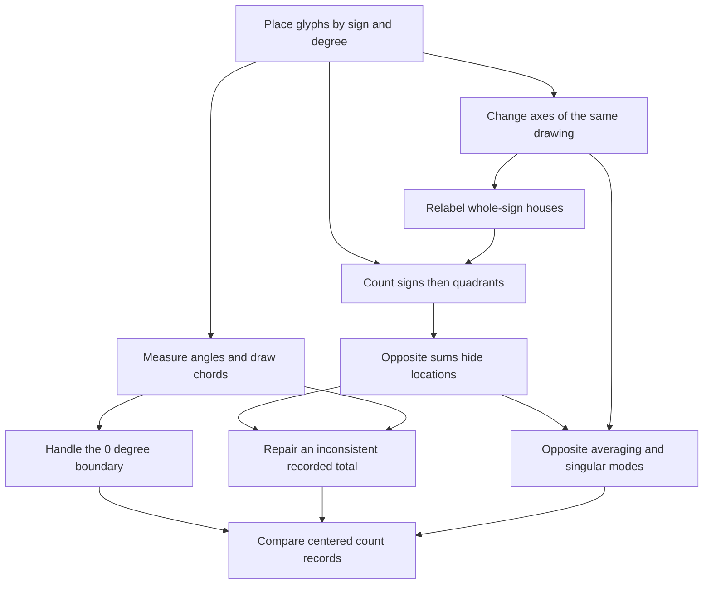

# Around the Zodiac — The Astrological Wheel as a Mathematical Instrument

Connected analogy canon · 2026-10-26
[Companion rubric](ANALOGY_ASTROLOGICAL_WHEEL_RUBRIC.md) · [Main bible](SHOW_BIBLE.md)

## 1. The actual wheel, not twelve personality labels

Draw the zodiac ring, mark planetary glyphs at specified longitudes, draw aspect
lines, select a house system, move the coordinate origin, and compare two overlaid
wheels. These concrete chart-reading actions anchor the mathematics. The analogy
concerns geometry, conventions, and recorded placements; it does not turn
astrological interpretation into a demonstrated causal or predictive scientific model.

Use the **tropical zodiac** for this reference. Aries begins at longitude 0°;
Taurus 30°, Gemini 60°, Cancer 90°, Leo 120°, Virgo 150°, Libra 180°, Scorpio 210°,
Sagittarius 240°, Capricorn 270°, Aquarius 300°, Pisces 330°. We draw increasing
longitude counterclockwise from the positive horizontal axis for a mathematical
teaching diagram; actual chart layouts may orient the wheel differently.
The 12 equal sign sectors are distinct from a chosen house system. Aspect labels
include conjunction 0°, sextile 60°, square 90°, trine 120°, opposition 180°.
[Astrodienst aspects](https://www.astro.com/astrology/in_aspect_r.htm?lang=e&nhor=28),
[chart-wheel reading](https://cafeastrology.com/articles/how-to-understand-read-chart-wheel.html).

For houses, explicitly select **whole-sign houses** when using a sign permutation.
The first house is the entire sign containing the Ascendant. An Ascendant at 45°
(Taurus 15°) selects Taurus as the first-house sign; it does not put that house's
boundary at 45°. Equal houses measured from the Ascendant are a different system.
[CHANI whole-sign explanation](https://www.chani.com/astro-education/what-whole-sign-houses-are-and-why-we-use-them),
[Astrodienst equal-house distinction](https://www.astro.com/astrowiki/en/Equal_House_System).

Planetary placements and datasets below are invented chart exercises, not an
actual person's chart, ephemeris, or evidence about personality. All algebraic
relationships are our mathematical constructions using these conventions.

## 2. Canonical objects and recurring anchors

Keep three records distinct: **longitudes**, **Cartesian marker positions**, and
**counts within bins**. Never rotate counts as if they were angles or treat an
average of angle numbers as a circular mean.

### W — Locate markers and draw aspects

A marker at longitude θ has `u(θ)=(cos θ,sin θ)^T` on a unit wheel. Use degrees
consistently or convert to radians before evaluating software trigonometry.
For 0°,90°,180°,270°, positions are `(1,0),(0,1),(-1,0),(0,-1)`.

`u(θ)^T u(φ)=cos(θ−φ)`. A square gives zero dot product; opposition gives −1,
not zero. Trine gives −1/2; sextile gives +1/2. Aspect lines are chords joining
markers; their length is `sqrt(2−2 cos(θ−φ))`, not their angular separation.
Angles differing by 360° represent the same marker.

A chart aspect can illustrate an angle without establishing a real-world
psychological relationship between the planets or the reader.

### R — Change the plotted axes without moving the sky

```text
R(α) = [[cos α,-sin α],[sin α,cos α]]
R(90°) = [[0,-1],[1,0]]
```

Actively rotate markers by `R(α)`, or passively rotate axes using `R(−α)`; declare
which. `R^T R=I`, `det(R)=1`, and `R^{-1}=R^T`: distance, dot product, and signed
area are preserved. `R(90°)` has no real eigenvector, despite being a perfectly
valid real matrix; its eigenvalues are `±i` over the complex numbers.
`R(180°)=-I` instead has every nonzero real vector as an eigenvector with λ=−1.
This is a concrete counterexample to “every real square matrix has a real eigenbasis.”

Changing a display frame does not advance the actual planets in time. Changing a
house convention is not generally a Cartesian rotation of the physical sky.

### H — Read a coarse wheel report and discover what it hides

Divide the drawing into four 90° quadrants: starting at Aries, Cancer, Libra,
and Capricorn respectively. Each contains three full signs. This is a deliberate
coarse chart histogram, not the 12 signs or 12 houses themselves.
Let `x=(q0,q1,q2,q3)^T` count chosen markers in those bins. Choose `x=(3,2,2,1)`.

Report opposite-quadrant sums and a computed total:

```text
y=A x,  A=[[1,0,1,0],[0,1,0,1],[1,1,1,1]]
y=(q0+q2,q1+q3,total)=(5,3,8)
```

This reporting rule is invented, not a standard astrological interpretation.
It provides a concrete information-loss example tied to the actual drawn markers.

- Rank 2; null basis `(1,0,-1,0)` and `(0,1,0,-1)`: move counts between opposite bins.
- Column space `{y:y3=y1+y2}`; left-null basis `(1,1,-1)` detects inconsistent totals.
- Row-space basis `(1,0,1,0)` and `(0,1,0,1)`; these are observable input directions.
- All real solutions for `(5,3,8)` are `(t,s,5-t,3-s)`; physical histograms require
  integers `0≤t≤5`, `0≤s≤3`. Equal reports do not mean the same placements or chart.
- A contradictory report `(5,3,9)` projects to `(16/3,10/3,26/3)`; residual
  `(-1/3,-1/3,1/3)` satisfies `A^T e=0`. Fractions describe a fit, not half a planet.

### P — Reindex the same markers and merge opposite bins

Define a quarter-turn histogram permutation `P x=(q3,q0,q1,q2)`. It is orthogonal,
`P^4=I`, with inverse `P^T`, and has complex as well as real eigenvalues.
This is not the same operator as planar R: its space has four count coordinates.

`S=(I+P^2)/2` averages opposite bins. It is symmetric, idempotent, and an orthogonal
projection. Its +1 eigenspace contains equal opposite bins; its zero eigenspace
contains opposite-bin differences. The latter is exactly H's null space.

The unnormalized two-row report `J=[[1,0,1,0],[0,1,0,1]]` has two singular values
`sqrt(2),sqrt(2)`. Right singular directions may be the normalized row vectors;
two additional right directions span the null space. Equal singular values mean
there is no uniquely preferred leading direction within the retained plane.

## 3. Specific chart-action cards

### PLACE — Put a planetary glyph at a degree within its sign

Convert Taurus 15° to longitude 45°, then plot `u(45°)`. This introduces vector
entries, dimensions, length, and coordinate conventions. Add markers as records,
not as a claim that adding unit vectors places a new real planet. Connect ASPECT,
ROTATE, and COUNT. Raw longitudes live on a circle, not a real vector space.

### ASPECT — Measure the shorter angular separation and draw the chord

Use W's actual square, opposition, sextile, and trine. Relate dot product, cosine,
normalization, and chord distance. The zero sum of opposite marker vectors is not
absence of those markers. Connect FIT and CENTER. “Harmonious” in a tradition is
not “positive covariance,” and a square is not a matrix's being square.

### ROTATE — Move the wheel's reference line

Use R and distinguish active/passive transformations. Changing to orthonormal
axes is a basis change; the same marker acquires new coordinates. Determinant is
area scaling in the drawing, not astrological power. Connect HOUSES and MODES.

### HOUSES — Label the same signs from a different first house

With whole-sign houses and Taurus rising, house counts are the same 12 sign-bin
counts cyclically relabeled, beginning with Taurus. This is a 12-by-12 permutation
matrix with inverse transpose. It does not lose within-sign position any further
than the original count record already did. Do not substitute this map for
Placidus or equal-house boundaries. Connect ROTATE and COUNT.

### COUNT — Recount glyphs, then deliberately discard detail

First record a marker's sign with a 12-coordinate one-hot vector; adding these
gives sign counts. Then aggregate into the four quadrants of H, then into opposite
sums. Matrix products compose these reporting stages. Order and dimensions must
be checked: not every permutation commutes with every aggregation. Connect SPACE.

### SPACE — Several wheels can produce one coarse report

Use H's explicit null vectors to move a marker count between opposite quadrants
without changing the report. Work a real linear system, then restrict to feasible
integer counts. Independence/rank concern reporting directions, not independent
planetary influence. Four spaces live in `R^4` and `R^3`, not one mystical circle.
Connect FIT and MODES.

### FIT — A handwritten chart total disagrees with its bins

Use H's `(5,3,9)` report to derive orthogonal projection and normal equations.
The closest real fit is not an actual corrected chart until integer choices and
the original marker placements are checked. Gram–Schmidt on `(1,0,1)` and
`(0,1,1)` yields `(1,0,1)/sqrt(2)` and `(-1,2,1)/sqrt(6)` in report space.
Connect SPACE and SURVEY. Rank-deficient A does not admit inverse-based normal
formulas; use an independent column basis or another justified method.

### MODES — Overlay opposite sectors and inspect what cancels

Use P, S, and J rather than vague “planetary energies.” Contrast rotation's complex
eigenvalues with a symmetric averaging map's real orthonormal eigenbasis. Derive
SVD from J's retained sums and lost differences. Repeated values make the choice
of singular vectors nonunique. Connect SPACE, ROTATE, and SURVEY.

### CENTER — Compare placements across the 0° boundary

A mean of 359° and 1° is not 180° on the wheel. Their mean unit-vector direction
is 0°. Opposite placements have zero resultant and no defined mean direction.
This is a concrete boundary example for mean, vector addition, and normalization.
For the course's ordinary variance/PCA, switch explicitly to a declared Cartesian
or count feature table; do not apply raw-angle arithmetic silently. Connect SURVEY.

### SURVEY — Compare hypothetical drawn wheels, not personality scores

Collect rows `(opposite-sum 1, opposite-sum 2)`:
`(5,4),(4,5),(3,2),(2,3)`. Means `(3.5,3.5)`; sample covariance
`[[5/3,1],[1,5/3]]`, standard deviations `sqrt(5/3)`.
Covariance eigenpairs are `8/3` with `(1,1)/sqrt(2)` and `2/3` with `(1,-1)/sqrt(2)`;
centered-data singular values `sqrt(8),sqrt(2)`; first variance share 80%.
Each row's total is the sum of its counts, so these are different chosen marker
sets, not a claim that every natal chart has a different number of planets.
PCA describes chosen chart records, not validated personality structure.
A chart-by-glyph-position table with withheld entries supplies the recommendation/
matrix-completion bridge; filling an entry is not making a horoscope prediction.

## 4. Full course-coverage register

| Mathematical coverage | Specific chart anchor and required landing |
| --- | --- |
| Vectors, representations/dimensions, addition/scaling/combinations | PLACE/COUNT: marker coordinates versus one-hot sign counts; never conflate them. |
| Dot product, norm, unit vectors, angle | ASPECT: square/opposition/trine/sextile; zero resultant boundary. |
| Matrices, entries, shapes, addition/scaling | ROTATE/COUNT/MODES: R, quadrant report A, averaging S in different declared spaces. |
| Matrix-vector/products; multiplication properties/order | COUNT/HOUSES: compose sign aggregation and relabeling with compatible dimensions; provide noncommuting example. |
| Transpose | ROTATE/FIT: orthogonal inverse versus residual pairing; not universal inverse. |
| Identity, diagonal, orthogonal, symmetric matrices, trace | ROTATE/MODES: identity turn, `-I`, R, S, and trace as diagonal sum. |
| Systems, augmented matrices, elimination, echelon/RREF/pivots/back substitution | SPACE/FIT: recover quadrant counts from opposite sums; formal row-swap cases. |
| No/unique/infinite solutions, free variables, complete solution | SPACE: `(t,s,5-t,3-s)`; compare actual integer histograms and incompatible totals. |
| Determinants, properties/cofactor expansion, area/volume | ROTATE: determinant 1; a chosen planar projection has determinant 0; A is rectangular and has no determinant. |
| Inverse, invertibility tests, Gauss–Jordan/cofactor formulas | ROTATE/HOUSES: undo a coordinate relabeling; aggregation loses information. |
| Vector space, subspace, span | SPACE/MODES: real record spaces and retained/lost planes, not the circle itself. |
| Independence, basis, dimension, natural basis, change of basis | PLACE/ROTATE/HOUSES: coordinate directions and marker-count directions; distinguish rebinning from basis change. |
| Rank, rank-nullity, four fundamental subspaces | SPACE: rank 2, nullity 2; input `R^4`, output `R^3`. |
| Orthogonality, orthonormality, Gram–Schmidt | ASPECT/FIT: square marker directions versus orthogonalized report-plane directions. |
| Projection line/subspace, projection matrices | ASPECT/FIT/MODES: coordinate shadow, contradictory report, opposite-bin averaging S. |
| Least squares, normal equations, line fitting, `A^T A` conditions | FIT/SURVEY: real noisy report fit; explicit independent design for inverse formulas and trend fitting. |
| Eigenvalues/eigenvectors/characteristic equation/eigenspaces | ROTATE/MODES: R90 has no real eigenvectors; S has +1 and 0 eigenspaces. |
| Diagonalization/eigendecomposition/spectral theorem | MODES: S real symmetric; rotation illustrates real-field limitations; formal defective-matrix example still required. |
| SVD, `A^T A`, full/reduced/truncated, approximation | MODES: J's sums, differences, two equal singular values, and information loss. |
| Recommendation and missing data | SURVEY: withheld chart-table entries as a declared mathematical extension. |
| Mean/variance/standard deviation/covariance | CENTER/SURVEY: circular-mean boundary then ordinary centered count data; sample denominator. |
| PCA | SURVEY/MODES: covariance and centered SVD; scaling, signs, tied directions, reconstruction and mean restoration. |

## 5. Connected chart-action graph



Accessible narrative: placements define geometric markers; chart conventions change
coordinates or bins; aggregation hides distinctions; projections and decompositions
identify them; repeated count records support statistics and PCA.
Each chapter use must return from a real chart-reading action to exact mathematics,
state what is lost, connect an earlier card, and test a fresh formal question.

## 6. Status

Conventions and action cards drafted with linked domain sources; original numeric
anchors are calculation-checked. Exact course-source mapping, rendered annotated
wheel, chapter examples/counterexamples, independent review, and learner transfer
remain pending. No birth data, actual ephemeris calculation, or personality claim
is supplied or inferred.
