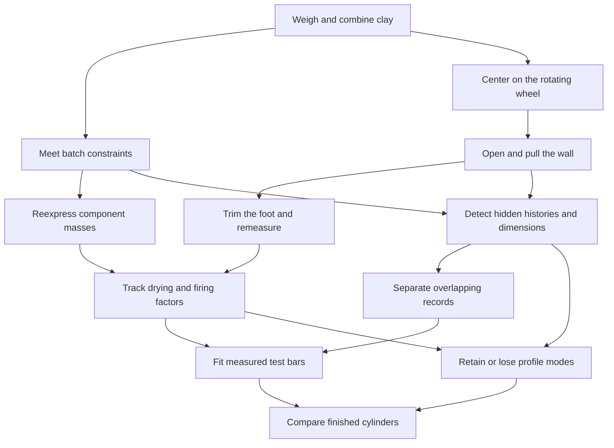

# From Spinning Clay to Fired Form — An Original Pottery Analogy Canon

Connected analogy canon · 2026-10-26
[Companion rubric](ANALOGY_POTTERY_RUBRIC.md) · [Main bible](SHOW_BIBLE.md)

## 1. Why this world connects

A potter centers clay on a rotating wheel, opens it, pulls a wall, checks a profile,
trims a foot, and measures the finished piece after drying/firing. The same piece
can be understood as material, shape, measurements, or a compact profile. Those
are different representations, and moving between them reveals what information
is retained, lost, fitted, or transformed. This is an original teaching framework,
not an assertion that pottery is globally governed by linear algebra.

The **fixed project** is a small wheel-thrown cylinder plus test bars made from
its clay batch. Follow the clay, the maker's actions, and measured dimensions;
do not turn it into a fictional product-design business.

[Wheel-throwing cross sections](https://ceramicartsnetwork.org/daily/article/wheel-throwing-in-cross-section/)
show centering, opening, and lifting walls.
[Digitalfire's shrinkage testing](https://digitalfire.com/test/shab) explains using
consistent specimens and measurements; a maker's account of
[drying/firing shrinkage](https://www.lakesidepottery.com/HTML%20Text/Tips/Clay%20drying%20and%20firing%20process.htm)
shows why actual bodies and firing histories must be tested.
These sources support the craft context. All batches, measurements, scale factors,
and algebra below are invented teaching examples, not empirical material recipes,
firing schedules, tested functional ware, or guarantees about glaze/food safety.

## 2. Permanent objects and physical boundaries

- A **wheelhead point** has planar coordinates `(x,y)`; rotating it is geometry.
- A **vessel profile record** lists radii at stated heights. It is not all the clay.
- A **batch record** lists masses of declared clay components. It is not a shape.
- A **test-bar record** lists wet/dry/fired lengths with units and stage labels.
- A **dataset row** is a specimen; columns are explicitly selected measurements.

Always name the object and units before using a vector. Real/signed combinations
of records are mathematical extensions; negative clay mass is not a batch.
Centering a lump of clay is not automatically mean-centering a dataset. Firing is
not an invertible physical linear map just because a dimension formula can be inverted.

## 3. Numerical anchors that stay attached to the clay

### BATCH — Weigh actual components; identify a redundant source

Consider a bookkeeping example using 1 kg portions of red clay, 1 kg portions of
white clay, and 2 kg portions of an equal-mass premix. No claim is made about
compatibility, firing performance, or a useful body formulation.

```text
x=(red portions,white portions,premix portions)^T
A=[[1,0,1],[0,1,1],[1,1,2]]
b=A x=(red kg,white kg,total kg)^T
```

For `x=(3,2,0)`, `b=(3,2,5)`. One premix portion has the same recorded component
masses as one red plus one white portion: `a3=a1+a2`.

- Rank 2, null direction `(-1,-1,1)`; real solutions `(3-t,2-t,t)` have the same masses.
  For counted portions, feasible t values are integers 0,1,2; continuous weighing
  would allow real nonnegative quantities with a separately stated portion convention.
- Column space `b3=b1+b2`; left-null direction `(1,1,-1)`.
- Row space spans `(1,0,1)` and `(0,1,1)`; its perpendicular input null space is
  different from the output left-null space, even with equal coordinate dimensions.
- `det(A)=0`; total mass duplicates the first two measurements. No unique premix
  history can be reconstructed from final component masses.
- A reported `(3,2,6)` projects to `(10/3,7/3,17/3)` with residual
  `(-1/3,-1/3,1/3)` under equal Euclidean weighting. `A^T e=0`.
- Gram–Schmidt on `a1=(1,0,1)`, `a2=(0,1,1)` yields
  `(1,0,1)/sqrt(2)` and `(-1,2,1)/sqrt(6)`.

Mass addition is exact under the declared accounting; clay color, plasticity,
shrinkage, and strength do not generally mix linearly in these coordinates.

### TURN — Rotate the wheelhead and mark a rim point

Use `R90=[[0,-1],[1,0]]` on a planar point. In an ideal rigid rotation the point's
radius is preserved; `R90^T R90=I`, inverse is transpose, determinant 1.
A potter's hand deforms wet clay, so the actual throwing action is not merely
this rigid rotation. Changing the coordinate axes uses the opposite rotation.
A fixed spatial origin, a measured vessel center, and a mean profile are distinct.

### SHRINK — Predict a dimension from a tested factor, without “unfiring”

Suppose a test establishes an illustrative isotropic length factor `s=0.9` for
one declared wet-to-fired process. Then `f=0.9 w`, a diagonal map on dimensions;
10 cm predicts 9 cm, and a desired 9 cm suggests a 10 cm wet target under that model.
An illustrative anisotropic map `F=diag(0.9,0.9,0.8)` has coordinate eigenvectors
and determinant 0.648. That is volume scaling only for the idealized affine
geometric deformation, not an assertion that every vessel's capacity or mass
scales by that amount.

If two successive length factors are 0.95 and 0.90 relative to their own starting
stages, their product is 0.855: total loss is 14.5%, not 15%. Parameters must be
measured for the actual material/process. Inverting this formula sizes a wet
piece; it does not reverse firing chemistry or reconstruct cracks and warping.

### FIT — Measure the bars instead of assuming a universal shrink rate

Take invented wet lengths `w=(10,20,30)^T` cm and fired lengths `f=(9,18,26)^T` cm.
Least squares for `f≈s w` gives
`s=(w^T f)/(w^T w)=123/140`. Predicted lengths are
`(123/14,123/7,369/14)` and residuals `(3/14,3/7,-5/14)`; `w^T e=0`.
This is projection onto a line, with a meaningful measurement action behind it.
It is a fit to hypothetical observations, not a law or a firing recommendation.
Explain when an intercept, weighted errors, or a nonlinear model is warranted.

### PROFILE — Caliper readings, modes, and a real loss of detail

Record base, belly, and rim radii at three declared heights. A two-reading device
that reports only the average of base/belly and the rim uses

```text
H=[[1/2,1/2,0],[0,0,1]].
```

The difference `(1,-1,0)` is invisible: flare at one level can be hidden by an
opposite change at the other in this record. Equal reports do not establish equal
vessels, wall thickness, volume, or stability.
Singular values are 1 and `1/sqrt(2)`; right directions can be `(0,0,1)` and
`(1,1,0)/sqrt(2)`, with null direction `(1,-1,0)/sqrt(2)`.
`H^T H` is real symmetric and positive semidefinite. This is a concrete SVD of
measurements, not a claim that pulling a wall literally performs an SVD.

### SERIES — Compare finished cylinders from the same declared practice exercise

Use invented rows `(height,rim diameter)` in cm:
`(11,12),(10,13),(9,10),(8,11)`. Mean `(9.5,11.5)`; sample covariance
`[[5/3,1],[1,5/3]]`; standard deviations `sqrt(5/3)` cm. Principal directions
`(1,1)/sqrt(2)` and `(1,-1)/sqrt(2)` have covariance eigenvalues `8/3,2/3`.
Centered singular values `sqrt(8),sqrt(2)` cm; first component captures 80% of the
sample variance. State the feature scaling before interpreting length/shape tradeoffs.
Variation is not necessarily a defect or an aesthetic ranking.

## 4. Action cards, from hands to equations

### PREPARE — Portion and combine clay

Weigh BATCH's components and count premix portions. Add mass vectors and compare
different preparation histories. Scalar multiples make larger mass batches but
do not guarantee geometrically scaled pots. Connect SOLVE and FINISH.

### CENTER — Center clay on the rotating wheel

Observe a marked point relative to the rotation axis; separate rigid TURN from
the hand pressure that changes the clay. Use axes, vectors, norm, angle, coordinate
basis, and rotations. Connect OPEN and SERIES. Physical centering is not statistical
centering; explain that later callback rather than claiming identity.

### OPEN — Open the center and pull the wall

Follow the cross section: opening establishes a cavity and lifting redistributes
clay into the wall. Measure selected radii/heights before and after. Introduce a
profile vector and signed measurement changes. Connect PROFILE and TRIM.
There is no universal constant matrix from hand pressure to final shape; use a
local measured approximation only if its data, range, and assumptions are stated.

### SOLVE — Meet the batch totals before throwing

Use BATCH's equations and elimination to choose amounts. Show redundant total-mass
constraints, free variables, and feasible ranges. A different preparation history
can produce the same recorded masses, but not necessarily identical mixing or
material performance. Connect OBSERVE and COORDINATES.

### COORDINATES — Weigh components or weigh total and one component

For the two component masses, use `C=[[1,1],[1,0]]` to report `(total,red)`.
`det(C)=-1`; recover white as total minus red. This is a reversible basis/coordinate
change, unlike merging profile readings. Reordering mass columns is a permutation;
changing kg to g is diagonal scaling. Connect SOLVE, TURN, and SHRINK.

### OBSERVE — A caliper or summary cannot see everything

Use PROFILE's hidden base/belly difference and BATCH's invisible premix history.
Derive four spaces with A, keeping input portion space and output mass space
separate. Connect ORTH and MODES. Hidden detail is not physically absent.

### ORTH — Separate overlapping mass measurements

Use BATCH's explicit column records and Gram–Schmidt directions. Orthogonalize
recorded effects, not the potter's hands. A dot product may compute a weighted
measurement; Euclidean angles need declared units and scaling. Connect FIT.
Crossed calipers or perpendicular walls do not prove algebraic independence.

### TRIM — Remove material from a foot and remeasure

Record which part was removed and the changed dimensions or mass. Subtracting
measured mass is valid accounting; subtracting vessel shapes is a modeling choice.
Trimming generally cannot be undone by an inverse dimension map. Connect OBSERVE
and FINISH; do not label trimming “projection” without specifying a record and norm.

### FINISH — Dry, fire, and compare stage measurements

Follow actual stage-labeled length records rather than calling all change “shrink.”
Use SHRINK to teach composition, eigen-directions, determinant, and inversion limits.
Rotation and anisotropic scaling need not commute; with
`D=diag(2,1)`, `R90 D(1,0)=(0,2)` but `D R90(1,0)=(0,1)`.
These are ideal geometric maps, not permission to reverse physical process order.
Connect FIT and SERIES.

### MODES — Keep the useful profile distinctions

Use PROFILE's exact H to derive SVD, rank/nullity, and full/reduced/truncated shapes.
Discarding a singular mode loses a specific radius distinction. The spectral
theorem applies to `H^T H`, while a nonsymmetric shape-record map need not admit
an orthonormal eigenbasis. Include explicit formal defective and negative-eigenvalue
cases rather than claiming every physical deformation diagonalizes. Connect SERIES.

### COMPARE — Study a shelf of finished practice cylinders

Use SERIES to teach means, deviations, sample/population variance, covariance,
PCA, reconstruction, and choosing how many modes to retain. Add the mean back
when reconstructing physical dimensions. A piece-by-measurement table with withheld
readings offers a matrix-completion bridge to the course's recommendation example;
aesthetic ratings are a different, explicitly declared dataset. No missing reading
is silently zero, and a low-rank fit is not a verdict that a pot is safe or beautiful.

## 5. Full course-coverage register

| Mathematical coverage | Physical anchor and exact landing |
| --- | --- |
| Vectors, representations, dimensions, addition/scaling/combinations | PREPARE/OPEN: mass records and radius records, with units and meanings kept distinct. |
| Dot product, norm, unit vector, angle | ORTH/CENTER: weighted mass records and rim-point geometry; zero-direction exception. |
| Matrix entries, addition/scaling, dimensions | BATCH/PROFILE: records with stated domains; compatible-map conditions. |
| Matrix-vector/products; properties and order | PREPARE/FINISH: batch accounting, staged factors, explicit noncommuting geometry example. |
| Transpose | TURN/FIT/MODES: orthogonal inverse versus residual pairing versus `H^T H`. |
| Identity, diagonal, symmetric, orthogonal matrices, trace | TURN/SHRINK/MODES: R, F, `H^T H`; trace is the map's diagonal sum. |
| Systems, elimination, echelon/RREF, pivots, back substitution | SOLVE: original batch constraints; add formal row-swap and zero-pivot cases. |
| No/unique/infinite solutions, complete solution/free variables | SOLVE/OBSERVE: redundant batch history, incompatible totals, real versus physical counts. |
| Determinants, properties/cofactors, area/volume | COORDINATES/SHRINK: `det(C)=-1`, `det(A)=0`, `det(F)=0.648` with geometric assumptions. |
| Inverse, invertibility tests, Gauss–Jordan/cofactor methods | COORDINATES/FINISH: invert recorded coordinates or a prediction, not firing or trimming. |
| Vector spaces, subspaces, span | BATCH: real mass-report plane; actual nonnegative mixtures are not a real vector space. |
| Independence, basis, dimension, natural basis, change of basis | COORDINATES/ORTH: component axes versus total/red coordinates; report-plane orthonormal basis. |
| Rank/rank-nullity, four fundamental subspaces | OBSERVE: A's rank 2 and both orthogonal pairs, with input/output meanings. |
| Orthogonality, orthonormality, Gram–Schmidt | ORTH: explicit BATCH column calculation, not a claim about hand motions. |
| Line/subspace projection, projection matrices | FIT/BATCH: shrink-line fit and contradictory mass report. |
| Least squares/normal equations/line fitting, `A^T A` assumptions | FIT: bar-length design vector and independent-column requirement. |
| Eigenvalues/eigenvectors/characteristic equation/eigenspaces | SHRINK: coordinate axes of the chosen F; distinguish model from empirical behavior. |
| Diagonalization/eigendecomposition/spectral theorem | MODES: `H^T H`; supply formal non-diagonalizable cases explicitly. |
| SVD, `A^T A`, full/reduced/truncated, dimension reduction | PROFILE/MODES: exactly which radius differences are lost. |
| Recommendation and missing entries | COMPARE: withheld piece measurements or declared aesthetic-rating table. |
| Mean/variance/standard deviation/covariance | SERIES: measured dimensions, units, centering, denominator. |
| PCA | COMPARE/MODES: covariance/centered SVD, scaling/sign/ties, reconstruction and lost variance. |

## 6. The connected action graph



Accessible narrative: material portions create a batch; the maker shapes it;
measurements summarize it; coordinate changes, fits, and decompositions explain
those records; test bars and repeated pieces check the model against observations.
A chapter passage must start with one of these actions, show actual before/after
records, derive the mathematics, state the boundary, link a previous card, and
include a fresh formal transfer question.

## 7. Status and originality

This pottery framework is the requested original alternative: a continuous physical
process paired with an explicit distinction between material, form, and record.
Cards, graph, coverage, and calculation anchors are drafted; craft sources are
linked. The numerical data are invented and mathematically checked, not measured.
Exact course pages, completed manuscript examples, worked pottery demonstrations,
rendered diagrams, qualified review, and learner-transfer validation remain open.
