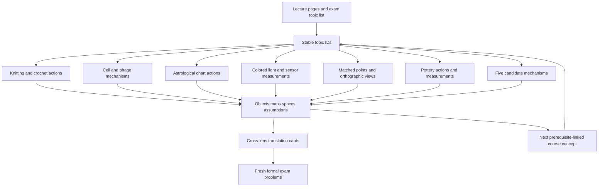

# One Course, Connected Analogy Lenses

2026-10-26 · Shared source and translation index

## How everything connects

The mathematical concept is the shared node. Lecture page → topic ID → each lens's
actual mechanism → exact mathematics → fresh exam problem. Connections are not a
claim that yarn, infection, a horoscope, colored light, shadows, and sound are physically equivalent.
“Everything connects” means every registered topic has a route in every lens,
with explicit translation and limits—not that every concept equals every other.

| Existing lens | Canon | Rubric |
| --- | --- | --- |
| Knitting/crochet | [Yarn in Your Hands](systems/knitting-crochet/canon.md) | [Rubric](systems/knitting-crochet/rubric.md) |
| Bacteria/viruses | [Cells and infection](systems/bacteria-viruses/canon.md) | [Rubric](systems/bacteria-viruses/rubric.md) |
| Astrological wheel | [Around the Zodiac](systems/astrology/canon.md) | [Rubric](systems/astrology/rubric.md) |
| Colored light | [Different Light, the Same Color](systems/colored-light/canon.md) | [Rubric](systems/colored-light/rubric.md) |
| Multiple shadows | [The Object Behind the Shadows](systems/shadows/canon.md) | [Rubric](systems/shadows/rubric.md) |
| Pottery | [From Spinning Clay to Fired Form](systems/pottery/canon.md) | [Rubric](systems/pottery/rubric.md) |

This file is the sole authoritative register for topic definitions and exact
lecture PDF pages. Each system's canon owns its detailed mechanisms and examples;
the cross-system cells below are navigation summaries. Update this register first
when a source or topic changes, then update affected canon mechanisms.

All six systems are current editorial drafts. Knitting/crochet is the existing
primary mathematical and narrative thread; [the teaching strategy](teaching-strategy.md)
uses shadows/light only as optional support. [Comparisons](comparisons/light-vs-shadows.md) support later
choices; sound, mobile, and dance remain undeveloped options. For past selections
and rebuilds, use [development history](verification/history.md).

## Source discipline

All page numbers are **one-based PDF pages**, including title/reveal pages; not
invented slide labels. Mappings were checked against local `pdftotext -layout`
extraction of all five decks on 2026-10-26. Image-only pages remain unreviewed.
W3 pages 16–17 and W5 page 22 yielded no text; do not invent their contents.
Statistics and PCA are explicit in the exam-topic list; they were not found in the
extracted Week 5 lecture text. Their bridge is supplementary until source review
establishes otherwise. Exact homework/problem-level alignment remains pending.

### Lecture files

- W1: [WK1_ Vectors and Matrices.pdf](../resources/lectures/WK1_%20Vectors%20and%20Matrices.pdf)
- W2: [WK2_SLE_Inverse_Determinants.pdf](../resources/lectures/WK2_SLE_Inverse_Determinants.pdf)
- W3: [WK3_VectorSpaces_SLE_Rank.pdf](../resources/lectures/WK3_VectorSpaces_SLE_Rank.pdf)
- W4: [WK4_Orthogonality_and_Projections.pdf](../resources/lectures/WK4_Orthogonality_and_Projections.pdf)
- W5: [WK5_Matrix_Decomposition.pdf](../resources/lectures/WK5_Matrix_Decomposition.pdf)
- Bridge source: [MidtermTopics.md](../resources/practiceExams/MidtermTopics.md).

## Specific lecture-topic register

Subtopics named together in a row share a source range, not necessarily a single
analogy passage. Each formal rule still needs its own explanation and checked
example/callback when chapters are written. Zero/singular/rectangular/dependent
cases and failed hypotheses belong with the relevant row.

| Topic ID | Course content | Source: PDF pages |
| --- | --- | --- |
| W1.01 | Vector entries, dimensions, representations | [W1 pp. 4–6](../resources/lectures/WK1_%20Vectors%20and%20Matrices.pdf#page=4) |
| W1.02 | Addition, scaling, linear combinations | [W1 pp. 7–19](../resources/lectures/WK1_%20Vectors%20and%20Matrices.pdf#page=7) |
| W1.03 | Dot product, properties, cosine/angle | [W1 pp. 20–26](../resources/lectures/WK1_%20Vectors%20and%20Matrices.pdf#page=20) |
| W1.04 | Norm, length, unit vectors, normalization | [W1 pp. 27–34](../resources/lectures/WK1_%20Vectors%20and%20Matrices.pdf#page=27) |
| W1.05 | Matrix entries/shapes, addition/scaling | [W1 pp. 35–36, 40–41](../resources/lectures/WK1_%20Vectors%20and%20Matrices.pdf#page=35) |
| W1.06 | Diagonal, identity, symmetric matrices; trace | [W1 pp. 37–39, 43](../resources/lectures/WK1_%20Vectors%20and%20Matrices.pdf#page=37) |
| W1.07 | Transpose | [W1 pp. 42](../resources/lectures/WK1_%20Vectors%20and%20Matrices.pdf#page=42) |
| W1.08 | Matrix-vector/products; multiplication properties | [W1 pp. 44–48](../resources/lectures/WK1_%20Vectors%20and%20Matrices.pdf#page=44) |
| W2.01 | Systems, column picture, augmented equations | [W2 pp. 3–7](../resources/lectures/WK2_SLE_Inverse_Determinants.pdf#page=3) |
| W2.02 | Gaussian elimination, row operations, echelon/pivots, back substitution | [W2 pp. 8–21](../resources/lectures/WK2_SLE_Inverse_Determinants.pdf#page=8) |
| W2.03 | Determinant, properties, Laplace/cofactors, geometry | [W2 pp. 22–29](../resources/lectures/WK2_SLE_Inverse_Determinants.pdf#page=22) |
| W2.04 | Inverse, invertibility tests, Gauss–Jordan, cofactor formulas | [W2 pp. 30–36](../resources/lectures/WK2_SLE_Inverse_Determinants.pdf#page=30) |
| W3.01 | Vector spaces, closure, subspaces/counterexamples | [W3 pp. 3–8](../resources/lectures/WK3_VectorSpaces_SLE_Rank.pdf#page=3) |
| W3.02 | Column and null spaces | [W3 pp. 9–12](../resources/lectures/WK3_VectorSpaces_SLE_Rank.pdf#page=9) |
| W3.03 | Four fundamental subspaces | [W3 pp. 13](../resources/lectures/WK3_VectorSpaces_SLE_Rank.pdf#page=13) |
| W3.04 | Complete solution, particular plus null, free variables | [W3 pp. 14–17](../resources/lectures/WK3_VectorSpaces_SLE_Rank.pdf#page=14) |
| W3.05 | Rank, pivot computation | [W3 pp. 18–21](../resources/lectures/WK3_VectorSpaces_SLE_Rank.pdf#page=18) |
| W3.06 | Linear independence and dependence | [W3 pp. 22–26](../resources/lectures/WK3_VectorSpaces_SLE_Rank.pdf#page=22) |
| W3.07 | Span and membership | [W3 pp. 27–29](../resources/lectures/WK3_VectorSpaces_SLE_Rank.pdf#page=27) |
| W3.08 | Basis, dimension, natural/alternative bases | [W3 pp. 30–33](../resources/lectures/WK3_VectorSpaces_SLE_Rank.pdf#page=30) |
| W3.09 | Change of basis | [W3 pp. 34](../resources/lectures/WK3_VectorSpaces_SLE_Rank.pdf#page=34) |
| W4.01 | Orthogonality, paired four-space complements | [W4 pp. 3–5](../resources/lectures/WK4_Orthogonality_and_Projections.pdf#page=3) |
| W4.02 | Line/subspace projection, residual geometry | [W4 pp. 6–13](../resources/lectures/WK4_Orthogonality_and_Projections.pdf#page=6) |
| W4.03 | Invertibility of A transpose A; proof conditions | [W4 pp. 14](../resources/lectures/WK4_Orthogonality_and_Projections.pdf#page=14) |
| W4.04 | Least squares, line fit, normal equations | [W4 pp. 15–21](../resources/lectures/WK4_Orthogonality_and_Projections.pdf#page=15) |
| W4.05 | Orthonormal vectors/bases, simplified projections | [W4 pp. 22–24](../resources/lectures/WK4_Orthogonality_and_Projections.pdf#page=22) |
| W4.06 | Gram–Schmidt, worked example | [W4 pp. 25–27](../resources/lectures/WK4_Orthogonality_and_Projections.pdf#page=25) |
| W5.01 | Two-dimensional transformations | [W5 pp. 3–8](../resources/lectures/WK5_Matrix_Decomposition.pdf#page=3) |
| W5.02 | Eigenvalues/eigenvectors, computation, eigenspaces | [W5 pp. 9–18, 43](../resources/lectures/WK5_Matrix_Decomposition.pdf#page=9) |
| W5.03 | Eigendecomposition and diagonalization | [W5 pp. 19–20](../resources/lectures/WK5_Matrix_Decomposition.pdf#page=19) |
| W5.04 | Real symmetric spectral theorem | [W5 pp. 21](../resources/lectures/WK5_Matrix_Decomposition.pdf#page=21) |
| W5.05 | SVD, formulation, A transpose A, computation | [W5 pp. 23–26, 44](../resources/lectures/WK5_Matrix_Decomposition.pdf#page=23) |
| W5.06 | Truncated SVD, dimension reduction | [W5 pp. 27–33](../resources/lectures/WK5_Matrix_Decomposition.pdf#page=27) |
| W5.07 | Recommendation and user-rating example | [W5 pp. 34–40](../resources/lectures/WK5_Matrix_Decomposition.pdf#page=34) |
| B.01 | Mean, variance, standard deviation, covariance | [Exam topic list](../resources/practiceExams/MidtermTopics.md); supplement location pending |
| B.02 | PCA, covariance eigenvectors, centered SVD | [Exam topic list](../resources/practiceExams/MidtermTopics.md); supplement location pending |

## Every current lens, linked through each topic

Each cell names local actions/anchors and their mathematical landing. The knitting/crochet, biology, astrology, and pottery canons provide local topic
mechanism indexes linked here. Source pages appear only in this register. These
are editorial references, not delivered chapters.

| Topic ID | Knitting/crochet | Bacteria/viruses | Astrological wheel | Colored light | Multiple shadows | Pottery |
| --- | --- | --- | --- | --- | --- | --- |
| W1.01 | SWATCH/COUNT: Record pink stitches in four fixed six-stitch sections; distinguish stitch order, whole-row totals and section vectors. | CELL/EVENTS: B,I,V counts. | PLACE/COUNT: glyph coordinates. | EMIT/SENSOR: Sampled spectral powers | MARK: Tracked point coordinates | PREPARE/OPEN: radius record. |
| W1.02 | SWATCH/LEDGER: Add repeated section records and actual plain/increase/decrease effects; state real signed extensions. | EVENTS: sum event columns. | COUNT: add marker records. | EMIT/MIX: Add linear-light spectra | MARK: Add point displacements | PREPARE: component masses. |
| W1.03 | SWATCH/REPEAT: Use dot products with uniform/alternating section directions and with the operation-output weights. | GEOMETRY: report pairing. | ASPECT: square versus opposition. | SENSOR/FIT: Sensor response to spectrum | ONE/ANGLE: Screen-axis component of point | ORTH/CENTER: pairing and geometry. |
| W1.04 | SWATCH/REPEAT: Normalize the uniform and alternating count directions; compute record norms, angles and zero-vector limits. | GEOMETRY: normalize record. | PLACE/ASPECT: unit circle. | FIT/MODES: Normalize response vector; not perceived brightness | MARK/TURN: Point distance and unit direction | CENTER/ORTH: radius of marked point. |
| W1.05 | SWATCH/LEDGER: Read W row/section entries and the rectangular operation map H with declared input/output spaces. | EVENTS/OBSERVE: event/report maps. | COUNT/ROTATE: bin reporting matrix. | SENSOR/MIX: Fixed sensor response table | ONE/TWO: View-coordinate matrix | BATCH/PROFILE: masses versus radii. |
| W1.06 | ROUND/CHARTMODES: Use sector permutation, identity/gain maps and symmetric W transpose W; compute trace in the declared record space. | GROWTH/MODES: diagonal window, Gram map. | ROTATE/MODES: I, S, diagonal sum. | FILTER/MODES: Spectral gain filter, identity, sensor Gram map | ONE/TURN: Axis scales, identity, view Gram map | TURN/SHRINK/MODES: diagonal F, Gram map. |
| W1.07 | CHARTMODES/FIT: Transpose swaps weighted section/row roles; residual pairing uses a transpose without claiming a physical inverse. | FIT/MODES: report-residual pairing. | ROTATE/FIT: orthogonal inverse versus transpose. | FIT/MODES: Pair sensor residual with spectral responses | ONE/FIT: Backproject coordinate residual; not generic inverse | TURN/FIT: inverse rotation versus residual. |
| W1.08 | ROUND/LEDGER/CHARTMODES: Compose compatible relabeling, shaping-record and reporting maps; check spaces and order before multiplying. | EVENTS/COORDINATES: M E and coordinate map. | ROTATE/HOUSES/COUNT: compose maps. | MIX/FILTER: Filter then sense; compatible spaces | TURN/TWO: Rotate then project; dimensions/order | PREPARE/FINISH: staged factors, rotation/scale order. |
| W2.01 | SOLVE: Derive consumed/produced requirements for 24 stitches becoming 30. | SOLVE: endpoint event equations. | SPACE: recover quadrant counts. | MIX: Match target sensor response | ONE/TWO: Reconstruct point from view coordinates | SOLVE: component batch targets. |
| W2.02 | SOLVE: Eliminate the actual stitch equations, then develop larger source systems, pivots and back substitution. | SOLVE: recover d,a,l. | SPACE/FIT: eliminate count equations. | MIX/FIT: Eliminate sensor-response equations | TWO/FIT: Eliminate view-coordinate equations | SOLVE: eliminate redundant batch equations. |
| W2.03 | SOLVE/ROUND: Compute determinant/cofactor properties on square B and coordinate permutations; distinguish singular A and coordinate volume. | SOLVE: det E versus det M. | ROTATE/COUNT: signed drawing area. | FILTER/CALIBRATE: Square response map; determinant not colorfulness | TURN/TWO: Planar coordinate area versus collapsed depth | COORDINATES/SHRINK: signed mass-coordinate or ideal volume scale. |
| W2.04 | SOLVE: Invert B or a declared bookkeeping map; distinguish counts recovered from original stitch order. | SOLVE/COORDINATES: reconstruct records not biology. | ROTATE/HOUSES: reverse relabeling, not aggregation. | CALIBRATE/SENSOR: Recover calibrated inputs where map permits | TURN/TWO: Invert full-rank coordinate map, not one shadow | COORDINATES: invert prediction not firing. |
| W3.01 | SWATCH/LEDGER: Separate real repeat/ledger subspaces from physically feasible integer stitch records. | EVENTS/OBSERVE: real records not organisms. | SPACE: real records, not unit circle. | EMIT/MIX: Real spectral extension versus physical nonnegative cone | MARK/ONE: Spatial planes and linear view domains | BATCH: real record plane, not positive clay. |
| W3.02 | SWATCH/LEDGER/CHARTMODES: Contrast total-count invisibility, operation cancellation and repeated W columns; identify the specific map. | OBSERVE: infection distinction hidden. | SPACE: opposite-bin shifts hidden. | SENSOR/MIX: Sensor responses versus indistinguishable spectra | ONE/TWO: Visible screen coordinates versus lost depth | OBSERVE: premix history hidden. |
| W3.03 | LEDGER/CHARTMODES: Derive all four spaces with operation/output or section/row-weight meanings and explicit ambient dimensions. | OBSERVE: state versus report spaces. | SPACE: four bins versus three reports. | SENSOR/MIX: Spectral input and sensor output spaces | ONE/TWO: Spatial input and stacked screen output spaces | OBSERVE: portions versus mass reports. |
| W3.04 | SOLVE/LEDGER: Give the complete real shaping family and then the finite feasible integer instructions. | OBSERVE/SOLVE: (8-t,t,12). | SPACE: (t,s,5-t,3-s). | SENSOR/MIX: All spectra/inputs yielding target response | ONE/TWO: All positions consistent with views | SOLVE/OBSERVE: (3-t,2-t,t). |
| W3.05 | LEDGER/CHARTMODES: Repeated pattern columns and redundant ledger totals explain rank and pivot count. | OBSERVE: rank 2 report. | SPACE: rank 2 opposite sums. | SENSOR/MIX: Independent spectral distinctions measured | TWO/ANGLE: Independent spatial directions seen | OBSERVE: rank 2 mass report. |
| W3.06 | LEDGER/SWATCH: Show increase plus decrease equals three plain ledger effects; repeated motifs produce dependent chart columns. | OBSERVE: duplicate infection-status report columns. | SPACE: duplicate opposite-bin signatures. | MIX: Duplicate primary/sensor response signatures | TWO/ANGLE: Redundant views of same directions | BATCH: premix equals sum of components. |
| W3.07 | SWATCH/SOLVE: Test whether a target record is in the repeat/operation span and separately whether counts are feasible. | OBSERVE: compatible total report. | SPACE: total equals opposite sums. | MIX: Target response within calibrated light span | ONE/TWO: Observed views within attainable point-image span | SOLVE: total mass consistency. |
| W3.08 | SWATCH/REPEAT: Use uniform/alternating repeat directions as a basis of the chosen two-dimensional record subspace. | COORDINATES/GEOMETRY: compartments and report basis. | PLACE/SPACE: plane axes versus bin basis. | CALIBRATE/FIT: Independent primary/response vectors | TURN/ANGLE: World axes and independent view directions | COORDINATES/ORTH: component/report bases. |
| W3.09 | SWATCH/SOLVE/ROUND: Compare e,a with q0,q1 coordinates, bookkeeping bases and cyclic marker labels. | COORDINATES: total/infected versus B/I. | ROTATE/HOUSES: declared frame or permutation. | CALIBRATE: Two bases of same attainable response space | TURN: World versus rotated camera axes | COORDINATES: red/white versus total/red. |
| W4.01 | REPEAT/LEDGER: Verify uniform and alternating count directions are perpendicular; derive both four-space complement pairs. | OBSERVE/GEOMETRY: detectable and invisible. | ASPECT/SPACE: 90 degrees and complement pairs. | SENSOR/FIT: Sensor row space versus invisible spectral differences | ONE/TWO: View plane versus depth direction | OBSERVE/ORTH: mass-report complements. |
| W4.02 | REPEAT/FIT: Project r onto uniform repeats and compare with the contradictory-ledger fit under its own metric. | FIT: inconsistent component/sum report. | FIT: impossible count total. | FIT: Closest achievable sensor response in declared metric | ONE/FIT: Orthogonal shadow and closest view-consistent record | FIT: line fit or inconsistent totals. |
| W4.03 | REPEAT/FIT: State independent-column conditions for a chosen repeat basis; contrast the dependent operation ledger. | FIT: rank-deficient M versus chosen basis. | FIT: dependent report versus independent basis. | FIT: Independent calibrated response columns required | FIT: Sufficient independent measured spatial directions | FIT: dependent batch map versus nonzero bar vector. |
| W4.04 | REPEAT/FIT/GAUGE: Fit a closest repeat and a declared gauge trend, retaining the lecture line-fit derivation and assumptions. | FIT/REPLICATES: noisy records. | FIT/SURVEY: noisy counts; declared trend. | FIT/RECORD: Calibrate response from intensity readings | FIT/CLOUD: Fit noisy corresponding point views | FIT: actual test-bar measurement model. |
| W4.05 | REPEAT: Use q0=e/2 and q1=a/2; distinguish the uniform-line projector from the two-direction repeat-plane projector. | GEOMETRY: normalized report-plane basis. | ASPECT/MODES: axes and symmetric averaging. | FIT/MODES: Orthonormal spectral/response coordinates | ONE/ANGLE: Orthonormal screen axes | ORTH: normalized report-plane basis. |
| W4.06 | REPEAT: Gram–Schmidt on e,r subtracts the shared baseline and isolates alternating contrast. | GEOMETRY: orthogonalize report effects. | FIT: orthogonalize report plane. | FIT: Orthogonalize response/spectral template columns | ANGLE: Orthogonalize independent viewing directions | ORTH: orthogonalize mass reports. |
| W5.01 | ROUND: Relabel six marked sectors with an explicit same-space permutation; distinguish a record action from fabrication. | GROWTH: chosen count window. | ROTATE: markers versus frame. | FILTER: Two-channel response/filter map | TURN: Rotate/scale point coordinates | TURN/SHRINK: rotation versus scale. |
| W5.02 | ROUND/MODES: Derive +1 uniform and -1 alternating eigen-directions of P6; keep the optional T example and formal characteristic calculations. | GROWTH/MODES: idealized diagonal update. | ROTATE/MODES: R90 versus symmetric S. | FILTER: Eigenvectors of declared square response/filter map | ONE/TURN: Stable directions of a square geometric map | SHRINK/TURN: axes of declared F. |
| W5.03 | ROUND/CHARTMODES: State P6 real-basis limits, retain formal defective cases and diagonalization hypotheses. | MODES: declared update and Gram maps. | MODES: symmetric S; real rotation limitations. | FILTER/MODES: Diagonalize specified square filter map | TURN/MODES: Diagonalize specified geometric map when possible | MODES: symmetric Gram versus generic deformation. |
| W5.04 | CHARTMODES: Apply the real symmetric theorem to W transpose W; separate arbitrary repeated-eigenspace vectors from an orthonormal choice. | MODES: H transpose H. | MODES: opposite-bin averaging S. | MODES: Symmetric sensor Gram map | ONE/MODES: Symmetric view Gram map | MODES: profile Gram map. |
| W5.05 | CHARTMODES/MODES: Derive W baseline/alternating singular pairs and full/compact shapes; H supplies different rectangular input/output dimensions. | MODES: retained versus lost infection distinction. | MODES: J sums versus differences. | MODES: Spectral directions, sensor strengths, response directions | MODES/ANGLE: Spatial directions, view strengths, image directions | MODES: radius average loses difference. |
| W5.06 | CHARTMODES/SWATCHPCA: Reconstruct the rank-1 uniform chart, quantify lost alternation, then distinguish centered data compression. | MODES/REPLICATES: lost report distinctions. | MODES/SURVEY: tied modes and loss. | MODES/RECORD: Compact spectral/response model | MODES/CLOUD: Best low-rank coordinate/view approximation | MODES/COMPARE: lost radius detail. |
| W5.07 | GAUGE: Introduce maker-by-named-swatch ratings as a separate dataset; teach the supplied recommendation example and missing-data limits. | REPLICATES: declared assay-table completion bridge. | SURVEY: chart-table completion bridge. | RECORD: Viewer-by-light-scene ratings, distinct from spectra | CLOUD: Viewer-by-sculpture ratings, distinct from geometry | COMPARE: piece readings or declared ratings. |
| B.01 | SWATCHPCA/GAUGE: Compute descriptive statistics on designed panel rows and specimen gauge; distinguish their data-generating interpretations. | REPLICATES: repeated compartment reports. | CENTER/SURVEY: circular boundary then count data. | RECORD: Center measured spectrum/response records | CLOUD: Center point/view records | COMPARE: measured dimensions. |
| B.02 | SWATCHPCA/GAUGE: Center W to isolate alternating variation, then use GAUGE for two nonzero modes and specimen-feature interpretation. | REPLICATES: dominant recorded count variation. | SURVEY: dominant chart-record variation. | RECORD: Variation of spectra/responses, not universal perceptual distance | CLOUD: Dominant point-cloud directions, not unseen true geometry | COMPARE: dominant measured piece variation. |

## Additional option routes

Only the three undeveloped alternatives are listed here. Light and shadows already
have current canons in the six-system table above. These are mechanism proposals,
not additional source registers or claims of completed educational coverage.

| Topic ID | Sound | Hanging mobile | Dance capture |
| --- | --- | --- | --- |
| W1.01 | Aligned sound samples | Load records | Marker coordinates |
| W1.02 | Mix signals and change gain | Superpose load effects at fixed geometry | Combine signed marker displacements |
| W1.03 | Template correlation in sample space | Force component along declared axis | Pose alignment in scaled coordinates |
| W1.04 | Normalize a sampled signal | Normalize a load/displacement direction | Normalize marker displacement |
| W1.05 | Microphone gain table | Fixed lever-arm coefficient table | Marker-observation matrix |
| W1.06 | Independent gains, unchanged channels, symmetric mix | Declared mass/stiffness or constraint Gram map | Axis scales, identity, observation Gram map |
| W1.07 | Map channel residuals back through A transpose | Pair residual constraints with load directions | Map marker residuals to input directions |
| W1.08 | Mix then process; composition/order | Change coordinates then evaluate constraints | Rotate then observe; coordinate compatibility |
| W2.01 | Recover source samples with known gains | Meet force/torque requirements | Recover pose coordinates from known observation map |
| W2.02 | Eliminate mixed-channel equations | Eliminate balance constraints | Eliminate observed-coordinate equations |
| W2.03 | Square gain-map information loss; coordinate volume | Square constraint map; determinant not torque | Coordinate area scaling; not body mass |
| W2.04 | Unmix known nonsingular channels | Solve nonsingular fixed-load map | Reverse known frame map, not missing observation |
| W3.01 | Real sample space; clipping is outside linear model | Real load/displacement extension versus feasible loads | Coordinate space versus nonlinear valid-pose set |
| W3.02 | Recordable mixtures versus invisible source changes | Achievable constraints versus undetected load redistributions | Observed coordinates versus invisible pose changes |
| W3.03 | Input source combinations and output microphone space | Load input and constraint output spaces | Pose input and observed marker output spaces |
| W3.04 | All source combinations yielding same recording | All load assignments satisfying fixed constraints | All coordinate records matching observations |
| W3.05 | Independent mixtures retained | Independent constraints/load signatures | Independent coordinates measured |
| W3.06 | Duplicate microphone gain patterns | Redundant balance equations | Duplicate observed marker-coordinate directions |
| W3.07 | Target recording within known template span | Target forces within available load signatures | Observed pose vector within declared linear template span |
| W3.08 | Independent signal templates and channel axes | Load/displacement directions | Independent recorded pose directions |
| W3.09 | Left/right versus mid/side | World versus orthonormal component axes | Stage versus rotated camera frame |
| W4.01 | Template dot products; source and residual complements | Constraint row space versus null loads | Observed-coordinate row space versus hidden directions |
| W4.02 | Fit known waveform template or template subspace | Closest achievable constraint target in weighted model | Closest observation to declared linear pose subspace |
| W4.03 | Distinct full-rank channel/template columns required | Independent chosen load/parameter columns | Independent observation columns in declared pose model |
| W4.04 | Fit noisy known mixtures or gain calibration | Fit noisy force/load observations | Fit noisy marker coordinates or linear trend |
| W4.05 | Unit orthogonal sample templates | Orthonormal or mass-weighted coordinates, stated | Orthonormal marker-coordinate directions |
| W4.06 | Remove known waveform overlaps successively | Orthogonalize independent load signatures | Orthogonalize recorded pose template columns |
| W5.01 | Two-channel linear processing | Two-coordinate displacement map | Planar marker transform |
| W5.02 | Same-space processor preserves signal-combination direction | Small-oscillation modes of derived system | Eigenvectors of declared square marker transform |
| W5.03 | Diagonalize known channel processor when possible | Derived normal coordinates; distinguish mass weighting | Diagonalize declared transform, not arbitrary body motion |
| W5.04 | Symmetric processor or template Gram matrix | Symmetric stiffness in appropriate model/coordinates | Symmetric observation Gram/covariance map |
| W5.05 | Input sound combinations, gains, output directions | Load signatures versus measured constraints, or displacement observations | Pose directions versus observed marker signatures |
| W5.06 | Compact recording model; lost signal energy | Compact measured motion/load record | Compress aligned recorded takes |
| W5.07 | Listener-by-recording ratings, distinct from raw waveform | Viewer-by-mobile ratings, distinct from dynamics | Viewer-by-performance ratings, distinct from marker coordinates |
| B.01 | Center repeated recording features | Center repeated trial records | Center aligned pose/take records |
| B.02 | Variation of recorded features, not automatic speaker identity | Variation of trial records, not necessarily dynamical modes | Dominant data variation, not universally valid dance poses |

## Cross-lens translation cards

### T1 — W3.02/W3.03/W3.05: the same observation can hide different causes

- Yarn: an increase/decrease pair and three plain stitches have the same ledger totals.
- Biology: the declared report does not distinguish infected/uninfected substitutions.
- Wheel: opposite-bin sums hide which opposite quadrant contains a marker.
- Pottery: final component masses can hide which premix portions were used.
- Sound: a rank-deficient microphone map hides certain source combinations.
- Light: a lower-dimensional response map hides spectral differences.
- Shadows: one orthographic view hides depth along its viewing direction.
- Mobile: a redundant measurement arrangement can hide load redistributions.
- Dance: a partial coordinate observation can hide unobserved displacements.

**Mathematical landing:** `A(x+v)=Ax` when `Av=0`. Each map has its own domain,
dimensions, units, and null vectors. Nonzero nullity establishes nonunique real
reconstruction, not that every null perturbation is physically feasible.

### T2 — W3.09: new coordinates versus information loss

Knitting ledger bases, biology total/infected coordinates, wheel-axis or whole-sign
permutations, pottery component/total records, stereo mid/side, two light-response
bases of the same span, rotated world/view axes, mobile coordinate frames, and
stage/camera frames all require an explicitly invertible coordinate map.
A noninvertible aggregation is not a basis change. Show the inverse before claiming
that two descriptions preserve all the information in the chosen record.

### T3 — W4.02–W4.04: the nearest allowed explanation

A miscounted stitch row, inconsistent biological report, incorrect wheel total,
noisy pottery test-bar lengths, noisy recording, target light response, inconsistent point
views, noisy balance observations, and noisy motion markers each need an explicit
model range and error metric. Derive the projection/least-squares residual condition
`A^T(b-Axhat)=0`. State the full-column-rank hypothesis before using inverse normal
equations. A real-valued best fit is not automatically a feasible physical object.

### T4 — W5.02–W5.05: eigenvectors are not singular vectors by default

Same-space transformations support eigenvector questions: the knit/purl rewrite,
a chosen biological update, wheel rotation, a pottery dimension model, band filtering, a square audio
processor, a declared light/filter map, a spatial map, a derived small-oscillation
operator, or a square marker transform. General input/output measurement maps need
SVD. Explain `Av_i=σ_i u_i`; input and output spaces can differ. Do not identify
principal data directions, dynamical modes, and original physical sources without
additional hypotheses. Repeated values make vector choices nonunique.

### T5 — B.01/B.02: center observations, then describe their variation

Swatches, population reports, chart records, pottery dimensions, sound features, spectra,
point clouds, mobile trials, and motion records all support an explicitly oriented
data table. State features and units; center columns; use a declared sample/population
denominator; derive covariance and centered SVD; explain projection and restoring
the mean. Variance is not quality, causation, species identity, personality, or
physical importance. Statistics/PCA must not be falsely attributed to a lecture
page that does not teach it.

## Shared graph

The tables and translation cards are the accessible counterpart of this graph.
It is a route through shared mathematical structure, not a complete graph of false
equivalences between every physical object.

## Corrections and precision to preserve during authoring

- W3 p. 13: describe subspaces as subsets of the ambient Euclidean spaces, not
  elements of those spaces. Keep row/null and column/left-null pairs separate.
- W4 p. 26: extracted Gram–Schmidt notation mixes variable labels. Reconstruct the
  standard projection-subtraction derivation and verify against the original image
  before reproducing its equations; do not copy the extraction as authoritative.
- W5 p. 21: eigenvectors of a real symmetric matrix for **distinct** eigenvalues
  are orthogonal; within a repeated eigenspace an orthonormal basis can be chosen.
  Not every pair of arbitrarily chosen eigenvectors is automatically perpendicular.
- W5 pp. 24–26: distinguish full/reduced SVD. For a rectangular map use the proper
  shapes and `Σ^TΣ`/`ΣΣ^T`; do not replace them indiscriminately by the same `Σ²`.
- Recommendation, pp. 34–40: missing ratings are not zeros, and a standard SVD of a
  completed matrix does not alone establish a missing-data prediction method.

## Maintenance and completion evidence

Update this register when a lecture/source or taught concept changes. New concepts
must receive stable IDs and a destination in every retained lens; a difficult
mapping may explicitly use a measured record rather than inventing physical behavior.
Update a lens's canon and rubric if its meaning changes. Chapter passages should
cite topic ID plus local action card and eventually link their manuscript location.

**Current evidence:** All 36 topic groups have source destinations and routes
through six systems. Local mechanism indexes link back to this register.
**Open work:** Image-only source review, supporting problem references, completed
chapter treatments, fresh transfer questions, rendered figures, independent review,
and observed student performance. See [verification](verification/rebuild.md)
for completed checks and [history](verification/history.md) for prior decisions.
