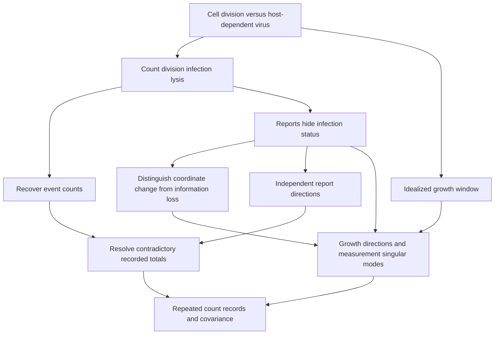

# Cells, Infection, and What a Measurement Can See

Connected bacteria-versus-viruses analogy canon · 2026-10-26
[Companion rubric](ANALOGY_BACTERIA_VIRUSES_RUBRIC.md) · [Main bible](../SHOW_BIBLE.md)

## 1. The concrete story and source boundary

Follow a bacterial cell dividing, a bacteriophage attaching to a susceptible cell,
an infected cell assembling progeny phage, and a lytic release. Then ask what a
record of cells and free particles actually tells us. The distinction between
bacteria and viruses is the mechanism of the story, not decoration on a table.

Bacteria are cells; viruses depend on host-cell components for replication.
Bacteriophages infect bacteria, so “bacteria versus viruses” is also an interaction,
not a universal contest between good and bad organisms.
[NHGRI bacteria](https://www.genome.gov/genetics-glossary/Bacteria),
[NHGRI virus](https://www.genome.gov/genetics-glossary/Virus).
Division and the lytic/lysogenic distinction are described in
[OpenStax microbial growth](https://openstax.org/books/microbiology/pages/9-1-how-microbes-grow)
and [viral life cycles](https://openstax.org/books/microbiology/pages/6-2-the-viral-life-cycle).

We use a chosen **lytic phage example**, not all viruses or all phages. No culture
conditions, incubation protocols, clinical conclusions, or empirical rate estimates
are supplied. All counts, measurement rules, burst sizes, and matrices below are
invented teaching constructions. Real infection is often nonlinear and stochastic.

**Fixed state:** `z=(B,I,V)^T`: susceptible uninfected bacterial cells, infected
bacterial cells, and free phage particles. Counts are distinct; an infected cell is
not a free virus. Nonnegative integer states/events describe counts. Real vectors
and signed deviations are mathematical extensions, not negative organisms.

## 2. Two recurring anchors

### E — Count actual events before writing a matrix

For this model, one division replaces one susceptible cell with two; one successful
infection removes one susceptible cell and one free phage from those compartments
and adds one infected cell; one lysis removes one infected cell and releases **four**
free phages. Four is an arbitrary illustrative yield, not a biological constant.

```text
Event              Division d   Infection a   Lysis l
Change in B             +1          -1           0
Change in I              0          +1          -1
Change in V              0          -1          +4

Δz = E x,   E = [[1,-1,0],[0,1,-1],[0,-1,4]],   x=(d,a,l)^T
```

For `x=(5,2,1)`, `Δz=(3,1,2)`. This is an **event ledger**, not a model assigning
infection rates. Feasible counts require enough starting cells/particles and a
possible event ordering. Inverting endpoints does not reconstruct the order.

`det(E)=3`; recover `l=(ΔV+ΔI)/3`, `a=ΔI+l`, `d=ΔB+a`. For the given change these
are 1,2,5. A real solution may fail nonnegative/integer feasibility.

### M — Count cells without distinguishing their infection status

Consider an explicitly idealized report that counts all intact bacterial cells,
free particles, and the sum of those two numbers:

```text
y = M z,   M = [[1,1,0],[0,0,1],[1,1,1]]
y = (total intact cells, free particles, sum of the two reported counts)^T
```

The last row is a computed reporting total, not an independent assay or a common
physical unit shared by cells and particles. This declared loss of information
explains the four fundamental subspaces:

- `rank(M)=2`; `N(M)=span((1,-1,0))`: infection-status substitutions cannot be detected.
- `C(M)={y:y3=y1+y2}`: the real report plane.
- `C(M^T)=span((1,1,0),(0,0,1))`: observable state directions.
- `N(M^T)=span((1,1,-1))`: detects contradictory reports.
- `z=(5,3,12)` yields `(8,12,20)`; `z=(6,2,12)` yields the same report.
  These populations are biologically different, despite identical reported values.
- General real reconstruction is `(8-t,t,12)`; physical counts here require an
  integer `0≤t≤8`. No unique infection-status inference follows.
- An inconsistent report `(8,12,21)` projects to `(25/3,37/3,62/3)` under equal
  Euclidean weighting. Residual is `(-1/3,-1/3,1/3)` and `M^T e=0`.
  Fractions diagnose a real fit; they do not prescribe fractional cells.

Euclidean report distance is an explicit teaching convention. Counting a redundant
sum as a third observation changes weighting; actual measurement models need
appropriate units, noise, and independent observations.

## 3. Mechanism cards and continuity

### CELL — One cell divides; a free virus does not do the same

Start with the physical distinction: cell division versus host-dependent viral
production. Use the column `(+1,0,0)` to explain net change rather than saying one
cell “creates two extra cells.” This introduces states, entries, addition, signed
changes, and repeated events. Connect to EVENTS and GROWTH. Boundary: not every
bacterial cell divides synchronously, and viral production is not binary fission.

### EVENTS — Attachment/infection, assembly, lysis

Name the actual before/after compartments in E. Adding event columns accounts for
net changes; multiplying by event counts is a linear combination. The ledger omits
intermediate assembly states and all timing. Connect to SOLVE and OBSERVE. Do not
call a mixed-species population a vector space of living things; the real record
space is the vector space.

### SOLVE — Infer counts, then check feasibility

Use the endpoint equations of E and elimination to recover event counts. Show the
augmented system and substitution for `(3,1,2)`. Connect determinant/inverse to
information retained by this ledger. Contrast with M's nonunique reconstruction.
An algebraic inverse cannot reverse lysis or recover an entire infection history.

### OBSERVE — Distinguish a bacterial cell from its infection status

Walk through why `(5,3,12)` and `(6,2,12)` produce the same declared report. This is
a concrete null-space mechanism: a measurement fails to distinguish compartments.
Use M's four spaces together. Connect to FIT and MODES. Do not imply a real assay
has these properties without specifying and validating that assay.

### COORDINATES — Count infected cells or count all cells

The same state has coordinates `w=(B+I,I,V)`. Define
`w=Cz`, `C=[[1,1,0],[0,1,0],[0,0,1]]`; recover `B=w1-w2`.
This is invertible coordinate bookkeeping, unlike M's information loss. In the
new coordinates a measurement becomes `M C^{-1}w`; event changes become `C E x`.
Connect basis, change of basis, multiplication, and order. `C` is not an infection.

### GEOMETRY — Compare changes in declared measurement units

A dot product can apply reporting weights; norms/angles require declared scaling.
A unit vector denotes a normalized record direction, not one organism. From
`mB=(1,0,1)` and `mV=(0,1,1)`, Gram–Schmidt gives
`q1=(1,0,1)/sqrt(2)`, `q2=(-1,2,1)/sqrt(6)`.
These span reachable reports; they are not biological pathways. Connect to FIT.
Perpendicular cell shapes or microscope axes do not establish algebraic orthogonality.

### FIT — A total disagrees with the component counts

Derive the inconsistent-report projection in §2 and its perpendicular residual.
Normal equations describe a fit, not proof that the fitted counts are true.
Use an independent full-rank design for inverse-based formulas; M has dependent
columns. A trend fitted to counts over time is an approximation, not a universal
linear growth law. Connect least squares to REPLICATES.

### GROWTH — Separate a chosen count window from actual infection dynamics

For an idealized interval in which susceptible cells each divide once while the
chosen free-particle count is unchanged and no infection occurs, `G=diag(2,1,1)`.
Its coordinate directions are eigenvectors, with scaling factors 2,1,1.
This teaches diagonal/identity matrices, powers, trace, and repeated eigenvalues.
It does not assert viruses replicate without hosts. Actual encounters often involve
products such as `B V`; these are nonlinear, not captured by a universal constant
3-by-3 growth matrix. Connect to EVENTS and MODES.

### MODES — Which distinctions survive measurement?

Keep the first two rows of M as `H=[[1,1,0],[0,0,1]]`. Its singular values are
`sqrt(2),1`; right singular directions `(1,1,0)/sqrt(2)` and `(0,0,1)` map to the
two output axes. `(1,-1,0)/sqrt(2)` is a right null direction.
This ties SVD directly to the undetected infection distinction. `H^T H` is symmetric;
its orthonormal eigenvectors explain the right singular vectors and squared values.
Dropping the second mode discards free-particle information under this chosen scaling;
it does not say viruses are biologically less important.
Connect spectral theorem, full/reduced/truncated SVD, rank, and PCA. Use separate
formal counterexamples for non-diagonalizable and negative-eigenvalue maps.

### REPLICATES — Measure repeated samples, not an invented “health score”

Use hypothetical rows of `(total intact cells, free particles)`:
`(13,22),(12,23),(11,20),(10,21)`. Mean `(11.5,21.5)`; sample covariance
`[[5/3,1],[1,5/3]]`. Standard deviations `sqrt(5/3)`; first component direction
`(1,1)/sqrt(2)`, second `(1,-1)/sqrt(2)`, covariance eigenvalues `8/3,2/3`.
Centered-data singular values are `sqrt(8),sqrt(2)`; first explained fraction is 80%.
State normalization: raw count features receive equal numeric weighting here.
PCA describes variation, not infection mechanism, causation, or clinical risk.
A sample-by-assay response table can connect the course's recommendation example
to missing-entry prediction; distinguish this from medical treatment recommendation.

## 4. Course coverage register

Every named weekly/exam topic has a mechanism anchor; chapter passages and exact
course pages remain pending. Supplements must be registered before use.

| Mathematical coverage | Card and specific landing |
| --- | --- |
| Vectors, dimensions, addition/scaling, combinations | CELL/EVENTS: compartment counts and before/after columns of E. |
| Dot product, norm, angle, unit vectors | GEOMETRY: weighted reports and explicitly scaled count-record geometry; zero-vector exception. |
| Matrix entries, shape, addition/scaling | EVENTS/OBSERVE: event and report maps; combine only maps with matching domains. |
| Matrix-vector and matrix-matrix products; properties/order | EVENTS/COORDINATES: net change, coordinate conversion, and `M E x`; check intermediate spaces. |
| Transpose | FIT/MODES: `M^T e`, `H^T H`; not reverse infection. |
| Identity, diagonal, symmetric matrices, trace | GROWTH/MODES: G and `H^T H`; symmetry concerns the map, not cell shape. |
| Systems, elimination, echelon/RREF, pivots, back substitution | SOLVE: recover d,a,l; include row-swap/zero-pivot cases formally. |
| No/unique/infinite solutions, particular plus null, free variables | SOLVE/OBSERVE: invertible E versus rank-deficient M; real versus integer solutions. |
| Determinants, properties/cofactors, signed area/volume | SOLVE: `det(E)=3`, `det(M)=0`; coordinate volume, not biological biomass. |
| Inverse, invertibility tests, Gauss–Jordan/cofactor formulas | SOLVE/COORDINATES: reconstruct recorded coordinates, not reverse cell processes. |
| Vector space, subspace, span | OBSERVE: real report plane; feasible organisms are not closed under real scaling. |
| Independence, basis, dimension, natural basis, change of basis | COORDINATES/GEOMETRY: compartment basis versus total/infected basis and report-plane basis. |
| Rank, rank-nullity, four fundamental subspaces | OBSERVE: rank 2 and both orthogonal-complement pairs of M. |
| Orthogonality, orthonormal bases, Gram–Schmidt | GEOMETRY: q1,q2 in the report plane. |
| Projection line/subspace, projection matrices | FIT: contradictory component/sum report and perpendicular residual. |
| Least squares, normal equations, line fitting, `A^T A` conditions | FIT/REPLICATES: noise and linear trend models with stated assumptions. |
| Eigenvalues/eigenvectors, characteristic equation, eigenspaces | GROWTH: controlled idealized G; compute and interpret scaling. |
| Eigendecomposition/diagonalization, spectral theorem | MODES: symmetric `H^T H`; separate formal failure cases, no universal biological eigenbasis. |
| SVD, full/reduced/truncated forms, dimensional reduction | MODES: retained versus lost infection/free-particle information. |
| Recommendation example and missing entries | REPLICATES: predict withheld assay-table entries only as an added mathematical exercise. |
| Mean, variance, standard deviation, covariance | REPLICATES: centered repeated counts; state sample denominator and units. |
| PCA | REPLICATES/MODES: covariance eigenvectors, centered SVD, projection, reconstruction, scaling/sign/tie caveats. |

## 5. Connected graph and use contract



The path is an accessible prose narrative too: physical events change compartments;
reports hide distinctions; coordinate changes preserve distinctions; geometry and
SVD identify what is retained; repeated observations lead to fitting and PCA.
Each chapter use must explain the biological event, record, exact mathematics,
representation loss, callback, and a fresh formal transfer question. An unchanged
report never proves an unchanged biological state.

## 6. Status

Drafted mechanism cards, coverage, graph, and original calculations. Linked sources
support biology; mathematical models are our constructions. Exact course-page
mapping, full worked chapter treatments, diagram rendering, biological/mathematical
review, and learner evidence remain pending. No real sample or medical result is claimed.

## Shared lecture and cross-analogy source map

[ANALOGY_COURSE_MAP.md](ANALOGY_COURSE_MAP.md) now gives the exact one-based
lecture PDF pages for each registered topic, identifies statistics/PCA as an
exam-topic supplement, and connects this canon to the knitting/crochet, biology,
wheel, colored-light, and multiple-shadow lenses, while preserving the five-option shortlist. Use its W1–W5 and B
IDs alongside the local action-card names above. Earlier references here to
pending lecture-page mapping are superseded by that register; exact supporting
problem numbers, image-only source review, and manuscript locations remain open.

A cross-lens passage must name the invariant mathematics before translating:
what counts as input/output, what the map preserves or hides, what the real/signed
extension means, and which physical constraints differ. Do not silently merge
objects from separate domains. The graph connects through mathematical structure,
not a claim that different mechanisms are physically equivalent.
