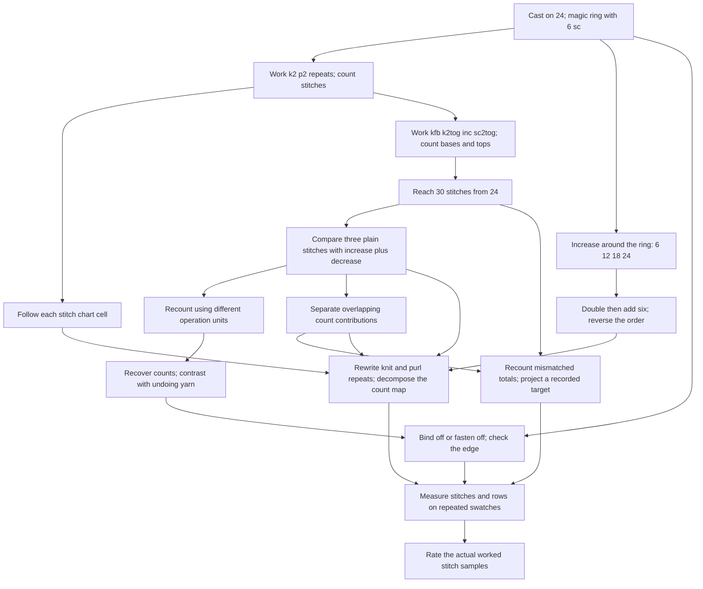

# Yarn in Your Hands — Knitting and Crochet Analogy Canon

Connected knitting-and-crochet analogy canon · Version 3 · 2026-10-26
[Companion rubric](ANALOGY_KNITTING_CROCHET_RUBRIC.md) · [Main bible](../SHOW_BIBLE.md)
[Lecture and cross-analogy map](ANALOGY_COURSE_MAP.md)

## 1. The actual stitches, shared projects, and source boundary

The recurring story is **making a knitted sampler and a crocheted circular motif**:
putting stitches on a needle, inserting a hook, counting loops, repeating a stitch
sequence, increasing, decreasing, checking gauge, correcting a row, and finishing
an edge. Every concept must connect to something the maker actually does, sees,
counts, or measures. A fictional design studio or unnamed “recipe adjustment” is
not specific enough.

A useful explanation begins with the physical action, identifies the relationship
it illustrates, and lands in exact mathematics. “Matrices are like patterns” alone
is not an analogy entry. A complete entry says which stitches, which pattern,
what is counted, how the operation changes those counts, and what the count loses.

This is the canonical source for the connected analogy system, not a finished
chapter manuscript. The examples below are original teaching constructions.
Craft facts have linked references; mathematical constructions are identified as
our deductions. Exact lecture-page destinations are recorded in the shared course map. Chapter
integration, diagrams, independent review, and learner-transfer evidence remain open.

### Fixed projects and terminology

- **Knitted sampler:** cast on 24 stitches; begin with a `k2, p2` row repeated six
  times. Use separate rows or samples to explore increases, decreases, charts,
  gauge, and binding off. Later count examples may change the stitch total and
  must say so. A single row does not establish a complete rib-fabric pattern.
- **Crocheted motif:** make a magic ring, work 6 single crochet into it, and tighten
  the tail. Use continuous rounds with a beginning-of-round marker: 6 increases
  give 12 stitches; then `(sc, inc)` six times gives 18; then `(2 sc, inc)` six times
  gives 24. These are chosen count instructions, not a guarantee of flatness for
  every yarn, hook, and tension.
- Use **US crochet terms**: `ch`, `sc`, `dc`, `sl st`, `sc2tog`. Define them on first
  use; do not mix UK and US names. For these examples `inc` means two sc worked
  into one base stitch. No joining slip stitch or setup chain counts toward the
  round total. [CYC crochet terminology](https://www.craftyarncouncil.com/standards/crochet-abbreviations)
- Knitting terms include `CO` (cast on), `k`, `p`, `kfb`, `k2tog`, `yo`, and
  `BO` (bind off, also called cast off). A knitting yarn over and a crochet yarn
  over must be explained in their own contexts. [CYC knitting terminology](https://www.craftyarncouncil.com/standards/knitting-abbreviations)
- Crochet **magic ring / magic circle** means an adjustable starting loop into
  which the first stitches are worked; tightening the tail draws its center
  closed. It is distinct from knitting's magic-loop method.
  [Lion Brand magic-ring tutorial](https://www.lionbrand.com/community/blog/magic-ring-crochet-tutorial/)

## 2. The central mathematical distinction: fabric versus its record

Always show three layers together:

1. **Action:** for example, knit two stitches together or make two sc in one stitch.
2. **Record:** for example, count stitches consumed and stitches produced.
3. **Mathematics:** for example, a column vector, a linear map, or an integer constraint.

A record can be linear without physical fabric being linear. Stitch counts alone
do not encode placement, leaning, loops, texture, tension, yarn path, or order.
A valid count equation does not establish that two swatches are the same.

**Nonnegative integers** describe executable counts. **Signed differences** describe
changes between count records. **Real vector spaces** extend those records to
study linear algebra. Say when a calculation moves between these domains.
Fractional stitches and negative repetitions are not literal instructions.

## 3. The permanent stitch ledger

These three operations provide the shared arithmetic backbone. A plain operation
can be a knit stitch or a single crochet; the corresponding increase/decrease
must be specified. Do not infer identical fabric from identical counts.

| Operation | Knitting action | Crochet action | Base stitches consumed | New stitches produced | Net change |
| --- | --- | --- | ---: | ---: | ---: |
| Plain | `k1` | `sc` into next stitch | 1 | 1 | 0 |
| Increase | `kfb` in next stitch | 2 sc into next stitch | 1 | 2 | +1 |
| Decrease | `k2tog` | `sc2tog` over next two stitches | 2 | 1 | −1 |

The craft vocabulary follows the CYC references above; the ledger and linear
algebra below are our mathematical bookkeeping. For `x=(p,i,d)^T`, define

```text
                [1  1  2]       [base stitches consumed]
b = A x,   A =  [1  2  1],  b = [new stitches produced ]
                [0  1 -1]       [net change           ]
```

The third measurement is output minus input. It is deliberately redundant.
Write columns as `aP=(1,1,0)^T`, `aI=(1,2,1)^T`, `aD=(2,1,-1)^T`.
Physical pattern writing also requires a workable order and placement; this ledger
only checks aggregate accounting.

### A recurring row to work, count, and revisit

Start with 24 stitches and work `(k3, kfb)` six times: 18 plain operations and
6 increases consume 24 old stitches and produce 30 new ones. In crochet, `(3 sc,
inc)` six times has the same count signature. Their structures are not identical.

```text
x0 = (18,6,0)^T          b = (24,30,6)^T          A x0 = b
```

One increase plus one decrease has the same ledger totals as three plain stitches:
`aI+aD=3aP`. Thus

```text
x = (18,6,0)^T + t(-3,1,1)^T
```

has the same totals. In the real linear system, `t` is any real number. For
executable nonnegative counts here, `t` is an integer from 0 through 6. The two
solutions `t=0` and `t=1` have the same totals but different stitch actions; their
fabric and arrangement need not match. This distinction persists throughout the book.

## 4. Actual-action analogy cards

Every card supplies a physical anchor, mathematical landing, callback, and boundary.
Cards can support several closely related concepts, but new concepts still need
explicit registration in the coverage table below.

### START — Cast on, chain, or begin with a magic ring

**Hands:** Cast on the sampler's 24 stitches. Separately, form a crochet ring,
work 6 sc into its center, then pull the tail to tighten it.
**Landing:** These give stated initial conditions: `N0=24` for the sampler and
`N1=6` for the motif. Six added stitches each later round gives `Nr=6r` for the
chosen motif instructions. Initialization and repeated update are different steps.
**Connects:** COUNT, SHAPE, FINISH. **Boundary:** Casting on a fixed number is not
a linear operator on a vector space of fabrics. A magic ring is not a zero vector,
a null space, an eigenvalue, or “the origin” by virtue of being circular.

### COUNT — Read and repeat individual stitches

**Hands:** Work `k2,p2` six times; count 12 knit and 12 purl operations. Compare
the ordered instructions `k2,p2` and `k,p,k,p`: both count as `(2,2)^T`.
**Landing:** Operation counts are vectors; repeated motifs give scalar multiples,
and concatenated instructions give sums. Counts discard order, so vector equality
is weaker than pattern equality. The count of each operation gives the standard
coordinate directions; negative entries are signed bookkeeping, not stitches.
**Connects:** START, CHART, LEDGER. **Boundary:** Nonnegative integer counts are not
a real vector space; show their real extension explicitly when teaching closure.

### CHART — Follow a stitch chart cell by cell

**Hands:** Use a 4-by-4 chart; each cell specifies knit/purl or a color. Track the
current row and stitch marker rather than treating the chart as a texture picture.
**Landing:** Indices locate entries. Encode knit as 1 and purl as 0 for a declared
binary chart. Transposition swaps the chart's row/column coordinates; symmetric
arrays equal their transposes. Matrix multiplication has a separate numerical
meaning and must not be presented as “just following the chart.”
**Connects:** COUNT, ORDER, MODES. **Boundary:** Chart reading direction and wrong-side
symbol interpretation must be stated; transposing symbols does not guarantee a
physically rotated or equivalent fabric. A trace is the sum of numeric diagonal
entries, not the yarn length or total stitches.

### LEDGER — Work an increase and a decrease

**Hands:** Compare one `kfb` and one `k2tog` with three plain stitches; repeat with
crochet `inc` and `sc2tog`. Count old stitch positions and new stitch tops.
**Landing:** Use `A` above for matrix-vector multiplication and dimension checks.
The dot product `(1,2,1)·(p,i,d)` counts new stitches; a norm or angle instead treats
vectors as geometric records in an explicitly chosen metric.
**Connects:** COUNT, SOLVE, SPACE, ORTH. **Boundary:** A crochet `dc` is not “twice an
sc” in yarn use or height, and the number of wraps in a stitch is not a universal
linear conversion of yarn length.

### SOLVE — Reach the next row's required stitch count

**Hands:** From a 24-stitch round, reach 30 stitches using only plain sc and increases.
Count `p+i=24` old positions and `p+2i=30` new tops. Subtract to get `i=6`, then `p=18`.
**Landing:** This is elimination, not a loose resemblance. The two independent
constraints produce a unique real solution, which must also pass integer and
placement checks. Including decreases gives the family in §3.
**Connects:** LEDGER, SPACE, FIT. **Boundary:** Row operations rewrite requirements;
they do not physically remove rows of fabric. A zero candidate pivot may call for
a row swap; it does not alone prove singularity.

### SPACE — Same count, different stitches; what can the ledger detect?

**Hands:** Work three plain stitches in a test section; in another, use an increase
and a decrease consuming the same three old positions. Compare the actual fabric
and then compare only their ledger totals.
**Landing:** `A(-3,1,1)^T=0` demonstrates a null direction in the count record.
The column space is all real ledger totals with `b3=b2-b1`; rank is 2. Row space
is the observable part of operation-count space. The left-null vector
`n=(-1,1,-1)^T` detects incompatible totals, because `n^T b=0` is necessary and
sufficient for real ledger reachability. The input null vector and output left-null
vector live in different spaces even though both happen to have three entries.
**Connects:** SOLVE, BASIS, FIT, MODES. **Boundary:** “No change” means no change in
this record, not no change in yarn or fabric. Physical feasibility is stricter
than belonging to the real column space.

### BASIS — Recount the same shaping using different operation units

**Hands:** Keep the labels plain/increase/decrease attached to the actions in the
ledger. Ask whether the aggregate row requirements can be described using plain
and increase columns, or plain and decrease columns.
**Landing:** `K=[aP aI]` and `C=[aP aD]` are two bases of the real ledger plane.
Since `aD=3aP-aI`, `C=K M` with `M=[[1,3],[0,-1]]`. The target `(24,30,6)^T` has
coordinates `(18,6)^T` in `K` and `(36,-6)^T` in `C`.
**Connects:** SPACE, SOLVE, INVERSE. **Boundary:** The negative decrease coordinate
correctly says that actual plain/decrease-only stitching cannot widen this row.
These are bases of a mathematical record, not two craft techniques declared
interchangeable. The same counts can arise in knitting or crochet; coordinate
translation does not convert one fabric to the other.

### INVERSE — Reverse a count calculation; separately undo a stitch

**Hands:** Given 24 base stitches and 30 new stitch tops, recover the plain and
increase counts. Contrast that calculation with physically undoing a stitch,
where its yarn path and construction matter.
**Landing:** `B=[[1,1],[1,2]]` maps `(p,i)` to consumed/produced counts and has
`det(B)=1`; its inverse recovers `(18,6)`. Determinant measures oriented scaling
in this two-dimensional count space. The full `A` has determinant zero because
its third measurement adds no information.
**Connects:** SOLVE, BASIS, FINISH. **Boundary:** Inverting `B` does not reconstruct
stitch order or tension. Casting off is not “the inverse of casting on,” and
frogging is not a matrix inverse merely because it undoes work.

### ORDER — Change the order of shaping instructions

**Hands:** Begin a round with 6 stitches. Compare doubling every stitch and then
adding 6 evenly placed increases, versus adding those 6 and then doubling.
The count outcomes are 18 and 24, respectively; corresponding stitch arrangements
must be specified before treating either as a complete pattern.
**Landing:** Order matters: `D(N)=2N`, `I6(N)=N+6`, and `I6(D(6))≠D(I6(6))`.
**Connects:** START, SHAPE, CHART. **Boundary:** `I6` is affine, not linear. Use
homogeneous coordinates `[N,1]^T` if presenting these as matrices:
`D=[[2,0],[0,1]]`, `I6=[[1,6],[0,1]]`. Do not silently pass an affine count update
off as a linear map on `N` alone.

### SHAPE — Increase around a magic-ring center

**Hands:** Mark the start of the motif round; count 6,12,18,24 stitches through the
specified rounds. Observe the difference between increasing six times in total
and increasing in every stitch.
**Landing:** Repeated +6 gives arithmetic growth; doubling every stitch gives
geometric growth. Uniform radial expansion provides an intuition for a preserved
direction, but the eigenvalue claim must use an explicitly defined linear map.
**Connects:** START, ORDER, MODES. **Boundary:** The magic-ring center is a physical
construction, not a linear-algebra object. Flatness, curvature, and stitch height
are not determined by count recurrence alone.

### ORTH — Separate the overlapping information in a row count

**Hands:** Lay out markers for the records of one plain stitch and one increase:
`aP=(1,1,0)` and `aI=(1,2,1)`. Both consume an old position and produce new tops,
so their recorded effects overlap. Count those contributions before abstracting.
**Landing:** Dot products, norms, and orthogonal projections quantify overlap
under the declared Euclidean count-record metric. Gram–Schmidt gives
`q1=(1,1,0)/sqrt(2)`, `q2=(-1,1,2)/sqrt(6)` from `aP,aI`. Removing the projection
isolates the second independent measurement direction.
**Connects:** LEDGER, SPACE, FIT, MODES. **Boundary:** These derived directions are
signed bookkeeping combinations, not stitches a person can physically work.
Crossed needles and visually perpendicular stitch columns are not a proof of
zero dot product. The redundant third measurement changes the metric's weighting.

### FIT — Catch a miscount and fit measured gauge

**Hands:** A note says 24 old stitches, 30 new stitches, and net +7. Recount the
stitches: +6 is required. Separately, measure several completed gauge swatches
instead of assuming the printed gauge matches the maker's tension.
**Landing:** The inconsistent note `b*=(24,30,7)^T` lies outside the ledger plane.
Its orthogonal projection is `p=(71/3,91/3,20/3)^T`, with residual
`e=(1/3,-1/3,1/3)^T` and `A^T e=0`. This derives the least-squares condition.
For actual instructions, retain integer constraints or correct the measurement;
for gauge, fit stitch counts against measured widths with stated units/weights.
**Connects:** SOLVE, SPACE, ORTH, GAUGE. **Boundary:** The projected fractional totals
are a diagnostic real-valued fit, not an executable row. Inverse normal-equation
formulas need independent columns; `A` does not have them. Gauge is measured from
a swatch in the specified materials/stitch pattern.
[CYC gauge instructions](https://www.craftyarncouncil.com/files/DiscoverPDFs/020_CGauge3.pdf)

### FINISH — Bind off the knitted edge; fasten off the crochet

**Hands:** Bind off the sampler's remaining live stitches to finish its edge;
finish the crochet motif using the specified fastening and tail treatment. These
are different procedures, not one shared “cast-off” operation.
**Landing:** Use the finished edge as a **boundary/checking callback**: compare the
last live-stitch count with the intended edge before finishing, and compare the
finished swatch's measured gauge with the target. It illustrates when the maker
checks constraints, not a new linear operator.
**Connects:** START, SOLVE, FIT, GAUGE. **Boundary:** Do not call bind-off projection,
null-space collapse, determinant zero, or an inverse. If a future chapter needs
an operator on active-loop states, define and justify that separate state model
before making a mathematical claim. [CYC knitting terms](https://www.craftyarncouncil.com/standards/knitting-abbreviations)

### MODES — Rewrite a knit/purl repeat, then analyze its counts

**Hands:** On paper, replace every `k` in a repeat by `k,k,p`, and every `p` by
`k,p,p`; cast on enough stitches to work the expanded sequence as a new sample.
This rewrites instructions; it does not claim to produce three stitches from each
old stitch while preserving their topology.
**Landing:** Counts transform by `T=[[2,1],[1,2]]`. The total-count direction
`(1,1)` scales by 3; the knit-minus-purl direction `(1,-1)` scales by 1. Normalize
these to get an orthonormal eigenbasis: the spectral theorem applies because
`T` is real symmetric. `trace(T)=4`, `det(T)=3`. The signed difference direction
is mathematical even though an actual repeat needs nonnegative counts.
**Connects:** COUNT, CHART, SHAPE, SPACE, GAUGE. **Boundary:** Not every stitch-count
transformation is symmetric or diagonalizable; a circular shape does not make
an eigenvector. Provide separate formal examples for failure cases.

For a rectangular SVD, return to **the actual stitch ledger**, keeping only input
and output counts: `H=[[1,1,2],[1,2,1]]`. Its left singular directions are
`(1,1)/sqrt(2)` and `(1,-1)/sqrt(2)`, with singular values `sqrt(11)` and `1`.
Their right singular directions are `(2,3,3)/sqrt(22)` and `(0,-1,1)/sqrt(2)`.
The remaining right direction `(-3,1,1)/sqrt(11)` is null. Explain these as modes
of recorded stitch consumption/production, not as new physical stitches. Full,
reduced, and truncated SVD differ in retained directions and matrix shapes;
dropping a nonzero mode loses information about this ledger.

### GAUGE — Measure the swatches made by those hands

**Hands:** Use the same specified stitch pattern and materials; count stitches and
rows over a fixed 10 cm span on each swatch. Record four illustrative measurements
as rows: `(23,32),(22,33),(21,30),(20,31)`. The data are invented for instruction,
not reported observations. [CYC gauge instructions](https://www.craftyarncouncil.com/files/DiscoverPDFs/020_CGauge3.pdf)
**Landing:** Mean is `(21.5,31.5)`. Center the columns. Sample covariance is
`S=[[5/3,1],[1,5/3]]`; both sample standard deviations are `sqrt(5/3)` in their
respective count-per-10-cm units. Principal directions are `(1,1)/sqrt(2)` and
`(1,-1)/sqrt(2)`, eigenvalues `8/3,2/3`; the first accounts for 80% of total sample
variance. The centered matrix has singular values `sqrt(8),sqrt(2)`. Use this to
connect covariance, eigenvectors, projection, SVD, PCA, and low-rank reconstruction.
**Connects:** FIT, FINISH, MODES. **Boundary:** Gauge changes depend on actual craft
conditions; no linear law from hook size to gauge is assumed. Population and sample
formulas differ. Covariance is not causation. PCA depends on feature scaling and
centering, its signs are arbitrary, and large variance need not predict exam success
or determine which swatch looks best.

### RECOMMEND — Compare actual stitch patterns someone likes making

**Hands:** The maker rates worked samples of `k2,p2`, a chosen lace repeat, and a
specified crochet motif. Each column must name a real sample with actual instructions,
not a vague “style score.”
**Landing:** This introduces a separate maker-by-sample rating matrix and connects
low-rank structure to the course's recommendation example.
**Connects:** COUNT, GAUGE, MODES. **Boundary:** Ratings are not stitch counts, gauge,
or instructions. Missing ratings are not zeros; ordinary full-data SVD alone does
not establish a sound missing-rating prediction method.

## 5. Complete course-coverage register

A card reference is a concrete starting point, not proof that a chapter is taught.
All entries are **drafted**. Use the shared [course map](ANALOGY_COURSE_MAP.md) for
one-based lecture PDF pages and cross-lens connections. Manuscript locations,
diagrams, formal edge cases, and transfer exercises remain to be developed.

| Course concept(s) | Physical anchor / card | Required mathematical landing |
| --- | --- | --- |
| Vectors, dimensions, row/column representations | COUNT: count knit/purl operations in a worked repeat | Declare order and dimension; distinguish counts from stitch sequence. |
| Addition, scaling, linear combinations | COUNT: concatenate repeats and work them several times | Count addition/repetition; real signed extension identified. |
| Dot product | LEDGER: calculate tops produced by a row's operations | Pair a coefficient row with the operation vector. |
| Norm, distance, unit vector, angle | ORTH: compare the declared stitch-count records | Specify metric, units, normalization, and zero-vector exception. |
| Matrix entries, addition/scaling, dimensions | CHART and LEDGER: indexed cells and operation columns | Keep chart encoding distinct from count maps; compatible spaces for map sums. |
| Matrix-vector multiplication | LEDGER: 18 plain stitches and 6 increases | `Ax=(24,30,6)`. |
| Matrix products, composition, associativity, distributivity, noncommutativity | ORDER: double stitches and add six increases in different orders | Declare affine updates or use homogeneous matrices; formal algebra follows. |
| Transpose | CHART: exchange numeric row/column indices; FIT: `A^T e` | Transpose swaps index roles, and the normal-equation check pairs residuals with operation columns; neither physically undoes stitching. |
| Identity and diagonal matrices | COUNT: leave count records unchanged, or independently scale declared operation counts | Distinguish a count identity from a knit stitch that changes fabric. |
| Symmetric matrices and trace | CHART and MODES: numerical chart symmetry and the repeat-rewriting matrix | Apply definitions to the encoded array, not tactile appearance. |
| Systems, augmented matrices, elimination, echelon/RREF, pivots, back substitution | SOLVE: reach 30 tops from 24 bases | Display and solve exact requirements, including row-swap and contradiction cases. |
| No/unique/infinitely many solutions, free variables, complete solution | SOLVE and SPACE: require or allow decreases | Distinguish real solution families from finitely many feasible integer count choices. |
| Determinants, cofactor expansion/properties, geometric scaling | INVERSE: independent versus redundant count measurements | Compute square-map determinant; signed area is in count-coordinate space. |
| Inverse, invertibility, Gauss–Jordan, cofactor formulas | INVERSE: recover operation counts from input/output totals | Verify inverse and hypotheses; no claim of recovering fabric or stitch order. |
| Vector space, subspace, span | SPACE: the real extension of valid ledger records | Closure of `b3=b2-b1`; actual nonnegative integer stitches are not the real subspace. |
| Independence, basis, dimension, natural basis | COUNT, SPACE, BASIS: primitive counts and redundant operations | Show independence/spanning and dimension explicitly. |
| Change of basis | BASIS: plain/increase versus plain/decrease ledger units | Compute coordinate map; negative coordinates need not be executable. |
| Rank and rank-nullity | SPACE: three operations, two independent measurements | Rank 2, input nullity 1 for `A`; state ambient dimensions. |
| Column, null, row, left-null spaces | SPACE: reachable totals, count-invisible substitutions, observable input directions, invalid-total detector | Give bases and the two different ambient spaces. |
| Orthogonality of four spaces | SPACE and ORTH: pair each record space with its perpendicular detector | Verify dot products rather than pointing to crossed stitches. |
| Line/subspace projection, projection matrix | FIT: inconsistent row count and its closest real fit | Derive `p`, residual, and orthogonality; note integer-feasibility boundary. |
| Least squares, normal equations, line fitting, invertibility of `A^T A` | FIT and GAUGE: recount conflicting notes; fit measured counts against widths | State rank assumptions, design matrix, units, and residual criterion. |
| Orthonormal vectors/bases, Gram–Schmidt | ORTH: remove shared consumption/production contributions | Derive `q1,q2`; use as bookkeeping directions, not invented physical stitches. |
| Transformations, eigenvalues/eigenvectors, eigenspaces | MODES: rewrite explicit knit/purl instructions | Solve the characteristic equation and each null space; distinguish signed modes. |
| Diagonalization, eigendecomposition, spectral theorem | MODES: total versus contrast in repeat counts | Explain hypotheses and provide non-diagonalizable/negative-eigenvalue countercases. |
| SVD, `A^T A`, full/reduced/truncated forms | MODES: actual two-row stitch ledger `H` | Verify singular pairs, dimensions, null direction, and lost information. |
| Dimensionality reduction and approximation | MODES and GAUGE: retain one count or variation mode | Quantify error; reconstruct centered data and restore mean. |
| Recommendation | RECOMMEND: maker ratings of named, worked stitch samples | Explicitly change matrix meanings and handle missing data honestly. |
| Mean, variance, standard deviation | GAUGE: repeated measurements of actual swatches | State denominator, units, sample/population distinction. |
| Covariance | GAUGE: do stitch and row gauges vary together? | Compute centered products; distinguish correlation and causation. |
| PCA | GAUGE: dominant variation across measured swatches | Center, state feature scaling, derive covariance/SVD relation, project and interpret loss. |

All newly taught concepts must get the same specificity. If a direct physical
mapping is weak, use a measurement or count of the actual stitches, name the
abstraction, and supply a precise worked derivation. Do not fill a coverage gap
with an unsupported “magic circle = vector space” slogan.

## 6. Connected graph of actions, not a studio business model

Arrows describe callbacks, not mathematical equality. The card explanations above
are the accessible text counterpart. Mermaid rendering remains unverified.



## 7. Required format for a chapter passage

Each introduction must name the stitch/technique, show the actual action or a
labeled diagram, specify what is recorded, work through numbers, state the exact
mathematics and boundary, and connect to a previous card. End with a fresh formal
question that can be answered without craft terminology. A callback may be short
once these steps have been taught. Reuse the project, counts, and symbols above;
record deliberate changes here before using them elsewhere.

**Example opening:** “You have 24 stitches and want 30 on the next row. Every
plain stitch uses one old stitch and leaves one new stitch. A kfb uses one old
stitch and leaves two. How many of each should you work? Let `p` and `i` count
the operations. You must use exactly 24 old stitches, so `p+i=24`; you must finish
with 30 new stitches, so `p+2i=30`. Subtraction isolates the six increases.”

Follow with worked placement `(k3,kfb)` six times, a crochet count comparison,
and a transfer problem in ordinary linear-algebra notation. Do not assume knowing
how to knit replaces learning why elimination preserves a system's solutions.

## 8. Editorial status and remaining work

Version 2 replaces the rejected fictional feature/recipe-library model. The owner
requested the actual act of knitting and crochet, including stitches, swatches,
casting off, and magic circles. This reference now anchors all registered course
concepts to those actions or their explicitly identified counts/measurements.

Physical terminology was checked against linked craft references. The examples
are mathematically checked teaching constructions; none is a claimed tested
pattern or empirical gauge dataset. Full pattern execution, exact course-source
mapping, every formal countercase, independent craft/math review, chapter passages,
rendered illustrations, and student transfer evidence remain pending.

| Date | Change |
| --- | --- |
| 2026-10-26 | Rebuilt the canon around actual stitch operations, two fixed projects, a consumed/produced stitch ledger, cast-on/finish callbacks, magic-ring rounds, gauge measurements, and a connected action graph. |

## 9. Specific lecture route and formal transfer checks

| Lecture | Exact source-topic IDs | Stitch sequence and explanatory job |
| --- | --- | --- |
| Week 1 | W1.01–W1.08 in the course map | Cast on; count a `k2,p2` repeat; record a chart; use the plain/increase/decrease ledger. Show the difference between sequence, count vector, and count map. |
| Week 2 | W2.01–W2.04 | Work `(k3,kfb)` six times from 24 stitches to 30; derive the two equations; recover operation counts; compare a redundant net-count row with an invertible two-count map. |
| Week 3 | W3.01–W3.09 | Compare an increase plus decrease with three plain stitches; derive the four spaces, rank, feasible solution family, and alternative bookkeeping bases. |
| Week 4 | W4.01–W4.06 | Diagnose the impossible 24/30/+7 report; derive projection and orthogonality; use measured swatches for fitting; orthogonalize overlapping ledger columns. |
| Week 5 | W5.01–W5.07 | Rewrite a knit/purl repeat with the stated substitution; derive its eigenmodes; return to the rectangular stitch ledger for SVD and lost count distinctions; use actual named swatch ratings for the recommendation bridge. |
| Exam-topic supplement | B.01–B.02 | Measure stitch/row gauge across swatches, center the data, and derive covariance/PCA. This is required by the topic list, not claimed to be in the Week 5 deck. |

**Checked transfer anchors, in ordinary mathematics:**

- W2/W3: Solve `p+i=24`, `p+2i=30`: `(p,i)=(18,6)`. If decreases are allowed,
  verify the null direction `(-3,1,1)` of A; do not confuse its real solution family
  with its finite nonnegative-integer feasible choices.
- W4: For `b=(24,30,7)`, verify the stated projected p and `A^T(b-p)=0`. State why
  `A(A^T A)^{-1}A^T` is unavailable for this A.
- W5: For `T=[[2,1],[1,2]]`, find eigenvalues 3 and 1 and unit directions
  `(1,1)/sqrt(2)`, `(1,-1)/sqrt(2)`. Explain why the same values cannot be assumed
  for an arbitrary stitch map.

These are verified anchor checks, not yet a full fresh question bank. To connect
another lens, name the shared topic ID first, translate its objects/spaces, and
then ask what the other record retains or loses. Do not call a bacterial cell a
stitch, an aspect a yarn loop, or a matrix null direction an identical physical action.
