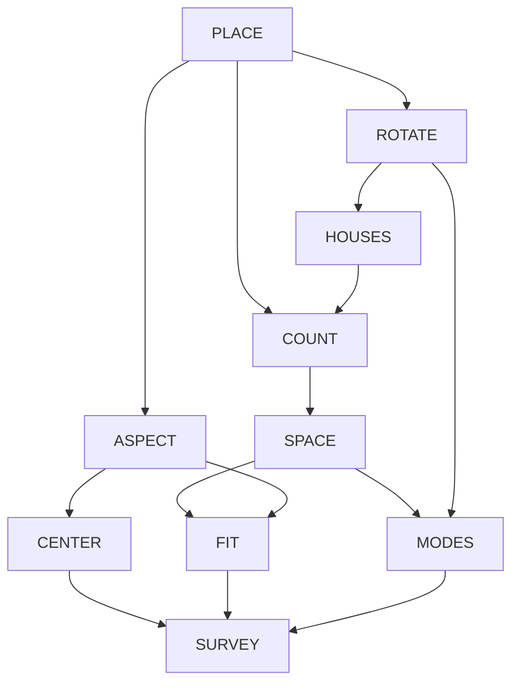

# Around the Zodiac — Coordinates, Aspects, and Hidden Placements

2026-10-26 · [Build method](../../build-method.md)
[Rubric](rubric.md) · [Lecture map](../../course-map.md)
[Historical original](../../old/ANALOGY_ASTROLOGICAL_WHEEL.md) · [Main bible](../../../SHOW_BIBLE.md)

Source pages and topic definitions are maintained only in the
[course map](../../course-map.md). This reference owns its mechanisms, examples,
and limits; its topic table is a navigation index, not a duplicate page register.

## 1. The strongest case and the actual scene

Move a glyph from one side of a wheel to the opposite side. A report of opposite
sector totals does not change. The placement changed; the report did not. A familiar
circular chart exposes the distinction between a position, its coordinates, and
a compressed summary of positions.

Draw the zodiac ring; mark longitudes; draw aspect chords; choose a house system;
rotate a reference line; count glyphs and compare wheels. These are specific chart
operations, not personality labels attached to abstract mathematics.
**The advantage:** Angular geometry is already visible, basis changes can be drawn,
and a real rotation supplies a memorable counterexample to a real eigenbasis.
**The burden:** Keep longitudes, Cartesian vectors, sign bins, houses, and count
records distinct. The metaphor concerns chart geometry and conventions, not
scientific validation of astrological personality or prediction claims.

Use tropical signs beginning at 0°,30°,...,330° in Aries-to-Pisces order. Draw
increasing longitude counterclockwise from a mathematical positive X axis; actual
chart displays may orient differently. Aspect labels include conjunction 0°,
sextile 60°, square 90°, trine 120°, opposition 180°.
[Astrodienst aspects](https://www.astro.com/astrology/in_aspect_r.htm?lang=e&nhor=28),
[chart-wheel guide](https://cafeastrology.com/articles/how-to-understand-read-chart-wheel.html).

For a sign-to-house permutation choose whole-sign houses: Ascendant 45° is Taurus
15°, selecting Taurus as the whole first house, whose sign boundary is 30°, not 45°.
Equal houses starting at the Ascendant are a different convention.
[CHANI whole-sign explanation](https://www.chani.com/astro-education/what-whole-sign-houses-are-and-why-we-use-them),
[Astrodienst equal-house distinction](https://www.astro.com/astrowiki/en/Equal_House_System).
All placements and datasets below are invented exercises, not an actual person's
chart, ephemeris calculation, or evidence about temperament.

## 2. Permanent objects and representation limits

| Object | Meaning | Boundary |
| --- | --- | --- |
| θ | Longitude modulo 360° | Not a real number line suitable for all ordinary averages. |
| `u(θ)` | Unit Cartesian marker `(cos θ,sin θ)` | Not a personality vector or a histogram. |
| Sign/house counts | Twelve declared bins and convention | Houses are not always interchangeable with signs. |
| `x=(q0,q1,q2,q3)` | Counts in four 90° quadrants anchored at 0°,90°,180°,270° | A deliberate coarse report, not the twelve houses. |
| `A x` | Opposite-quadrant sums and computed total | An invented reporting rule, not standard astrological interpretation. |
| `P` | Quarter-turn permutation of four count bins | Different from a 2×2 rotation acting on marker positions. |
| Dataset | Rows are declared wheels/marker collections; columns counts | Different chosen marker sets need not have equal totals. |

The circle itself is not a real vector space; its Cartesian embedding sits in
one. Count histograms are nonnegative integers, with a stated real extension.
Use radians consistently in code or convert degree inputs before trigonometry.

## 3. Exact recurring anchors

### ASPECT — Plot the glyph and measure its chord

`u(θ)^T u(φ)=cos(θ-φ)`. Square: dot 0; opposition: dot −1; trine: dot −1/2;
sextile: dot +1/2. Chord length is `sqrt(2-2 cos(θ-φ))`, not the angle itself.
For Taurus 15° (longitude 45°), `u=(1,1)/sqrt(2)`.
A favorable traditional description is not positive covariance; “square aspect”
is not the definition of a square matrix. Opposite unit vectors sum to zero even
though neither glyph disappears from the chart.

### ROTATE — Re-express a position without advancing the planets

`R(α)=[[cos α,-sin α],[sin α,cos α]]`.
Active rotation uses R(α); passive rotation of axes uses R(−α). State which.
`R^T R=I`, inverse transpose, determinant 1: distances/areas in the drawing are
preserved. `R90=[[0,-1],[1,0]]`, trace 0, eigenvalues ±i over C and no real
eigenvector. `R180=-I` instead has eigenvalue −1 for every nonzero real direction.
A perfectly good real map need not have a real eigenbasis. This is a strong formal
counterexample rooted in a picture the student can recognize.

An invertible 12-bin whole-sign house relabeling is a permutation. It does not
reposition the planets or model arbitrary Placidus/equal-house boundaries. Rebinning
into fewer counts is information loss, not a basis change.

### COUNT — Compress the wheel and expose all four spaces

Let `x=(3,2,2,1)` count four quadrants. Report opposite sums and a computed total:

```text
A=[[1,0,1,0],[0,1,0,1],[1,1,1,1]]
A x=(5,3,8)
```

The report hides shifts between opposite quadrants. Rank 2; null basis
`n1=(1,0,-1,0)`, `n2=(0,1,0,-1)`; row basis `(1,0,1,0),(0,1,0,1)`;
column space `y3=y1+y2`; left null span `(1,1,-1)`.
Row/null live in R4, column/left-null in R3.
All real solutions are `(t,s,5-t,3-s)`; feasible count histograms require integer
`0≤t≤5`, `0≤s≤3`. Equal reports are not equal charts, placements, or interpreted meanings.
A is rectangular: no determinant or two-sided inverse.

For a square invertible reporting coordinate example, retain just the two opposite
sums `r=(r1,r2)` and convert to `(r1+r2,r1-r2)` via
`C=[[1,1],[1,-1]]`, determinant −2, inverse `C/2`.
This preserves those two sums, not the original four-bin placement information.
Determinant is signed scaling in the chosen numeric record space, not astrological power.

### FIT — Repair an inconsistent total under a declared metric

For `b=(5,3,9)`, equal-weight orthogonal projection onto C(A) gives
`p=(16/3,10/3,26/3)`, residual `e=(-1/3,-1/3,1/3)`; `A^T e=0`.
If the bins are trusted and only the total is wrong, replacing 9 by 8 is a different
constrained correction. Fractional fitted counts do not mean fractional planets.

Gram–Schmidt on the independent report directions `(1,0,1)`, `(0,1,1)` gives
`q1=(1,0,1)/sqrt(2)`, `q2=(-1,2,1)/sqrt(6)`. Q yields projector `QQ^T`.
A has dependent columns: use an independent basis before inverse normal equations.
This geometry is in report space, not the physical zodiac ring.

### MODES — Average opposite bins and separate sums from differences

Define `P x=(q3,q0,q1,q2)`; `P^4=I`, `P^{-1}=P^T`, trace 0.
`S=(I+P^2)/2` averages each opposite pair. It is symmetric and idempotent, with
+1 eigenspace spanned by `(1,0,1,0),(0,1,0,1)`, zero eigenspace spanned by n1,n2.
Choose normalized versions to make an orthonormal eigenbasis; `trace(S)=2`, determinant 0.
The unit circle, 2D rotation, 4D histogram permutation, and S are different objects.

Use the two-row sum report `J=[[1,0,1,0],[0,1,0,1]]` for SVD.
Singular values are `sqrt(2),sqrt(2)`; output directions e1,e2; input directions
`(1,0,1,0)/sqrt(2)`, `(0,1,0,1)/sqrt(2)`; remaining input directions are normalized n1,n2.
Full U/Σ/V shapes: 2×2, 2×4, 4×4. Compact: 2×2, 2×2, 4×2.
Rank-1 truncation has squared Frobenius error 2; neither tied sum is uniquely the
most important. Symmetric S/Gram maps have the real spectral theorem; arbitrary
real rotations/record maps need not have a real eigenbasis.

### SURVEY — Circular boundaries first, then ordinary statistics

The arithmetic mean of raw angles 359° and 1° is 180°, which is misleading for
these nearby directions. Their mean unit vector points to 0°; opposite directions
have zero resultant and no defined mean direction. State the circular-data rule.

For the course's ordinary covariance/PCA, explicitly switch to invented rows of
opposite-sum counts `(5,4),(4,5),(3,2),(2,3)`. Mean `(3.5,3.5)`; centered Gram
`[[5,3],[3,5]]`; sample covariance `[[5/3,1],[1,5/3]]` and standard deviations
`sqrt(5/3)`. Unit principal directions `(1,1)/sqrt(2)`, `(1,-1)/sqrt(2)`;
eigenvalues `8/3,2/3`; centered singular values `sqrt(8),sqrt(2)`; first share 80%.
Center columns, state scaling, reconstruct, restore the mean. Different totals
refer to chosen marker collections, not a claimed changing count of planets in
an otherwise fixed chart. PCA describes records, not validated personality traits.

For the recommendation subsection, explicitly change to viewer-by-chart-artwork
ratings or a declared withheld-entry chart table. Ratings and marker coordinates
are different data. Missing entries are not zeros; SVD alone does not validate
prediction or horoscope forecasting.

## 4. Action cards and chapter route

| Card | Actual action/observation | Callback and limit |
| --- | --- | --- |
| PLACE | Put a glyph at a specified sign and degree | Longitude, Cartesian marker, and one-hot bin record are distinct. |
| ASPECT | Draw and measure a chord between markers | Angle versus chord distance; opposition is not orthogonality. |
| ROTATE | Move reference axes or rotate the drawing | Active/passive choice and a real-eigenbasis counterexample. |
| HOUSES | Label signs from a selected whole-sign first house | Not a universal model of all house systems. |
| COUNT | Recount twelve sign bins into quadrants and opposite sums | Product maps and explicit information loss. |
| SPACE | Move counts between opposite quadrants unnoticed by A | Four spaces and full solution family from COUNT. |
| FIT | Reconcile a total with its component sums | Projection in report coordinates, not moving real planets. |
| MODES | Average opposite bins and compare retained/lost directions | S's eigenstructure versus J's rectangular SVD. |
| CENTER | Compare positions across the 0° seam | Circular mean is not raw-angle arithmetic. |
| SURVEY | Compare explicitly chosen marker records | Centered count statistics/PCA; no causal personality inference. |

## 5. Chapter routes and topic mechanisms

Every topic below is an editorial destination, not a completed textbook passage.
The linked topic IDs resolve to the sole authoritative PDF-page register. The statistics/PCA bridge comes from the exam-topic list;
it is not falsely attributed to Week 5. Supporting problem-number mapping and
image-only lecture-page review remain open in the shared map.

| Chapter | Topic groups | Connected teaching route |
| --- | --- | --- |
| Week 1 | W1.01–W1.08 | Plot longitudes and unit markers, compute square/opposition dot products, define count vectors and chart/report matrices, and keep circular, Cartesian, and count representations distinct. |
| Week 2 | W2.01–W2.04 | Solve quadrant-count equations; show full solution and inconsistent total. Use C and R for determinant/cofactor/inverse examples; rectangular A has no determinant. |
| Week 3 | W3.01–W3.09 | Derive all four spaces, rank/nullity, span, basis/dimension and feasible histogram families; distinguish invertible frame/whole-sign relabeling from aggregation. |
| Week 4 | W4.01–W4.06 | Project inconsistent reports, derive residual geometry and rank conditions, compute Gram–Schmidt in report space, and use normalized chart axes to illustrate orthonormality. |
| Week 5 | W5.01–W5.07 | Contrast R90 real-field failure with symmetric opposite averaging S. Derive J singular modes, tied-value freedom, full/compact/truncated shapes, and the distinct rating-table extension. |
| Exam-topic bridge | B.01–B.02 | Explain the angular seam before switching to ordinary count data; center, compute sample statistics/covariance/PCA, reconstruct and restore the mean without personality claims. |

### Topic mechanisms

| Topic ID | Course content | Local mechanism and mathematical landing |
| --- | --- | --- |
| [W1.01](../../course-map.md#w1-01) | Vector entries, dimensions, representations | PLACE/COUNT: glyph coordinates. |
| [W1.02](../../course-map.md#w1-02) | Addition, scaling, linear combinations | COUNT: add marker records. |
| [W1.03](../../course-map.md#w1-03) | Dot product, properties, cosine/angle | ASPECT: square versus opposition. |
| [W1.04](../../course-map.md#w1-04) | Norm, length, unit vectors, normalization | PLACE/ASPECT: unit circle. |
| [W1.05](../../course-map.md#w1-05) | Matrix entries/shapes, addition/scaling | COUNT/ROTATE: bin reporting matrix. |
| [W1.06](../../course-map.md#w1-06) | Diagonal, identity, symmetric matrices; trace | ROTATE/MODES: I, S, diagonal sum. |
| [W1.07](../../course-map.md#w1-07) | Transpose | ROTATE/FIT: orthogonal inverse versus transpose. |
| [W1.08](../../course-map.md#w1-08) | Matrix-vector/products; multiplication properties | ROTATE/HOUSES/COUNT: compose maps. |
| [W2.01](../../course-map.md#w2-01) | Systems, column picture, augmented equations | SPACE: recover quadrant counts. |
| [W2.02](../../course-map.md#w2-02) | Gaussian elimination, row operations, echelon/pivots, back substitution | SPACE/FIT: eliminate count equations. |
| [W2.03](../../course-map.md#w2-03) | Determinant, properties, Laplace/cofactors, geometry | ROTATE/COUNT: signed drawing area. |
| [W2.04](../../course-map.md#w2-04) | Inverse, invertibility tests, Gauss–Jordan, cofactor formulas | ROTATE/HOUSES: reverse relabeling, not aggregation. |
| [W3.01](../../course-map.md#w3-01) | Vector spaces, closure, subspaces/counterexamples | SPACE: real records, not unit circle. |
| [W3.02](../../course-map.md#w3-02) | Column and null spaces | SPACE: opposite-bin shifts hidden. |
| [W3.03](../../course-map.md#w3-03) | Four fundamental subspaces | SPACE: four bins versus three reports. |
| [W3.04](../../course-map.md#w3-04) | Complete solution, particular plus null, free variables | SPACE: (t,s,5-t,3-s). |
| [W3.05](../../course-map.md#w3-05) | Rank, pivot computation | SPACE: rank 2 opposite sums. |
| [W3.06](../../course-map.md#w3-06) | Linear independence and dependence | SPACE: duplicate opposite-bin signatures. |
| [W3.07](../../course-map.md#w3-07) | Span and membership | SPACE: total equals opposite sums. |
| [W3.08](../../course-map.md#w3-08) | Basis, dimension, natural/alternative bases | PLACE/SPACE: plane axes versus bin basis. |
| [W3.09](../../course-map.md#w3-09) | Change of basis | ROTATE/HOUSES: declared frame or permutation. |
| [W4.01](../../course-map.md#w4-01) | Orthogonality, paired four-space complements | ASPECT/SPACE: 90 degrees and complement pairs. |
| [W4.02](../../course-map.md#w4-02) | Line/subspace projection, residual geometry | FIT: impossible count total. |
| [W4.03](../../course-map.md#w4-03) | Invertibility of A transpose A; proof conditions | FIT: dependent report versus independent basis. |
| [W4.04](../../course-map.md#w4-04) | Least squares, line fit, normal equations | FIT/SURVEY: noisy counts; declared trend. |
| [W4.05](../../course-map.md#w4-05) | Orthonormal vectors/bases, simplified projections | ASPECT/MODES: axes and symmetric averaging. |
| [W4.06](../../course-map.md#w4-06) | Gram–Schmidt, worked example | FIT: orthogonalize report plane. |
| [W5.01](../../course-map.md#w5-01) | Two-dimensional transformations | ROTATE: markers versus frame. |
| [W5.02](../../course-map.md#w5-02) | Eigenvalues/eigenvectors, computation, eigenspaces | ROTATE/MODES: R90 versus symmetric S. |
| [W5.03](../../course-map.md#w5-03) | Eigendecomposition and diagonalization | MODES: symmetric S; real rotation limitations. |
| [W5.04](../../course-map.md#w5-04) | Real symmetric spectral theorem | MODES: opposite-bin averaging S. |
| [W5.05](../../course-map.md#w5-05) | SVD, formulation, A transpose A, computation | MODES: J sums versus differences. |
| [W5.06](../../course-map.md#w5-06) | Truncated SVD, dimension reduction | MODES/SURVEY: tied modes and loss. |
| [W5.07](../../course-map.md#w5-07) | Recommendation and user-rating example | SURVEY: chart-table completion bridge. |
| [B.01](../../course-map.md#b-01) | Mean, variance, standard deviation, covariance | CENTER/SURVEY: circular boundary then count data. |
| [B.02](../../course-map.md#b-02) | PCA, covariance eigenvectors, centered SVD | SURVEY: dominant chart-record variation. |

### Formal precision and countercases to preserve

State dimensions and hypotheses before each formula. Cofactor/inverse/determinant
rules require a square matrix; inverse normal equations require independent columns.
The zero vector cannot be normalized or assigned a direction angle. With
`J=[[1,1],[0,1]]`, the only eigenvalue is 1 and the eigenspace is span((1,0)); J
has no eigenbasis. For I2, (1,0) and (1,1) are both eigenvectors with eigenvalue 1
but are not perpendicular: a symmetric matrix admits an orthonormal eigenbasis,
not automatic orthogonality of all arbitrarily chosen vectors in a repeated eigenspace.
Use the proper rectangular `Sigma transpose Sigma` and `Sigma Sigma transpose`.
These formal examples supplement the physical scene rather than pretending every
exception has a literal craft/biological/chart analogue.

## 6. Answered transfer anchors, one per chapter

These are explicitly reused mathematical anchors, not a validated fresh problem
bank. Ask the questions without requiring analogy vocabulary in the answer.
A future independent transfer bank must change numbers/representations and remove
method cues. Each feedback note identifies a specific misconception to revisit.

### W1 transfer

**Question:** Compare u(0) dot u(90), u(0) dot u(180), and the 90-degree chord length.

**Checked answer:** 0; -1; sqrt(2). Unit marker norms are 1.

**Diagnostic feedback:** Opposition is not orthogonality; angle and chord length are different quantities.

### W2 transfer

**Question:** For C=[[1,1],[1,-1]], convert opposite sums (5,3) to total/contrast, then recover the sums.

**Checked answer:** C(5,3)=(8,2); C inverse=C/2 gives (5,3); determinant -2.

**Diagnostic feedback:** This reversible two-number description does not recover four original quadrant counts.

### W3 transfer

**Question:** Solve A x=(5,3,8), state rank/nullity, and give the physical count constraints.

**Checked answer:** (t,s,5-t,3-s); rank 2, nullity 2; integer 0<=t<=5 and 0<=s<=3.

**Diagnostic feedback:** The unit circle is not this real vector space; histogram feasibility is a separate constraint.

### W4 transfer

**Question:** Project report (5,3,9) and identify the residual direction.

**Checked answer:** p=(16/3,10/3,26/3), e=(-1/3,-1/3,1/3), parallel to (1,1,-1); A transpose e=0.

**Diagnostic feedback:** Projection takes place in report space; it is not moving a planet to repair a chart.

### W5 transfer

**Question:** Give real eigenvectors of R90 if any; give J singular values, compact shapes and rank-1 squared error.

**Checked answer:** R90 has no nonzero real eigenvectors; J values sqrt(2),sqrt(2); U 2x2, Sigma 2x2, V 4x2; error 2.

**Diagnostic feedback:** A real matrix need not have a real eigenbasis. Tied singular values do not choose a unique best direction.

### B transfer

**Question:** Explain the problem with averaging 359 and 1 arithmetically; then state SURVEY leading variance share.

**Checked answer:** Raw arithmetic gives 180 degrees; the mean unit-vector direction is 0 degrees. SURVEY count PCA first share is 80%.

**Diagnostic feedback:** Circular direction statistics and ordinary count covariance need separate, explicit representations.

The knitting/crochet, biology, astrology, and pottery references deliberately share the same centered 4-by-2 numerical
pattern for their statistics anchors, with different domain baselines. This holds
the arithmetic difficulty fixed for comparison; it is not empirical evidence of a
shared physical distribution or a claim that all domains have the same covariance.

## 7. Connected graph, accessible route, and cross-lens links

Arrows mean an explanatory callback, not equality of physical mechanisms.
The action-card table and chapter routes give the accessible prose counterpart.



The path runs from an actual action/observation to its record, then constraints,
hidden distinctions, fitting, decomposition, and repeated-record variation.
Use the same topic IDs to translate to the other canons. Yarn count cancellation,
biology's hidden infection distinction, wheel aggregation, pottery's hidden batch
history, light's invisible spectral difference, and shadow depth all instantiate
`A(x+v)=Ax` for `Av=0`, with different matrices and physical feasible domains.
A coordinate change is invertible within its record; observation loss is not.
Each chapter use must state source ID, local action, object/space meanings, exact
mathematics, boundary, callback, and a formal question.

## 8. Diagram brief and strongest objection

Draw sign boundaries, chosen house convention, degree markers, and aspect chords with labels. Add a separate four-bin count report. Show an invisible opposite-bin redistribution and a quarter-turn frame change as different actions; do not reuse one arrow to mean both.

Use captions, text labels, patterns, and numeric records rather than color alone. Follow the textbook palette without assigning semantic red/yellow roles inconsistently. Figures remain unrendered and untested.

**Strongest objection:** Astrological interpretation does not establish a scientific causal model, and wheel conventions vary.

**Response:** Use sourced chart conventions and explicitly invented geometric/count exercises; specify zodiac and house system. Let the wheel teach rotations, observations, and circular-data boundaries without turning a matrix into evidence of personality or prediction.

## 9. Evidence and remaining work

This canon has exact numerical anchors, the six chapter routes, all 36
topic mechanisms linked to the authoritative source register, answered anchor questions, graph, diagram brief, and
its own rubric. See [verification](../../verification/rebuild.md) for evidence and
[development history](../../verification/history.md) for prior versions.
Source-backed domain facts are separated from invented parameters/models/data.
Calculations, topic IDs, graph structure, and links are checked; that is not
independent domain or mathematical review.

Still open: exact supporting problem references, complete chapter proofs and fresh
transfer bank, formal edge-case development, image-only lecture review, rendered
figures and accessibility, qualified independent review, and observed learner
transfer. No physical demonstration, measured dataset, chapter build, student grade,
or empirical effectiveness result is claimed. A complete editorial blueprint is
not a completed textbook or evidence that a student is ready for the exam.
