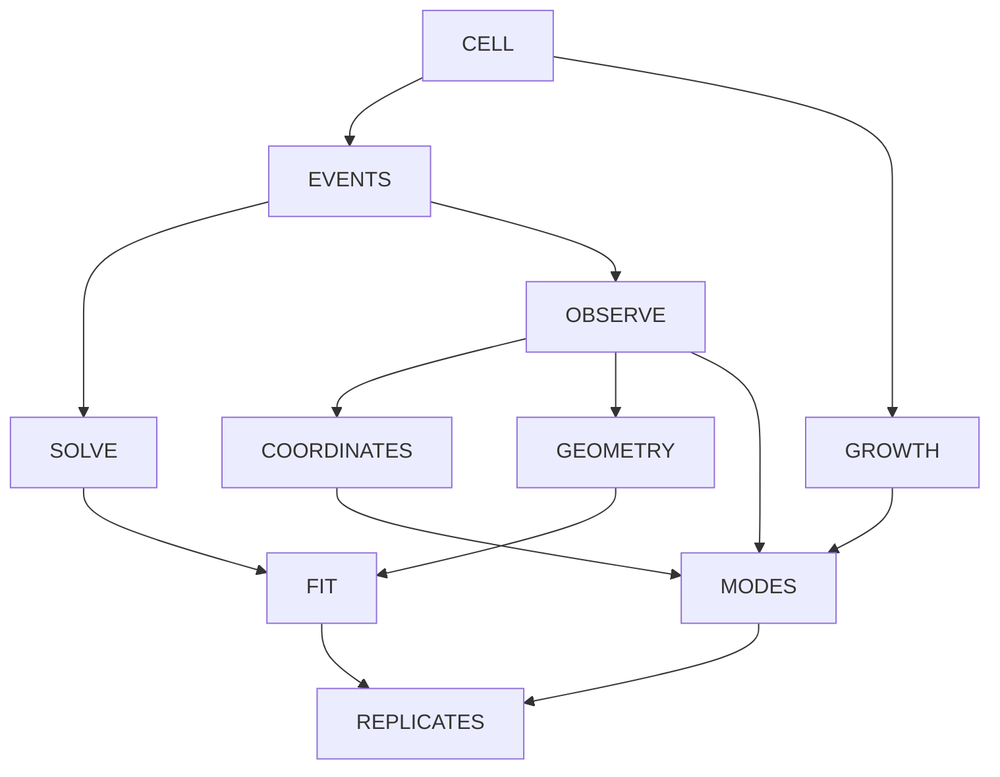

# Cells, Phages, and the Information a Count Can Hide

2026-10-26 · [Build method](../../build-method.md)
[Rubric](rubric.md) · [Lecture map](../../course-map.md)
[Historical original](../../old/ANALOGY_BACTERIA_VIRUSES.md) · [Main bible](../../../SHOW_BIBLE.md)

Source pages and topic definitions are maintained only in the
[course map](../../course-map.md). This reference owns its mechanisms, examples,
and limits; its topic table is a navigation index, not a duplicate page register.

## 1. The strongest case and the actual scene

A report counts the same number of bacterial cells before and after a change,
but some cells have become infected. The report is not necessarily wrong: it
may never have recorded infection status. A hidden biological distinction gives
the abstract null space a specific meaning.

Follow cell division, a bacteriophage infecting a susceptible cell, an infected
cell producing progeny, and lytic release. Bacteria are cells; viruses use host
components to replicate. This is an interacting system, not a universal contest
between “good bacteria” and “bad viruses.”
[NHGRI bacteria](https://www.genome.gov/genetics-glossary/Bacteria),
[NHGRI virus](https://www.genome.gov/genetics-glossary/Virus).
[OpenStax growth](https://openstax.org/books/microbiology/pages/9-1-how-microbes-grow)
and [viral life cycles](https://openstax.org/books/microbiology/pages/6-2-the-viral-life-cycle)
support division and the chosen lytic-phage setting; not every phage follows only
this cycle. No culture protocol, growth conditions, or medical inference is supplied.

**Why it can carry the book:** The difference between an event, a state, and an
observation becomes unavoidable. The same mechanism motivates equations, hidden
states, coordinates, inference, residuals, and data variation. Its main burden is
to keep toy event accounting separate from nonlinear infection dynamics.

All matrices, yields, reports, and datasets below are invented teaching models.
They are not measured assays, empirical rates, universal burst sizes, or predictions.

## 2. Permanent objects and limits

| Symbol/object | Meaning | Boundary |
| --- | --- | --- |
| `z=(B,I,V)` | Susceptible uninfected cells, infected cells, free phage particles | An infected cell is not itself a free virion. |
| `x=(d,a,l)` | Division, successful infection, lysis event counts | Counts require starting resources and feasible ordering. |
| `E x` | Net compartment changes from counted events | Not rates, timestamps, or a complete biological history. |
| `M z` | Declared report of intact cells, free particles, their computed sum | The last entry is a redundant reporting number, not a new assay. |
| `C z` | Total-cell/infected/free-particle coordinates | Coordinate change is not a physical infection. |
| Replicate data | Rows repeated reports; columns explicitly named | Variation is not causation or clinical risk. |

Physical counts are nonnegative integers. Real/signed extensions support algebra;
negative organisms are not physical. Cell and particle counts are distinct quantities;
a Euclidean metric treating their numeric changes equally is a stated convention,
not a biologically justified universal distance.

## 3. Exact recurring anchors

### EVENTS — Division, infection, and lysis as an event ledger

One modeled division changes B by +1: one cell has been replaced by two, not two
extra cells added. One successful infection moves a susceptible cell to I and
consumes one free particle in this compartment model. One lysis removes one I
and releases a chosen four V. Four is an illustrative yield, not a factual constant.

```text
E=[[1,-1,0],[0,1,-1],[0,-1,4]]
Δz=E(d,a,l)^T
E(5,2,1)^T=(3,1,2)^T
```

Endpoint equations are `ΔB=d-a`, `ΔI=a-l`, `ΔV=-a+4l`.
Elimination gives `l=(ΔV+ΔI)/3`, `a=ΔI+l`, `d=ΔB+a`.
`det(E)=3` and
`E^{-1}=[[1,4/3,1/3],[0,4/3,1/3],[0,1/3,1/3]]`.
For `(3,1,2)` the counts are d=5,a=2,l=1. An algebraically valid solution must
still pass integer/nonnegative and state-resource checks. Endpoint inversion
cannot reverse cell lysis or reconstruct event order.

### OBSERVE — Two populations, the same report

Declare a report with total intact cells B+I, free particles V, and their computed sum:

```text
M=[[1,1,0],[0,0,1],[1,1,1]]
M(5,3,12)^T=M(6,2,12)^T=(8,12,20)^T
```

The report cannot distinguish replacement of one infected cell by one uninfected
cell in the state record. It does not prove those cells actually underwent a
particular reverse biological event.

All real states producing this report are `(8-t,t,12)`. Physical counts restrict
t to integers 0 through 8. Equal reports are not equal infection states.

**Four spaces:** rank 2; `N(M)=span((1,-1,0))`;
`C(M)={y:y3=y1+y2}`; row space spans `(1,1,0),(0,0,1)`;
`N(M^T)=span((1,1,-1))`. Input null vectors change states without changing reports;
left-null vectors test output consistency. They belong to different spaces.
`det(M)=0`; the computed total adds no independent measurement.

### COORDINATES — Change description without losing information

Use `w=(B+I,I,V)=Cz`, `C=[[1,1,0],[0,1,0],[0,0,1]]`, determinant 1.
Recover `B=w1-w2`, `I=w2`, `V=w3`. This is invertible, unlike M.
Report from w using `M C^{-1}w`; event changes use `C E x`. Matrix products compose
maps with explicit intermediate spaces. Neither C nor C inverse is a biological
process, and a coordinate inverse cannot restore information lost by M.

### FIT — A redundant total contradicts its components

For report `b=(8,12,21)`, equal-weight projection onto C(M) gives
`p=(25/3,37/3,62/3)`, `e=(-1/3,-1/3,1/3)`, with `M^T e=0`.
If only the total is suspected, correcting it to 20 while preserving the components
is a different constrained choice. Fractional fitted values are estimates/records,
not instructions to create fractional organisms.

Orthogonalize report columns `mB=(1,0,1)`, `mV=(0,1,1)`:
`q1=(1,0,1)/sqrt(2)`, `q2=(-1,2,1)/sqrt(6)`. Their Q gives projector `QQ^T`.
A column basis has independent columns; M does not. Use the rank hypothesis before
writing inverse normal equations. Redundant reported totals change equal-weight
geometry and must not masquerade as independent assay evidence.

### MODES — Lost distinctions and idealized changes

Use the independent two-output report `H=[[1,1,0],[0,0,1]]`.
Singular values `sqrt(2),1`; right directions `(1,1,0)/sqrt(2)` and `(0,0,1)`;
left directions `(1,0)`, `(0,1)`; right null unit vector `(1,-1,0)/sqrt(2)`.
Full U/Σ/V shapes: 2×2, 2×3, 3×3. Compact: 2×2, 2×2, 3×2.
Rank-1 truncation discards free-particle reporting, squared Frobenius error 1.
This ranking depends on scaling; it is not a ranking of biological importance.
`H^T H` is symmetric, with eigenvalues 2,1,0 and an orthonormal eigenbasis.

For a separate explicitly idealized window with one synchronous susceptible-cell
division and no infection/lysis, `G=diag(2,1,1)` is a same-space count update.
Eigenvalues 2,1,1, coordinate eigenvectors, determinant 2, trace 4. It does not say
viruses reproduce without hosts or all cells actually divide synchronously.
Encounter terms involving `B V` in other models are nonlinear. Do not promote
this special window or E's event ledger into a universal linear time-evolution law.

### REPLICATES — Measure variation in repeated records

Invented rows `(total intact cells,free particles)`:
`(13,22),(12,23),(11,20),(10,21)`. Mean `(11.5,21.5)`; centered Gram matrix
`[[5,3],[3,5]]`; sample covariance `[[5/3,1],[1,5/3]]` and standard deviations
`sqrt(5/3)`. Covariance eigenvalues `8/3,2/3`, unit directions `(1,1)/sqrt(2)`,
`(1,-1)/sqrt(2)`; centered singular values `sqrt(8),sqrt(2)`, first share 80%.
State count scaling, center columns, reconstruct and restore the mean.
PCA cannot infer infection status erased by M or establish causes of variation.

For the recommendation subsection, a declared sample-by-assay table with withheld
entries gives a matrix-completion extension, not clinical treatment advice.
If ratings are used, state whose ratings and what is rated. Missing values are
not zeros; ordinary SVD alone does not validate prediction from incomplete data.

## 4. Mechanism cards and chapter route

| Card | Actual mechanism/observation | Callback and limit |
| --- | --- | --- |
| CELL | A bacterial cell divides; phage production uses a host | Separates cell division from virus replication before counting. |
| EVENTS | Count division, successful infection, and lysis | E accounts for net events, not their probability/rate. |
| SOLVE | Reconstruct event counts from a chosen endpoint change | Integer/resource constraints still apply. |
| OBSERVE | Count cells without recording their infection status | M has a specific blind distinction, not universal assay behavior. |
| COORDINATES | Report total/infected versus susceptible/infected coordinates | Invertible description versus lost information. |
| GEOMETRY | Normalize/orthogonalize declared report directions | Geometry belongs to records with stated units/weights. |
| FIT | Reconcile component and total reports | Residual consistency is not proof of true biological counts. |
| GROWTH | A deliberately restricted count-update window | Host-dependent, nonlinear dynamics remain outside the simple update. |
| MODES | Separate observable state combinations from hidden ones | Singular vectors need not identify separate species or mechanisms. |
| REPLICATES | Compare repeated compartment reports | Statistics/PCA on measurements, not a diagnosis or causal explanation. |

## 5. Chapter routes and topic mechanisms

Every topic below is an editorial destination, not a completed textbook passage.
The linked topic IDs resolve to the sole authoritative PDF-page register. The statistics/PCA bridge comes from the exam-topic list;
it is not falsely attributed to Week 5. Supporting problem-number mapping and
image-only lecture-page review remain open in the shared map.

| Chapter | Topic groups | Connected teaching route |
| --- | --- | --- |
| Week 1 | W1.01–W1.08 | Count compartments and net events; distinguish E event accounting, M reporting, real signed changes, weighted dot products, and declared record geometry. |
| Week 2 | W2.01–W2.04 | Eliminate endpoint equations to recover d,a,l, verify E inverse/determinant, and contrast M nonuniqueness. Physical count/resource constraints remain separate. |
| Week 3 | W3.01–W3.09 | Derive M four spaces, full family, independence/rank, real report plane, and total/infected coordinate change. State why coordinate inversion cannot undo measurement loss. |
| Week 4 | W4.01–W4.06 | Fit inconsistent component/total reports, show both orthogonal-complement pairs, derive the independent report-plane basis and Gram–Schmidt, and declare rank assumptions for line fitting. |
| Week 5 | W5.01–W5.07 | Use the limited G update for eigenvalues and H for singular modes, full/compact/truncated dimensions and information loss. Use symmetric Gram maps for the spectral theorem, not a universal infection law. |
| Exam-topic bridge | B.01–B.02 | Center repeated count reports and derive variance, covariance, standard deviations, eigen/PCA and centered SVD; separate causal biology and withheld-table extensions from statistics. |

### Topic mechanisms

| Topic ID | Course content | Local mechanism and mathematical landing |
| --- | --- | --- |
| [W1.01](../../course-map.md#w1-01) | Vector entries, dimensions, representations | CELL/EVENTS: B,I,V counts. |
| [W1.02](../../course-map.md#w1-02) | Addition, scaling, linear combinations | EVENTS: sum event columns. |
| [W1.03](../../course-map.md#w1-03) | Dot product, properties, cosine/angle | GEOMETRY: report pairing. |
| [W1.04](../../course-map.md#w1-04) | Norm, length, unit vectors, normalization | GEOMETRY: normalize record. |
| [W1.05](../../course-map.md#w1-05) | Matrix entries/shapes, addition/scaling | EVENTS/OBSERVE: event/report maps. |
| [W1.06](../../course-map.md#w1-06) | Diagonal, identity, symmetric matrices; trace | GROWTH/MODES: diagonal window, Gram map. |
| [W1.07](../../course-map.md#w1-07) | Transpose | FIT/MODES: report-residual pairing. |
| [W1.08](../../course-map.md#w1-08) | Matrix-vector/products; multiplication properties | EVENTS/COORDINATES: M E and coordinate map. |
| [W2.01](../../course-map.md#w2-01) | Systems, column picture, augmented equations | SOLVE: endpoint event equations. |
| [W2.02](../../course-map.md#w2-02) | Gaussian elimination, row operations, echelon/pivots, back substitution | SOLVE: recover d,a,l. |
| [W2.03](../../course-map.md#w2-03) | Determinant, properties, Laplace/cofactors, geometry | SOLVE: det E versus det M. |
| [W2.04](../../course-map.md#w2-04) | Inverse, invertibility tests, Gauss–Jordan, cofactor formulas | SOLVE/COORDINATES: reconstruct records not biology. |
| [W3.01](../../course-map.md#w3-01) | Vector spaces, closure, subspaces/counterexamples | EVENTS/OBSERVE: real records not organisms. |
| [W3.02](../../course-map.md#w3-02) | Column and null spaces | OBSERVE: infection distinction hidden. |
| [W3.03](../../course-map.md#w3-03) | Four fundamental subspaces | OBSERVE: state versus report spaces. |
| [W3.04](../../course-map.md#w3-04) | Complete solution, particular plus null, free variables | OBSERVE/SOLVE: (8-t,t,12). |
| [W3.05](../../course-map.md#w3-05) | Rank, pivot computation | OBSERVE: rank 2 report. |
| [W3.06](../../course-map.md#w3-06) | Linear independence and dependence | OBSERVE: duplicate infection-status report columns. |
| [W3.07](../../course-map.md#w3-07) | Span and membership | OBSERVE: compatible total report. |
| [W3.08](../../course-map.md#w3-08) | Basis, dimension, natural/alternative bases | COORDINATES/GEOMETRY: compartments and report basis. |
| [W3.09](../../course-map.md#w3-09) | Change of basis | COORDINATES: total/infected versus B/I. |
| [W4.01](../../course-map.md#w4-01) | Orthogonality, paired four-space complements | OBSERVE/GEOMETRY: detectable and invisible. |
| [W4.02](../../course-map.md#w4-02) | Line/subspace projection, residual geometry | FIT: inconsistent component/sum report. |
| [W4.03](../../course-map.md#w4-03) | Invertibility of A transpose A; proof conditions | FIT: rank-deficient M versus chosen basis. |
| [W4.04](../../course-map.md#w4-04) | Least squares, line fit, normal equations | FIT/REPLICATES: noisy records. |
| [W4.05](../../course-map.md#w4-05) | Orthonormal vectors/bases, simplified projections | GEOMETRY: normalized report-plane basis. |
| [W4.06](../../course-map.md#w4-06) | Gram–Schmidt, worked example | GEOMETRY: orthogonalize report effects. |
| [W5.01](../../course-map.md#w5-01) | Two-dimensional transformations | GROWTH: chosen count window. |
| [W5.02](../../course-map.md#w5-02) | Eigenvalues/eigenvectors, computation, eigenspaces | GROWTH/MODES: idealized diagonal update. |
| [W5.03](../../course-map.md#w5-03) | Eigendecomposition and diagonalization | MODES: declared update and Gram maps. |
| [W5.04](../../course-map.md#w5-04) | Real symmetric spectral theorem | MODES: H transpose H. |
| [W5.05](../../course-map.md#w5-05) | SVD, formulation, A transpose A, computation | MODES: retained versus lost infection distinction. |
| [W5.06](../../course-map.md#w5-06) | Truncated SVD, dimension reduction | MODES/REPLICATES: lost report distinctions. |
| [W5.07](../../course-map.md#w5-07) | Recommendation and user-rating example | REPLICATES: declared assay-table completion bridge. |
| [B.01](../../course-map.md#b-01) | Mean, variance, standard deviation, covariance | REPLICATES: repeated compartment reports. |
| [B.02](../../course-map.md#b-02) | PCA, covariance eigenvectors, centered SVD | REPLICATES: dominant recorded count variation. |

### Formal precision and countercases to preserve

State dimensions and hypotheses before each formula. Cofactor/inverse/determinant
rules require a square matrix; inverse normal equations require independent columns.
The zero vector cannot be normalized or assigned a direction angle. With
`J=[[1,1],[0,1]]`, the only eigenvalue is 1 and the eigenspace is span((1,0)); J
has no eigenbasis. For I2, (1,0) and (1,1) are both eigenvectors with eigenvalue 1
but are not perpendicular: a symmetric matrix admits an orthonormal eigenbasis,
not automatic orthogonality of all arbitrarily chosen vectors in a repeated eigenspace.
Use the proper rectangular `Sigma transpose Sigma` and `Sigma Sigma transpose`.
These formal examples supplement the physical scene rather than pretending every
exception has a literal craft/biological/chart analogue.

## 6. Answered transfer anchors, one per chapter

These are explicitly reused mathematical anchors, not a validated fresh problem
bank. Ask the questions without requiring analogy vocabulary in the answer.
A future independent transfer bank must change numbers/representations and remove
method cues. Each feedback note identifies a specific misconception to revisit.

### W1 transfer

**Question:** Compute E(5,2,1); explain the first column mathematically.

**Checked answer:** (3,1,2). Division contributes (1,0,0): one parent is replaced by two daughters, a net +1.

**Diagnostic feedback:** Do not add two extra cells or infer event rates from an event-count matrix.

### W2 transfer

**Question:** Recover d,a,l for net change (3,1,2).

**Checked answer:** l=(2+1)/3=1; a=2; d=5. Verify E(5,2,1)=(3,1,2).

**Diagnostic feedback:** Inversion does not supply event order or prove physical feasibility without an initial state.

### W3 transfer

**Question:** Find all real states reported as (8,12,20), and both null spaces of M.

**Checked answer:** (8-t,t,12); input null span(1,-1,0), output left-null span(1,1,-1). Feasible t is an integer 0 through 8.

**Diagnostic feedback:** Do not interchange state-change directions with inconsistent-report detectors.

### W4 transfer

**Question:** Fit report (8,12,21) under equal squared-error weights.

**Checked answer:** p=(25/3,37/3,62/3), e=(-1/3,-1/3,1/3); M transpose e=0.

**Diagnostic feedback:** A redundant total is not independent evidence; equal weighting is an assumption, not a biological truth.

### W5 transfer

**Question:** Give H singular values, its unobserved state direction, compact shapes and rank-1 squared error.

**Checked answer:** sqrt(2),1; (1,-1,0)/sqrt(2); U 2x2, Sigma 2x2, V 3x2; error 1.

**Diagnostic feedback:** A stronger singular mode reflects the declared report/scaling; it is not biological importance.

### B transfer

**Question:** For REPLICATES, connect covariance eigenvalues to centered singular values and interpret the first mode.

**Checked answer:** 8/3,2/3 equal 8/3,2/3 from squared sqrt(8),sqrt(2) divided by 3; first mode explains 80% of observed variation.

**Diagnostic feedback:** Recorded covariance does not recover infection status hidden by M or establish a cause.

The knitting/crochet, biology, astrology, and pottery references deliberately share the same centered 4-by-2 numerical
pattern for their statistics anchors, with different domain baselines. This holds
the arithmetic difficulty fixed for comparison; it is not empirical evidence of a
shared physical distribution or a claim that all domains have the same covariance.

## 7. Connected graph, accessible route, and cross-lens links

Arrows mean an explanatory callback, not equality of physical mechanisms.
The action-card table and chapter routes give the accessible prose counterpart.



The path runs from an actual action/observation to its record, then constraints,
hidden distinctions, fitting, decomposition, and repeated-record variation.
Use the same topic IDs to translate to the other canons. Yarn count cancellation,
biology's hidden infection distinction, wheel aggregation, pottery's hidden batch
history, light's invisible spectral difference, and shadow depth all instantiate
`A(x+v)=Ax` for `Av=0`, with different matrices and physical feasible domains.
A coordinate change is invertible within its record; observation loss is not.
Each chapter use must state source ID, local action, object/space meanings, exact
mathematics, boundary, callback, and a formal question.

## 8. Diagram brief and strongest objection

Draw three distinct compartments B/I/V and event arrows with signed counts. Contrast two populations giving the same report. Show input null and output left-null directions in separate labeled spaces; a biological cartoon alone does not show this algebra.

Use captions, text labels, patterns, and numeric records rather than color alone. Follow the textbook palette without assigning semantic red/yellow roles inconsistently. Figures remain unrendered and untested.

**Strongest objection:** Biological replication and infection are nonlinear, stochastic, and more complicated than three counters.

**Response:** Use E only for counted net events and M only for a deliberately specified report. Never imply they are complete dynamics or real diagnostic assays. That boundary is the lesson: distinguish mechanistic state, counted change, and observable information.

## 9. Evidence and remaining work

This canon has exact numerical anchors, the six chapter routes, all 36
topic mechanisms linked to the authoritative source register, answered anchor questions, graph, diagram brief, and
its own rubric. See [verification](../../verification/rebuild.md) for evidence and
[development history](../../verification/history.md) for prior versions.
Source-backed domain facts are separated from invented parameters/models/data.
Calculations, topic IDs, graph structure, and links are checked; that is not
independent domain or mathematical review.

Still open: exact supporting problem references, complete chapter proofs and fresh
transfer bank, formal edge-case development, image-only lecture review, rendered
figures and accessibility, qualified independent review, and observed learner
transfer. No physical demonstration, measured dataset, chapter build, student grade,
or empirical effectiveness result is claimed. A complete editorial blueprint is
not a completed textbook or evidence that a student is ready for the exam.
