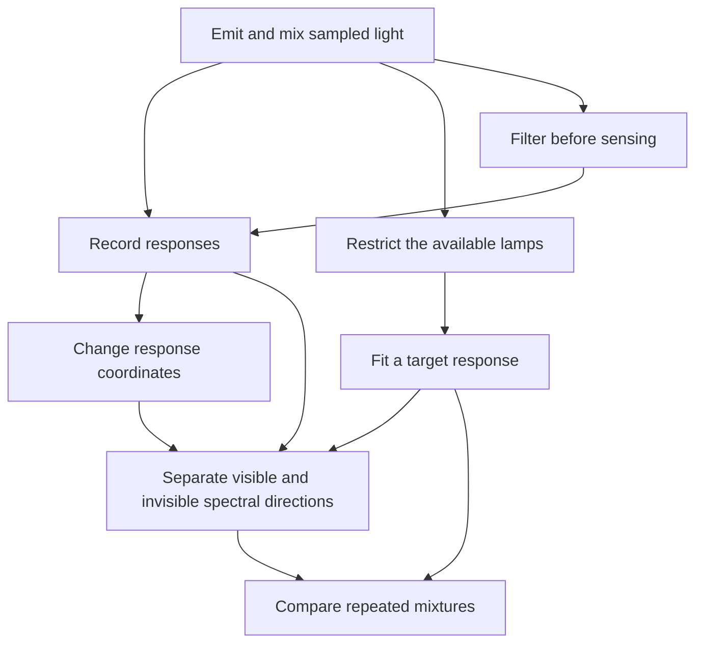

# Different Light, the Same Color

[Build method](../../build-method.md) · [Preserved earlier systems](../../old/README.md)

Connected analogy canon · 2026-10-26
[Rubric](rubric.md) · [Head-to-head comparison](../../comparisons/light-vs-shadows.md)
[Exact lecture/topic map](../../course-map.md) · [Main bible](../../../SHOW_BIBLE.md)

Source pages and topic definitions are maintained only in the
[course map](../../course-map.md). This reference owns its mechanisms, examples,
and limits; its topic table is a navigation index, not a duplicate page register.

## 1. The strongest case for this lens

You aim two light mixtures at a screen. Their measured color is identical. A
spectral instrument reveals that the mixtures contain different amounts of light
at different wavelengths. Nothing is wrong with the measurement: it retains some
distinctions and discards others.

That surprise gives the entire course a reason to exist. A vector describes what
is present; a matrix describes what an observer can record; a null space describes
what that observer cannot distinguish. Inversion asks whether the hidden thing can
be recovered. Projection asks for the closest achievable response. SVD names the
input distinctions and how strongly they survive. PCA asks which distinctions vary
most across observations.

**Thesis:** The observed record can be correct and incomplete at the same time.
The student learns to distinguish the world, its representation, and an observer's
measurement. The appearance of a familiar color hides an unusually deep inverse problem.

**Physical foundation:** Spectral power and tristimulus color records are distinct;
fixed matching responses map additive spectra to additive color coordinates, and
metameric spectra can share a color appearance under specified viewing conditions.
[PBRT: Color](https://pbr-book.org/4ed/Radiometry,_Spectra,_and_Color/Color).
The exact matrices below are **invented idealized sensor models**, not measured
CIE functions, an actual LED calibration, or a human-vision experiment. Equal toy
sensor responses do not establish human-perceived equality. Diagram colors and
hex codes are labels, not simulated spectra or proof of perceptual matching.

## 2. Permanent scene, objects, and boundaries

The scene has adjustable light sources, a white screen under fixed conditions,
four sampled wavelength bands, and three linear measurement channels. Keep these
objects distinct:

| Object | Meaning | What it is not |
| --- | --- | --- |
| `s ∈ R^4` | Power in four declared sampled bands; real signed extension for algebra | RGB, a whole continuous spectrum, or four hue names |
| `y ∈ R^3` | Three linear channel readings | An arbitrary gamma-encoded screen color or a universal perceptual metric |
| `A` | Fixed band-to-channel response matrix | The identity of a person, source, or color name |
| `L` | Columns are specified source spectra | Sensor responses or a camera image |
| `c` | Source intensity coefficients | Physical if nonnegative and within stated hardware limits |
| `G=AL` | Source-intensity-to-channel map | A spectrum-recovery inverse |
| `D` | Rows are repeated specimens/mixtures; columns declared measurements | Automatically a recommendation-rating matrix |

Signed spectral differences are legitimate algebraic records; negative physical
power is not. Do not confuse a vector space with the physically realizable cone.
Assume fixed responses and no saturation/clipping. Light mixing differs from
pigment mixing. Unit-vector normalization is not a universal brightness law;
Euclidean channel distance is an explicitly chosen metric, not guaranteed visual
color difference. No borrowed chart, matching function, or figure is reproduced.

## 3. A small sensor that carries the story

### SENSOR — Different underlying spectra, identical readings

```text
A = [[1,0,0,1],
     [0,1,0,1],
     [0,0,1,1]]

s1=(2,2,2,0)^T     s2=(1,1,1,1)^T
A s1=A s2=(2,2,2)^T
```

The fourth band excites all three toy channels. It need not be called “white” or
assigned a real wavelength-response curve. The two spectra differ by
`v=(-1,-1,-1,1)^T`, with `Av=0`. A nonzero difference has become unobservable.

For readings `(2,2,2)`, all real solutions are `(2-t,2-t,2-t,t)`, and nonnegative
spectra require `0≤t≤2`. More algebraic solutions exist than physical ones.

**Four-space ledger:** rank 3, input nullity 1; `C(A)=R^3`, `N(A)=span(v)`,
`C(A^T)=span((1,0,0,1),(0,1,0,1),(0,0,1,1))`, `N(A^T)={0}`.
The row space is perpendicular to v. No nonzero left-null direction is required:
not every fundamental subspace must be nontrivial. A is rectangular and has no
determinant or two-sided inverse.

### MIX — Restrict the available lamps and discover a different limitation

Choose two hypothetical source spectra:

```text
l1=(1,0,1,0)^T       l2=(1,1,2,0)^T
L=[l1 l2]
G=A L=[[1,1],[0,1],[1,2]]
```

A request `y=(2,1,3)` is achieved uniquely in real coefficient space by `c=(1,1)`.
Solve rows `c1+c2=2`, `c2=1`, and verify `c1+2c2=3`.

The real range is `y3=y1+y2`; rank 2, input null space zero, left-null direction
`n=(1,1,-1)`. The target `(0,1,1)` is in this plane but needs `c=(-1,1)`:
it cannot be produced by these lamps at nonnegative intensities, even though
it can be produced by another nonnegative spectrum. Distinguish real span,
physical gamut, and what a particular source set can emit.

The sensor map A is surjective onto its real output space; the lamp map G is not.
Always say which map is being discussed before claiming a target is unreachable.

### FIT — Find the closest response the available lamps can produce

Target `b=(1,1,0)` is outside `C(G)`. Under equal Euclidean channel weighting:

```text
p=(1/3,1/3,2/3)^T      c_hat=(0,1/3)^T
e=b-p=(2/3,2/3,-2/3)^T
G^T e=0               G^T G=[[2,3],[3,6]], det=3
```

The inverse normal equations apply to G's independent columns. They do not apply
as `(A^T A)^{-1}A^T` to the wider sensor A, which has a nonzero input null space.
If an unconstrained fit needs negative intensities, a physically constrained fit
is a different optimization problem; orthogonal projection onto a subspace is not
silently projection onto the nonnegative feasible cone.

Gram–Schmidt on G's columns produces `q1=(1,0,1)/sqrt(2)` and
`q2=(-1,2,1)/sqrt(6)`. `p=QQ^T b`; normalized reference directions need not be
physically emitted spectra or lamp settings.

### MODES — See what the sensor amplifies and what it erases

`AA^T=I+11^T`, with eigenvalues `4,1,1`. One full SVD has singular values `2,1,1`.
Choose output directions
`u1=(1,1,1)/sqrt(3)`, `u2=(1,-1,0)/sqrt(2)`, `u3=(1,1,-2)/sqrt(6)`.
Input directions are
`v1=(1,1,1,3)/(2 sqrt(3))`, `v2=(1,-1,0,0)/sqrt(2)`,
`v3=(1,1,-2,0)/sqrt(6)`; `v4=(-1,-1,-1,1)/2` is null.
Then `A v1=2u1`, `A v2=u2`, `A v3=u3`, `A v4=0`.

Full shapes: U 3-by-3, Σ 3-by-4, V 4-by-4. Compact rank-3 form removes the null
column; rank-1 truncation retains the first pair and loses both contrast modes,
with squared Frobenius error 2. Singular strength is not visual importance.
Repeated singular values make vectors within that tied subspace nonunique.
The nonzero minimum-norm solution for y=(2,2,2) is `(1/2,1/2,1/2,3/2)`;
minimum norm is an extra choice, not recovery of the unique true spectrum.

### FILTER — A square transformation and its eigen-directions

A hypothetical band filter `F=diag(1/2,1,1,1/2)` acts on the same four-band space;
coordinate axes are eigenvectors, determinant 1/4, trace 3. Apply the filter before
sensing: `A F s`. A does not commute with F; their shapes do not even permit
`F A`. Comparing order requires compatible, explicitly defined maps.
Inverting a nonzero factor mathematically does not promise a passive optical
filter that amplifies lost power or reverses noise. A zero transmission makes
that band unrecoverable. Use a general square response-coordinate map for
non-diagonalizable examples; do not claim actual optics is always diagonalizable.

### RECORD — Compare repeated mixtures

Use invented channel pairs `(3,2),(2,3),(1,0),(0,1)` as rows. Mean `(1.5,1.5)`;
sample covariance `[[5/3,1],[1,5/3]]`; sample standard deviations `sqrt(5/3)`.
Principal directions `(1,1)/sqrt(2)`, `(1,-1)/sqrt(2)` have eigenvalues `8/3,2/3`.
Centered-data singular values `sqrt(8),sqrt(2)`; first variance share 80%.
Center columns, declare scaling, project, reconstruct, then restore the mean.
This variation concerns measured mixtures, not the uniqueness of their spectra.

For the lecture's recommendation section, explicitly introduce viewer-by-light-scene
ratings. Ratings are neither wavelengths nor sensor channels. Missing ratings
are not zero, and ordinary SVD does not by itself solve the missing-data problem.

## 4. Mechanism cards and the lecture route

| Card | Actual action/observation | Mathematical job and continuity |
| --- | --- | --- |
| EMIT | Adjust source intensities and combine light | Vectors, addition, scaling, signed differences; leads to SENSOR and MIX. |
| SENSOR | Record three responses to four-band light | Matrix map, nonunique source recovery, four spaces; leads to MODES. |
| MIX | Limit the source set and request a measured response | Systems, span, feasibility, independent columns; leads to FIT. |
| CALIBRATE | Re-express a response using an invertible declared coordinate map | Basis change versus sensor information loss; leads to FILTER. |
| FIT | Adjust available lamps to approximate the target | Projection, residual, normal equations, Gram–Schmidt; leads to RECORD. |
| FILTER | Attenuate specified spectral bands before sensing | Composition, eigenvectors, determinant, inverse limits; leads to MODES. |
| MODES | Compare invisible, weak, and strong input directions | Spectral theorem for Gram maps, SVD, truncation, lost distinctions. |
| RECORD | Measure repeated mixtures and compare variation | Mean/covariance/PCA and a separately declared rating-table extension. |

[Shared course map](../../course-map.md) gives each topic's exact PDF pages.
The following IDs cover every current lecture and exam-topic group:

| Lecture route | Topic IDs | Required treatment |
| --- | --- | --- |
| Week 1: represent and mix light | W1.01–W1.08 | Spectral entries/dimensions; add/scale spectra; dot product as sensor weighting; declared norms/angles/unit vectors; A,L,G shapes; identity/diagonal/symmetric maps and trace; transpose pairing; product properties and compatible order. |
| Week 2: achieve and recover a response | W2.01–W2.04 | MIX's augmented system and elimination, pivots/echelon/back substitution; determinant/cofactor properties on square maps; inverse/Gauss–Jordan on independent selected coordinates; A's noninvertibility is not a failed cofactor calculation. |
| Week 3: distinguish world from observation | W3.01–W3.09 | Real spaces versus physical cone; A's nonunique family and G's unique real coordinates; four spaces, rank/nullity, independence, span, basis/dimension; invertible change of response basis preserves the record but cannot restore lost spectra. |
| Week 4: approximate the unavailable target | W4.01–W4.06 | Orthogonality of both complement pairs; FIT's line/subspace geometry; full-column-rank proof for G transpose G; least-squares line/calibration examples; orthonormal projection and full Gram–Schmidt derivation. |
| Week 5: explain measurement structure | W5.01–W5.07 | FILTER transformations/eigenvectors, characteristic equation and eigenspaces; eigendecomposition conditions and countercases; symmetric Gram spectral theorem; A's full/compact/truncated SVD, approximation, and distinct recommendation dataset. |
| Exam-topic bridge | B.01–B.02 | RECORD's mean, sample/population variance, standard deviation, covariance, centered SVD/PCA, reconstruction, scaling/sign/tie caveats. The lecture text does not establish a Week 5 statistics/PCA explanation. |

Detailed source-page destinations remain in the master register; exact homework
problem references and completed chapter passages are still pending.

## 5. Opening passage and checked transfer questions

“You change the light, but the meter does not change. Have you failed to change
anything—or has the meter failed to retain the difference? Write down the four
band powers before and after. Subtract them. Now pass that difference through
the meter's response matrix. The result is zero. The missing distinction has a
precise address: the null space.”

- **W3 transfer:** Given A above and y=(2,2,2), find every solution and the physical
  nonnegative range. Answer `(2-t,2-t,2-t,t)`, `0≤t≤2`; demonstrate rank 3/nullity 1.
- **W4 transfer:** For G,b above, compute the projection and prove residual
  orthogonality. Answers are in FIT; explain why the inverse formula works for G.
- **W5 transfer:** Give the singular values and one null unit vector of A; distinguish
  full and compact shapes. Answer `2,1,1`, v4 in MODES; a null vector is not a
  negative-power lamp instruction.

These are checked anchor exercises, not a validated fresh transfer bank.

## 6. Connected graph and cross-lens contract



The same route in words: emissions create spectra; sensing reduces them to a record;
calibration re-expresses that record; available sources constrain attainable targets;
fitting and decomposition identify what survives; repeated records support statistics.
Link knitting count-invisible substitutions, biology's hidden infection distinction,
and the wheel's hidden quadrant placement through `Av=0`, not through physical
identity. Link the shadow lens through an observation map that loses a direction.
Each use needs a source ID, local mechanism, formula, limitation, callback, and an
ordinary mathematics problem.

## 7. Status

Source-grounded domain premise; invented and calculation-checked sensor, lamp,
filter, fitting, and statistical examples. Not a measured CIE model, rendered color
simulation, executed optics experiment, completed chapter, or demonstrated learning
outcome. Formal countercases, figures, exact supporting problem references,
independent review, and student transfer evidence remain open.
