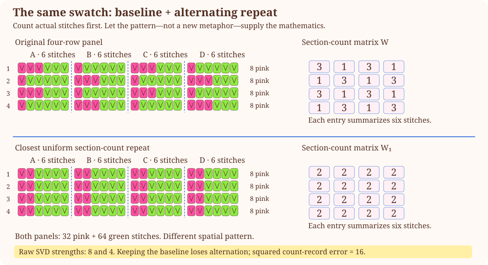
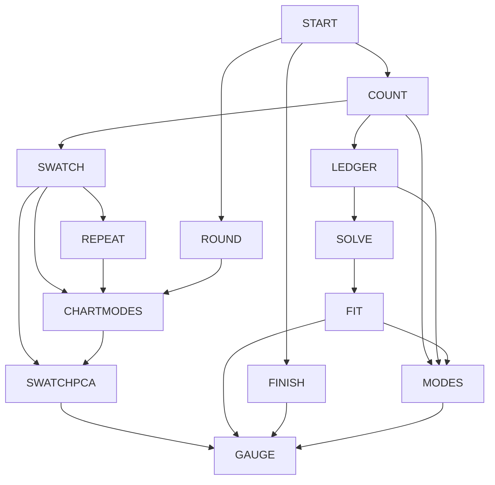

# Yarn in Your Hands — A Connected Knitting and Crochet Canon

2026-10-26 · [Build method](../../build-method.md)
[Rubric](rubric.md) · [Lecture map](../../course-map.md)
[Historical original](../../old/ANALOGY_KNITTING_CROCHET.md) · [Main bible](../../../SHOW_BIBLE.md)

Source pages and topic definitions are maintained only in the
[course map](../../course-map.md). This reference owns its mechanisms, examples,
and limits; its topic table is a navigation index, not a duplicate page register.

## 1. The strongest case and the actual scene

You work an increase and a decrease, recount the row, and find the same number of
stitches as before. The fabric has changed even though the total has not. That
small experience introduces the course's central question: **what does a record
retain, and what can change without that record noticing?**

Follow one 24-stitch knitted sampler and one crochet motif begun with 6 single
crochet in a magic ring. Cast on, form stitches, read a repeat, increase/decrease,
check counts, measure a swatch, and finish its edge. The same stitches recur as
vectors, constraints, independent effects, hidden substitutions, fitted targets,
and recorded variation. Knitting and crochet both contribute concrete actions;
neither is assigned a blanket mathematical property.

**Why it can carry the whole book:** One made object can support several faithful
records: individual stitches, shaping operations, counts within marked repeats,
a chart, and measured gauge. Those records supply their own combinations, systems,
subspaces, projections, singular modes, and principal components. Knitting/crochet
leads the mathematics throughout; shadows and light are optional visual checks,
not the explanations that take over when the course becomes abstract.

The main projects remain a 24-stitch sampler and a six-sector crocheted motif.
The sampler gains a four-row colorwork panel; the motif gains marked sectors.
These extend the same objects rather than introducing a new metaphor every week.

**Source boundary:** US terminology follows the
[CYC knitting](https://www.craftyarncouncil.com/standards/knitting-abbreviations)
and [crochet](https://www.craftyarncouncil.com/standards/crochet-abbreviations) lists.
A magic ring is an adjustable crochet starting loop, distinct from knitting's
magic-loop technique; see [Lion Brand's tutorial](https://www.lionbrand.com/community/blog/magic-ring-crochet-tutorial/).
Swatch measurements follow [CYC gauge guidance](https://www.craftyarncouncil.com/files/DiscoverPDFs/020_CGauge3.pdf).
The colorwork and marked-sector constructions are count-checked, not physically executed or craft-reviewed.
Numerical patterns and datasets below are original teaching constructions, not
physically tested patterns or reported observations.

## 2. Permanent objects and representation limits

| Symbol/object | Fixed meaning | Boundary |
| --- | --- | --- |
| Sampler | Cast on 24 stitches; one `k2,p2` row repeats six times | One row does not establish a complete rib-fabric pattern. |
| Motif | Magic ring, 6 sc; continuous rounds with a start marker | Setup chains are not counted as stitches in this example. |
| `x=(p,i,d)` | Counts of plain, single-increase, single-decrease operations | p means plain operations here; purl is written as a stitch instruction. |
| `A x` | Old stitches consumed, new stitches produced, net change | Omits placement, lean, yarn path, tension, and texture. |
| `K,C` | Two bookkeeping bases of the same real ledger plane | Not “knitting versus crochet” as physically convertible bases. |
| `W` | Four rows by four marked six-stitch sections; entries count pink stitches | Each entry summarizes six stitches, not one stitch or a color intensity. |
| `e,a` | Uniform and alternating directions in the four-section count record | a is a signed contrast, not a negative-yarn instruction. |
| `P6` | Cyclic relabeling of six marked crochet sectors | Changes recorded origin, not the actual fabric. |
| `T` | An optional rewrite of knit/purl instructions on paper | Supporting formal example; W/P6 now provide the main advanced craft route. |
| Gauge dataset | Rows are swatches; columns stitch/row counts per 10 cm | State stitch pattern/materials; no universal tension law. |

Nonnegative integers describe worked operations. Signed differences describe
changes between records. Real vector spaces are an explicit extension of these
records, not collections closed under physically working negative stitches.
Angles/norms concern a declared numeric metric, not tactile similarity.

## 3. Exact anchors, from stitch actions to mathematics

### SWATCH — Work a repeating color panel and record its actual stitches

Keep 24 stitches across and label four six-stitch sections A–D with markers. Work
four rows of a declared two-color panel. Record pink stitches per section:

```text
                A B C D
row 1           3 1 3 1
row 2           1 3 1 3
row 3           3 1 3 1
row 4           1 3 1 3

W=[[3,1,3,1],[1,3,1,3],[3,1,3,1],[1,3,1,3]]
```

Each section always has six stitches: the rest are green. Define rows in work order
and sections in a fixed fabric reference, not whichever direction the hands are
currently traveling. When turning a flat piece, look up each marked section by
its stable label. Work the prescribed number of pink stitches in that section
and the remaining stitches green; record the count regardless of their within-section
order. This defines a count construction, not a tested garment pattern. A separate
stitch-by-stitch front-view chart is required if exact color placement matters.
It can also be explored as flat sc colorwork with the same explicitly recorded
section counts; equal records do not make the knitted/crocheted structures identical.

Every row has eight pink and sixteen green stitches. The total-count map
`Jtotal=[1,1,1,1]` cannot distinguish the two row motifs: it returns 8 for both,
and it annihilates their nonzero difference `(-2,2,-2,2)`. The four-section records
retain that distinction. Counts within
sections still lose the order of stitches inside each section. Information loss
is now visible at several resolutions of the same real swatch.



The schematic displays rows in record order and uses V-shaped cell markers;
it is not a loop-accurate technique diagram or a standard chart-reading instruction.
Its cell counts are checked; visual/craft review remains pending.

**Vector geometry and basis, directly from the repeat.** Let
`r=(3,1,3,1)`, `e=(1,1,1,1)`, `a=(1,-1,1,-1)`.
Then `r=2e+a`: two pink stitches per section is the shared baseline, and a alternates
one extra and one fewer. The other motif is `2e-a`. Both have eight pink stitches;
`e^T a=0`, `||e||=||a||=2`, `||r||=sqrt(20)`.

The vectors e,a form a basis of this chosen two-dimensional repeat subspace,
not all of R4. In the orthonormal basis `q0=e/2`, `q1=a/2`, r has coordinates
`(4,2)`; in the unnormalized e,a basis its coordinates are `(2,1)`.
Signed coordinates express deviations; actual per-section counts must remain
integers from 0 through 6. A literal standalone negative stitch is never required.
Equal-width section counts give a declared Euclidean record metric, not a universal
measure of fabric appearance or tactile difference.

### REPEAT — Projection and Gram–Schmidt without leaving the swatch

Suppose we want the closest *uniform section-count record* to r. Project onto
span(e): `p=e(e^T r)/(e^T e)=2e=(2,2,2,2)`.
The residual is `r-p=a`, with `e^T a=0` and squared error 4. In this particular
construction p is executable as two pink/four green stitches per section; a
projection in a different model may require fractional or invalid counts.
This comparison is about section counts, not every detail of two fabrics.

Gram–Schmidt on e,r produces q0=e/2, then subtracts `2e` from r and normalizes
the remaining a to q1=a/2. The procedure discovers a shared repeat level and a
non-overlapping alternating contrast; it does not invent two new physical stitches.
These orthonormal coordinates support `p=Q Q^T r` for a declared Q/basis. For the
uniform-line projection use Q=q0; using both columns instead projects onto the
whole two-dimensional repeat subspace and returns r unchanged.

### CHARTMODES — Decompose a real section-count chart

The panel matrix satisfies `W=2e e^T+a a^T`. Numerically its singular expansion is

```text
W = 8 (e/2)(e/2)^T + 4 (a/2)(a/2)^T.
```

Left vectors label row motifs; right vectors label section contrasts. Their
numbers coincide here, but their meanings are different. W is a count map: it
maps section-weight vectors to weighted row-count totals, not physical inputs
that magically generate fabric. `W^T` swaps those record roles, not stitch topology.

Rank is 2; singular values are 8,4,0,0. Full U/Sigma/V shapes are 4×4,4×4,4×4;
compact rank-2 shapes are 4×2,2×2,4×2. Right-null directions include
`(1,0,-1,0)` and `(0,1,0,-1)`, because repeated section columns cannot be distinguished
by their aggregate weighted row contributions. Left-null directions have the
same numbers in the separate row-record space. Row/column spaces are each spanned
by the appropriate e,a directions. The identical numeric coordinates do not turn
those spaces into the same physical object.

Rank-1 truncation gives `W1=2e e^T`, a chart with two pink stitches per section
every row. It retains the baseline and loses the alternating repeat. Squared
Frobenius error is `4^2=16`: sixteen cells each differ by one count. W1 happens
to be an integer feasible count chart here; generic SVD approximations need not
be executable patterns, and rounding is an additional nonlinear decision.

For the spectral theorem analyze `W^T W`: eigenvalues 64,16,0,0, with orthonormal
section directions. These are measurement/record modes. They are not claims that
fabric stretches or evolves along eigenvectors. Keep the rectangular operation
ledger H below for SVD examples with different input/output dimensions.

### ROUND — Move the recorded start of a marked crochet round

After reaching 24 sc in the chosen motif, mark six sectors of four old stitches.
A sector of three plain sc plus one increase consumes four and produces five;
a sector of two plain sc plus one sc2tog consumes four and produces three.
Alternate these to obtain recorded new-sector counts `z=(5,3,5,3,5,3)`; total 24.
This is a chosen count exercise, not a promise of flatness or unchanged shape.

Let `e6=(1,1,1,1,1,1)`, `a6=(1,-1,1,-1,1,-1)`, so z=4e6+a6.
Change which marked boundary is written first using
`P6 z=(z6,z1,z2,z3,z4,z5)`. This relabels the same made round. It is a square
orthogonal permutation with inverse transpose, `P6^6=I`, determinant −1, trace 0.
`P6 e6=e6` and `P6 a6=-a6`: the uniform direction is unchanged and the alternating
contrast changes phase. The negative eigenvalue does not create negative stitches.

P6 has other complex eigenvalues; these two real eigen-directions do not supply
a complete real eigenbasis. A circular piece is not itself a vector space, and
changing the marker is not a physical inverse of stitching. The exact operator
and coordinates make the eigenvalue claim valid; the word “round” alone does not.

### SWATCHPCA — Center the same panel rather than invent a new world

Take W's rows as four related pattern records and its columns as the four sections.
Column means are `(2,2,2,2)`. Centering gives `X=a a^T`, rank 1 and singular value 4.
Under the sample-covariance convention, `S=X^T X/3=(4/3)a a^T` has leading
eigenvalue 16/3, unit direction a/2, and three zero eigenvalues. Each section has
sample variance 4/3 and standard deviation `2/sqrt(3)` pink-count units.

This toy pattern has 100% of its centered variance in the alternating direction.
Reconstruct with the retained direction and restore the mean. The strongest raw
W mode describes a baseline; the dominant centered PCA mode describes alternation.
This makes the difference between uncentered SVD and PCA teachable on the same
swatch. The repeated rows are related by design, not an independent random sample;
these descriptive computations do not establish population uncertainty or a
universal model of tension. GAUGE below supplies a different measured-feature
construction with two nonzero variation directions and an explicit invented dataset.

### LEDGER — Count old loops and new stitch tops

| Operation | Knitting | Crochet | Consumed | Produced | Net |
| --- | --- | --- | ---: | ---: | ---: |
| Plain | `k1` | sc in next stitch | 1 | 1 | 0 |
| Increase | `kfb` | 2 sc in next stitch | 1 | 2 | +1 |
| Decrease | `k2tog` | sc2tog over next two stitches | 2 | 1 | −1 |

```text
A=[[1,1,2],[1,2,1],[0,1,-1]]
x=(p,i,d)^T       b=Ax=(consumed,produced,net)^T
```

`(k3,kfb)` six times consumes 24 stitches and produces 30:
`x0=(18,6,0)`, `b=(24,30,6)`. `(3 sc,inc)` six times has the same count signature,
not the same fabric. Placement remains part of writing an executable pattern.

**A complete family:** `x=x0+t(-3,1,1)`. One increase plus one decrease has the
same consumed/produced/net record as three plain stitches. Real t gives a linear
solution family; nonnegative integer operation counts require `t∈{0,1,...,6}`.
Different feasible t values and orderings can give different fabric.

**All four spaces:** rank 2; `N(A)=span((-3,1,1))`;
`C(A)={b:b3=b2-b1}`; row space spans `(1,1,2),(1,2,1)`;
`N(A^T)=span((-1,1,-1))`. Row/null are in operation-count space; column/left-null
are in ledger-output space. The third measurement is redundant, so `det(A)=0`.

### SOLVE — Choose which shaping operations are allowed

If decreases are forbidden, use the independent two-count map
`B=[[1,1],[1,2]]` on `(p,i)`. For consumed/produced `(24,30)`, elimination gives
`i=6,p=18`; `det(B)=1`, `B^{-1}=[[2,-1],[-1,1]]`.
An inverse recovers aggregate operation counts, not their order or fabric.

Let `aP=(1,1,0)`, `aI=(1,2,1)`, `aD=(2,1,-1)`. Bases `K=[aP aI]` and
`C=[aP aD]` span the same plane. Since `aD=3aP-aI`,
`C=K M`, `M=[[1,3],[0,-1]]`, with determinant −1.
The same b has K coordinates `(18,6)` and C coordinates `(36,-6)`.
Negative decrease count is valid as a coordinate but cannot widen a real row
using only plain stitches and decreases. K/C are rectangular: invert M, not K.

### FIT — Reconcile a miscounted row as a second projection example

A note says `(24,30,7)`. Net must equal produced minus consumed, so this report
is inconsistent. Equal-weight Euclidean projection onto C(A) gives
`p=(71/3,91/3,20/3)`, residual `e=(1/3,-1/3,1/3)`, and `A^T e=0`.
This is a real-valued diagnostic, not a fractional-stitch instruction. If input
and output counts are trusted, correcting the net to 6 is a different constrained
measurement decision; do not claim equal-weight projection is the only correction.

Gram–Schmidt on aP,aI gives `q1=(1,1,0)/sqrt(2)` and
`q2=(-1,1,2)/sqrt(6)`. With Q=[q1 q2], `QQ^T` projects onto the ledger plane.
`A^T A` is singular; inverse normal equations require an independent column basis.
The redundant net coordinate affects the chosen metric and must be disclosed.

### MODES — Optional rewrite and rectangular operation-ledger decomposition

Rewrite each `k` as `k,k,p` and each `p` as `k,p,p` on paper, and cast on enough
stitches for the expanded sample. The knit/purl count map is
`T=[[2,1],[1,2]]`, eigenvalues 3 and 1, unit eigenvectors
`(1,1)/sqrt(2)` and `(1,-1)/sqrt(2)`, determinant 3, trace 4.
The total and contrast directions respond differently. The signed contrast mode
is a record direction, not a physically negative purl stitch.

Return to consumed/produced counts only:
`H=[[1,1,2],[1,2,1]]`. Singular values are `sqrt(11),1`;
left directions `(1,1)/sqrt(2)`, `(1,-1)/sqrt(2)`;
right directions `(2,3,3)/sqrt(22)`, `(0,-1,1)/sqrt(2)`.
Right null unit vector is `(-3,1,1)/sqrt(11)`.
Full U/Σ/V shapes are 2×2, 2×3, 3×3; compact shapes 2×2, 2×2, 3×2.
Rank-1 truncation discards the second mode with squared Frobenius error 1.
These modes are not new physical stitches. T is symmetric; H is rectangular:
eigenvectors and singular input/output vectors answer different questions.

### GAUGE — Measure repeated worked swatches

Invented rows `(stitches per 10 cm, rows per 10 cm)` are
`(23,32),(22,33),(21,30),(20,31)`. Mean `(21.5,31.5)`; centered Gram matrix
`[[5,3],[3,5]]`; sample covariance `[[5/3,1],[1,5/3]]`.
Sample standard deviations are `sqrt(5/3)` in their respective gauge units.
Covariance eigenvalues `8/3,2/3` have unit directions `(1,1)/sqrt(2)`,
`(1,-1)/sqrt(2)`; centered singular values `sqrt(8),sqrt(2)`.
The first component explains 80% of the sample variance. State feature scaling,
center columns, project, reconstruct, and add the mean back.
Variance is not craft quality, and PCA does not reveal a universal tension mechanism.

For the recommendation lecture, separately introduce maker-by-named-swatch ratings.
Those ratings are not gauge measurements. Missing values are not zero, and SVD
alone does not validate a prediction method for missing ratings.

## 4. Action cards and chapter route

| Card | Actual mechanism | Callback and limit |
| --- | --- | --- |
| START | Cast on 24, or form a magic ring and work 6 sc | Initial conditions; a ring is not a null space or the zero vector. |
| COUNT | Work and count `k2,p2` repeats; chart each stitch | Counts omit order. A chart encoding is not automatically a numeric linear operator. |
| SWATCH | Work four rows across four marked six-stitch color sections | Section counts retain more than whole-row totals but omit within-section order. |
| REPEAT | Replace alternating section counts with their closest uniform baseline | Projection/Gram–Schmidt act on a specific craft-derived record. |
| CHARTMODES | Separate baseline and alternating structure in the panel count chart | SVD modes have row/section meanings and explicit reconstruction loss. |
| ROUND | Relabel the first marked sector in the same crochet round | An exact permutation supplies eigen-directions without inventing a physical transformation. |
| SWATCHPCA | Subtract the panel's column means and analyze its alternating variation | Centered PCA differs from raw chart SVD; no independent-random-sample claim. |
| LEDGER | Work plain/increase/decrease; count consumed/produced loops | Derives A rather than labeling a generic table “knitting.” |
| SOLVE | Choose shaping counts that meet the next-row target | Includes feasibility, independence, and changed bookkeeping basis. |
| FIT | Recount contradictory totals; isolate overlapping ledger effects | Projection/Gram–Schmidt operate on records, not yarn paths. |
| MODES | Rewrite a repeat; separate retained/lost ledger directions | Same-space eigenstructure versus input/output SVD. |
| GAUGE | Measure multiple swatches under specified conditions | Statistics/PCA on declared measurements. |
| FINISH | Bind/cast off knitting; fasten off crochet and check the edge | Different procedures; neither is an algebraic inverse by name alone. |

The motif's chosen later rounds use 6 increases to reach 12 stitches, then
`(sc,inc)` six times to reach 18, then `(2 sc,inc)` six times to reach 24.
This is additive growth of 6 per round, unlike doubling every stitch. It does not
guarantee flatness for every yarn/hook/tension. A fixed +6 update is affine on a
scalar count, not linear unless a homogeneous-coordinate model is introduced.

## 5. Chapter routes and topic mechanisms

Every topic below is an editorial destination, not a completed textbook passage.
The linked topic IDs resolve to the sole authoritative PDF-page register. The statistics/PCA bridge comes from the exam-topic list;
it is not falsely attributed to Week 5. Supporting problem-number mapping and
image-only lecture-page review remain open in the shared map.

| Chapter | Topic groups | Connected teaching route |
| --- | --- | --- |
| Week 1 | W1.01–W1.08 | Cast on and work the marked color panel; distinguish individual stitches, section counts, chart entries, and the operation ledger. Compute dot products/norms from actual section records and compare compatible map shapes. |
| Week 2 | W2.01–W2.04 | Use the 24-to-30 shaping equations, elimination, and B inverse. Contrast the independent two-count system with redundant net count. Apply determinant/cofactor rules only to square maps. |
| Week 3 | W3.01–W3.09 | Derive operation-ledger four spaces and full solution family; use repeated panel columns for dependence, mean/alternating pattern directions for a basis, and fixed versus shifted round labels for coordinate changes. |
| Week 4 | W4.01–W4.06 | Project the actual section-count row onto uniform repeats and derive Gram–Schmidt on e,r; then reconcile contradictory ledger totals and fit gauge measurements under declared weights/rank conditions. |
| Week 5 | W5.01–W5.07 | Relabel crochet sectors for eigen-directions, decompose the color panel into baseline/alternation, analyze its Gram matrix, and use H for rectangular SVD. Quantify pattern loss; introduce ratings separately. |
| Exam-topic bridge | B.01–B.02 | Center the same color-panel records to distinguish baseline from variance, then compute statistics/PCA across gauge specimens; distinguish designed rows from empirical random observations. |

### Topic mechanisms

| Topic ID | Course content | Local mechanism and mathematical landing |
| --- | --- | --- |
| [W1.01](../../course-map.md#w1-01) | Vector entries, dimensions, representations | SWATCH/COUNT: Record pink stitches in four fixed six-stitch sections; distinguish stitch order, whole-row totals and section vectors. |
| [W1.02](../../course-map.md#w1-02) | Addition, scaling, linear combinations | SWATCH/LEDGER: Add repeated section records and actual plain/increase/decrease effects; state real signed extensions. |
| [W1.03](../../course-map.md#w1-03) | Dot product, properties, cosine/angle | SWATCH/REPEAT: Use dot products with uniform/alternating section directions and with the operation-output weights. |
| [W1.04](../../course-map.md#w1-04) | Norm, length, unit vectors, normalization | SWATCH/REPEAT: Normalize the uniform and alternating count directions; compute record norms, angles and zero-vector limits. |
| [W1.05](../../course-map.md#w1-05) | Matrix entries/shapes, addition/scaling | SWATCH/LEDGER: Read W row/section entries and the rectangular operation map H with declared input/output spaces. |
| [W1.06](../../course-map.md#w1-06) | Diagonal, identity, symmetric matrices; trace | ROUND/CHARTMODES: Use sector permutation, identity/gain maps and symmetric W transpose W; compute trace in the declared record space. |
| [W1.07](../../course-map.md#w1-07) | Transpose | CHARTMODES/FIT: Transpose swaps weighted section/row roles; residual pairing uses a transpose without claiming a physical inverse. |
| [W1.08](../../course-map.md#w1-08) | Matrix-vector/products; multiplication properties | ROUND/LEDGER/CHARTMODES: Compose compatible relabeling, shaping-record and reporting maps; check spaces and order before multiplying. |
| [W2.01](../../course-map.md#w2-01) | Systems, column picture, augmented equations | SOLVE: Derive consumed/produced requirements for 24 stitches becoming 30. |
| [W2.02](../../course-map.md#w2-02) | Gaussian elimination, row operations, echelon/pivots, back substitution | SOLVE: Eliminate the actual stitch equations, then develop larger source systems, pivots and back substitution. |
| [W2.03](../../course-map.md#w2-03) | Determinant, properties, Laplace/cofactors, geometry | SOLVE/ROUND: Compute determinant/cofactor properties on square B and coordinate permutations; distinguish singular A and coordinate volume. |
| [W2.04](../../course-map.md#w2-04) | Inverse, invertibility tests, Gauss–Jordan, cofactor formulas | SOLVE: Invert B or a declared bookkeeping map; distinguish counts recovered from original stitch order. |
| [W3.01](../../course-map.md#w3-01) | Vector spaces, closure, subspaces/counterexamples | SWATCH/LEDGER: Separate real repeat/ledger subspaces from physically feasible integer stitch records. |
| [W3.02](../../course-map.md#w3-02) | Column and null spaces | SWATCH/LEDGER/CHARTMODES: Contrast total-count invisibility, operation cancellation and repeated W columns; identify the specific map. |
| [W3.03](../../course-map.md#w3-03) | Four fundamental subspaces | LEDGER/CHARTMODES: Derive all four spaces with operation/output or section/row-weight meanings and explicit ambient dimensions. |
| [W3.04](../../course-map.md#w3-04) | Complete solution, particular plus null, free variables | SOLVE/LEDGER: Give the complete real shaping family and then the finite feasible integer instructions. |
| [W3.05](../../course-map.md#w3-05) | Rank, pivot computation | LEDGER/CHARTMODES: Repeated pattern columns and redundant ledger totals explain rank and pivot count. |
| [W3.06](../../course-map.md#w3-06) | Linear independence and dependence | LEDGER/SWATCH: Show increase plus decrease equals three plain ledger effects; repeated motifs produce dependent chart columns. |
| [W3.07](../../course-map.md#w3-07) | Span and membership | SWATCH/SOLVE: Test whether a target record is in the repeat/operation span and separately whether counts are feasible. |
| [W3.08](../../course-map.md#w3-08) | Basis, dimension, natural/alternative bases | SWATCH/REPEAT: Use uniform/alternating repeat directions as a basis of the chosen two-dimensional record subspace. |
| [W3.09](../../course-map.md#w3-09) | Change of basis | SWATCH/SOLVE/ROUND: Compare e,a with q0,q1 coordinates, bookkeeping bases and cyclic marker labels. |
| [W4.01](../../course-map.md#w4-01) | Orthogonality, paired four-space complements | REPEAT/LEDGER: Verify uniform and alternating count directions are perpendicular; derive both four-space complement pairs. |
| [W4.02](../../course-map.md#w4-02) | Line/subspace projection, residual geometry | REPEAT/FIT: Project r onto uniform repeats and compare with the contradictory-ledger fit under its own metric. |
| [W4.03](../../course-map.md#w4-03) | Invertibility of A transpose A; proof conditions | REPEAT/FIT: State independent-column conditions for a chosen repeat basis; contrast the dependent operation ledger. |
| [W4.04](../../course-map.md#w4-04) | Least squares, line fit, normal equations | REPEAT/FIT/GAUGE: Fit a closest repeat and a declared gauge trend, retaining the lecture line-fit derivation and assumptions. |
| [W4.05](../../course-map.md#w4-05) | Orthonormal vectors/bases, simplified projections | REPEAT: Use q0=e/2 and q1=a/2; distinguish the uniform-line projector from the two-direction repeat-plane projector. |
| [W4.06](../../course-map.md#w4-06) | Gram–Schmidt, worked example | REPEAT: Gram–Schmidt on e,r subtracts the shared baseline and isolates alternating contrast. |
| [W5.01](../../course-map.md#w5-01) | Two-dimensional transformations | ROUND: Relabel six marked sectors with an explicit same-space permutation; distinguish a record action from fabrication. |
| [W5.02](../../course-map.md#w5-02) | Eigenvalues/eigenvectors, computation, eigenspaces | ROUND/MODES: Derive +1 uniform and -1 alternating eigen-directions of P6; keep the optional T example and formal characteristic calculations. |
| [W5.03](../../course-map.md#w5-03) | Eigendecomposition and diagonalization | ROUND/CHARTMODES: State P6 real-basis limits, retain formal defective cases and diagonalization hypotheses. |
| [W5.04](../../course-map.md#w5-04) | Real symmetric spectral theorem | CHARTMODES: Apply the real symmetric theorem to W transpose W; separate arbitrary repeated-eigenspace vectors from an orthonormal choice. |
| [W5.05](../../course-map.md#w5-05) | SVD, formulation, A transpose A, computation | CHARTMODES/MODES: Derive W baseline/alternating singular pairs and full/compact shapes; H supplies different rectangular input/output dimensions. |
| [W5.06](../../course-map.md#w5-06) | Truncated SVD, dimension reduction | CHARTMODES/SWATCHPCA: Reconstruct the rank-1 uniform chart, quantify lost alternation, then distinguish centered data compression. |
| [W5.07](../../course-map.md#w5-07) | Recommendation and user-rating example | GAUGE: Introduce maker-by-named-swatch ratings as a separate dataset; teach the supplied recommendation example and missing-data limits. |
| [B.01](../../course-map.md#b-01) | Mean, variance, standard deviation, covariance | SWATCHPCA/GAUGE: Compute descriptive statistics on designed panel rows and specimen gauge; distinguish their data-generating interpretations. |
| [B.02](../../course-map.md#b-02) | PCA, covariance eigenvectors, centered SVD | SWATCHPCA/GAUGE: Center W to isolate alternating variation, then use GAUGE for two nonzero modes and specimen-feature interpretation. |

### Formal precision and countercases to preserve

State dimensions and hypotheses before each formula. Cofactor/inverse/determinant
rules require a square matrix; inverse normal equations require independent columns.
The zero vector cannot be normalized or assigned a direction angle. With
`J=[[1,1],[0,1]]`, the only eigenvalue is 1 and the eigenspace is span((1,0)); J
has no eigenbasis. For I2, (1,0) and (1,1) are both eigenvectors with eigenvalue 1
but are not perpendicular: a symmetric matrix admits an orthonormal eigenbasis,
not automatic orthogonality of all arbitrarily chosen vectors in a repeated eigenspace.
Use the proper rectangular `Sigma transpose Sigma` and `Sigma Sigma transpose`.
These formal examples supplement the physical scene rather than pretending every
exception has a literal craft/biological/chart analogue.

## 6. Answered transfer anchors, one per chapter

These are explicitly reused mathematical anchors, not a validated fresh problem
bank. Ask the questions without requiring analogy vocabulary in the answer.
A future independent transfer bank must change numbers/representations and remove
method cues. Each feedback note identifies a specific misconception to revisit.

### W1 transfer

**Question:** For the section-count row r=(3,1,3,1), compute its total, squared norm, and dot product with a=(1,-1,1,-1).

**Checked answer:** 8; 20; 4. With e=(1,1,1,1), verify r=2e+a and e dot a=0.

**Diagnostic feedback:** Each coordinate counts pink stitches in six actual stitches. Counts, stitch order, yarn length, and perceived texture are different records.

### W2 transfer

**Question:** Solve p+i=24, p+2i=30; verify with B.

**Checked answer:** i=6, p=18; B(18,6)=(24,30). det(B)=1.

**Diagnostic feedback:** Subtract the constraints before substituting; an inverse recovers counts, not stitch placement.

### W3 transfer

**Question:** Find the null direction and full real solution for A x=(24,30,6); then enforce count feasibility.

**Checked answer:** x=(18,6,0)+t(-3,1,1); A(-3,1,1)=0. Physical t is an integer 0 through 6.

**Diagnostic feedback:** An infinite real family can contain only finitely many nonnegative integer instructions.

### W4 transfer

**Question:** Find the closest uniform four-section record to r=(3,1,3,1); derive an orthonormal basis from e,r.

**Checked answer:** p=(2,2,2,2), residual a=(1,-1,1,-1), e dot a=0. Gram–Schmidt gives e/2 and a/2; squared fit error 4.

**Diagnostic feedback:** Projecting onto the uniform line uses only e/2. Using both orthonormal columns would project onto the whole repeat subspace and return r, not p.

### W5 transfer

**Question:** Give P6 eigenvalues on e6,a6, then the full/compact SVD shapes, nonzero singular values and rank-1 squared error of W.

**Checked answer:** P6 e6=e6 and P6 a6=-a6, so eigenvalues 1,-1. W values 8,4; full shapes 4x4,4x4,4x4; compact 4x2,2x2,4x2; rank-1 squared error 16. H remains the separate 2x3 operation-map example.

**Diagnostic feedback:** A marker change is a record permutation, not new fabric. W input/row modes are different roles despite identical coordinates; SVD strength is not a universal fabric-quality ranking.

### B transfer

**Question:** Center W by column and compare its leading raw SVD mode with its leading centered PCA mode.

**Checked answer:** Column mean (2,2,2,2); X=a a transpose; centered singular value 4; covariance leading eigenvalue 16/3 and direction a/2, explaining 100% of this designed variation. The largest raw W mode is e/2 with singular value 8.

**Diagnostic feedback:** PCA requires centering; baseline magnitude is not variance. Related pattern rows are not independent experimental swatches; use GAUGE for the separate specimen-feature example.

The knitting/crochet, biology, astrology, and pottery references deliberately share the same centered 4-by-2 numerical
pattern for their statistics anchors, with different domain baselines. This holds
the arithmetic difficulty fixed for comparison; it is not empirical evidence of a
shared physical distribution or a claim that all domains have the same covariance.

## 7. Connected graph, accessible route, and cross-lens links

Arrows mean an explanatory callback, not equality of physical mechanisms.
The action-card table and chapter routes give the accessible prose counterpart.



The path runs from an actual action/observation to its record, then constraints,
hidden distinctions, fitting, decomposition, and repeated-record variation.
Use the same topic IDs to translate to the other canons. Yarn count cancellation,
biology's hidden infection distinction, wheel aggregation, pottery's hidden batch
history, light's invisible spectral difference, and shadow depth all instantiate
`A(x+v)=Ax` for `Av=0`, with different matrices and physical feasible domains.
A coordinate change is invertible within its record; observation loss is not.
Each chapter use must state source ID, local action, object/space meanings, exact
mathematics, boundary, callback, and a formal question.

## 8. Diagram brief and strongest objection

Draw the full 24-stitch panel beside its four-section count matrix; label every six-stitch cell and its pink/green stitch counts. Show the uniform approximation and the alternating residual on the same panel. Draw six marked crochet sectors with the recorded origin shifted, then show the unchanged made motif. Also draw the actual k1/kfb/k2tog and sc/inc/sc2tog consumed/produced loops. Label 24 old positions and 30 new tops. Place a chart, a count vector, and a fabric view side by side so they cannot be mistaken for the same record. Show the fitted ledger plane and its residual separately from literal stitches.

Use captions, text labels, patterns, and numeric records rather than color alone. Follow the textbook palette without assigning semantic red/yellow roles inconsistently. The section-count schematic is generated and count-checked; visual inspection,
loop-accurate technique figures, accessibility/print review, and physical craft
execution remain pending.

**Strongest objection:** Stitching is not globally linear, and counting removes much of the craft.

**Response:** The main teaching objects are the made swatch, marked round, their explicit count records and measured gauge. The ledger handles shaping; the panel handles spatial repetition, projection, SVD and PCA; round indexing handles a concrete same-space permutation. Preserve the physical detail in diagrams while stating exactly what the record loses. Let finishing and magic-ring setup be honest boundary/initial-condition callbacks instead of inventing advanced operator identities.

## 9. Evidence and remaining work

This canon has exact numerical anchors, the six chapter routes, all 36
topic mechanisms linked to the authoritative source register, answered anchor questions, graph, diagram brief, and
its own rubric. See [craft-centered checks](../../verification/knitting-strengthening.md),
[earlier verification](../../verification/rebuild.md), and
[development history](../../verification/history.md) for prior versions.
Source-backed domain facts are separated from invented parameters/models/data.
Calculations, topic IDs, graph structure, and links are checked; that is not
independent domain or mathematical review.

Still open: exact supporting problem references, complete chapter proofs and fresh
transfer bank, formal edge-case development, image-only lecture review, rendered
figures and accessibility, qualified independent review, and observed learner
transfer. No physical demonstration, measured dataset, chapter build, student grade,
or empirical effectiveness result is claimed. A complete editorial blueprint is
not a completed textbook or evidence that a student is ready for the exam.
