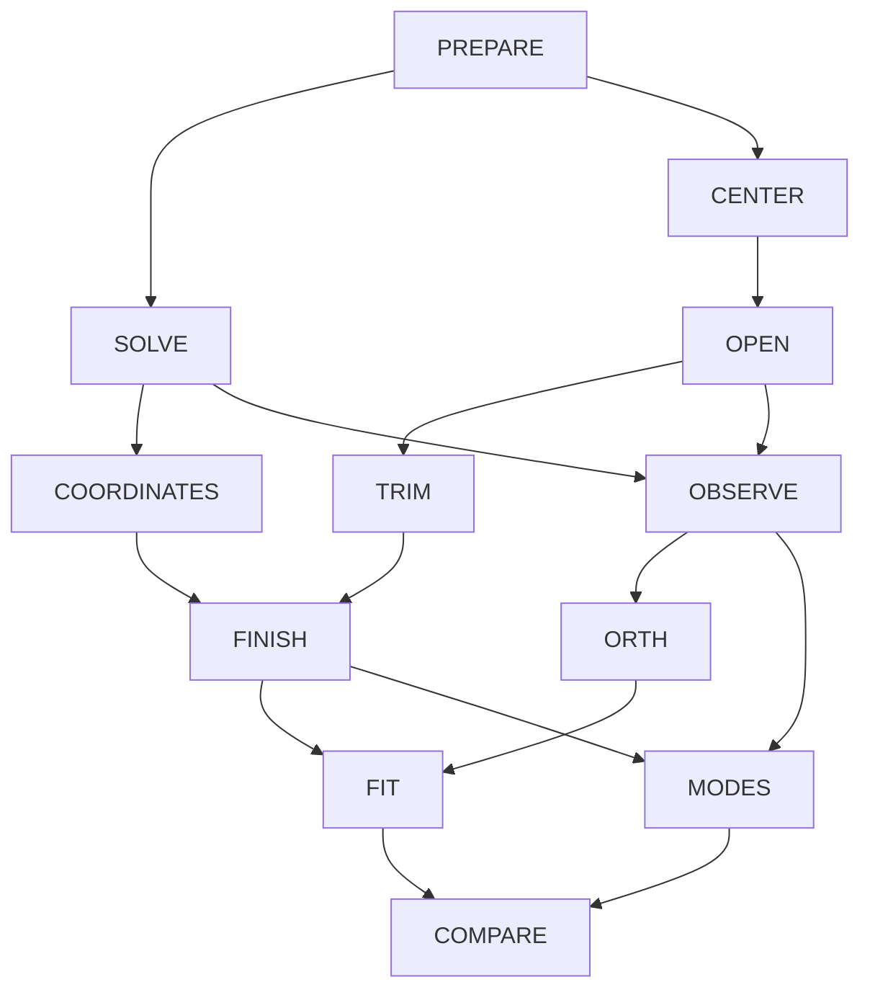

# From Spinning Clay to Fired Form — A Connected Pottery Canon

2026-10-26 · [Build method](../../build-method.md)
[Rubric](rubric.md) · [Lecture map](../../course-map.md)
[Historical original](../../old/ANALOGY_POTTERY.md) · [Main bible](../../../SHOW_BIBLE.md)

Source pages and topic definitions are maintained only in the
[course map](../../course-map.md). This reference owns its mechanisms, examples,
and limits; its topic table is a navigation index, not a duplicate page register.

## 1. The strongest case and the actual scene

Two vessels can share the same few caliper readings while differing between the
measurement points. A batch record can have the right total mass while hiding how
its components were portioned. A shrinkage formula can be inverted to size a wet
piece without making firing physically reversible.

Follow one small wheel-thrown cylinder and test bars from its clay batch: weigh,
center, open, pull the wall, measure a profile, trim the foot, track drying/firing
stages, and compare finished pieces. **The advantage:** The difference between
material, form, and measured record is tangible at every stage. **The burden:**
Do not pretend the potter's hand, clay chemistry, or firing is a universal linear
operator. The most faithful linear relationships are in mass accounting, calibrated
coordinates, and explicitly stated geometric/measurement models.

[Wheel-throwing cross sections](https://ceramicartsnetwork.org/daily/article/wheel-throwing-in-cross-section/)
support the action sequence. [Digitalfire specimen testing](https://digitalfire.com/test/shab)
and [Lakeside Pottery shrinkage discussion](https://www.lakesidepottery.com/HTML%20Text/Tips/Clay%20drying%20and%20firing%20process.htm)
support stage-specific measurement and material dependence. All batches, factors,
and datasets below are invented examples, not tested clay formulations, firing
schedules, observed properties, or claims about functional/food-safe ware.

## 2. Permanent objects and representation limits

| Object | Meaning | Boundary |
| --- | --- | --- |
| Batch record | Red-component kg, white-component kg, total kg | Does not establish color, plasticity, compatibility, or firing behavior. |
| Portion coefficients x | Chosen 1 kg red/white portions, 2 kg equal-mass premix portions | State discrete portions versus continuous weighing. |
| Wheelhead point | Planar location relative to rotation axis | Rotating a point is not the full deformation under the maker's hands. |
| Profile r | Base, belly, rim radii at declared heights | Does not determine wall thickness or full shape. |
| Test bars w,f | Wet and fired lengths in cm, with process stage stated | Different stage factors have different reference lengths. |
| Dataset | Rows finished specimens; columns selected dimensions | A statistical average need not be a realizable or desirable pot. |

Real signed records extend nonnegative masses/radii mathematically. Physical
centering is not subtracting a dataset's mean. Reconstructing coordinates does
not recreate clay removed by trimming or reverse firing chemistry.

## 3. Exact recurring anchors

### BATCH — Account for physical portions without inventing linear material properties

Choose 1 kg red-component portions, 1 kg white-component portions, and 2 kg portions
of an equal-mass premix. This is mass bookkeeping, not a tested body recipe.

```text
A=[[1,0,1],[0,1,1],[1,1,2]]
x=(red portions,white portions,premix portions)^T
b=A x=(red kg,white kg,total kg)^T
A(3,2,0)^T=(3,2,5)^T
```

The premix column is the sum of the first two. Complete real solution family:
`x=(3-t,2-t,t)`. Counted nonnegative portions require t=0,1,2; continuous weighing
with those portion units permits real `0≤t≤2`. Same final recorded masses do not
establish the same mixing history or material performance.

**Four spaces:** rank 2; null span `(-1,-1,1)`; column plane `b3=b1+b2`;
row span `(1,0,1),(0,1,1)`; left null span `(1,1,-1)`.
Input portion space and output mass space are distinct, even though both have
three coordinates. `det(A)=0`; total mass duplicates component information.

### COORDINATES — Change a mass description, not the clay

On the two independent component masses, `C=[[1,1],[1,0]]` reports `(total,red)`.
`det(C)=-1`, `C^{-1}=[[0,1],[1,-1]]`; recover white as total minus red.
Changing kg to g is diagonal scaling, not more clay. A coordinate basis change is
invertible; A's hidden premix history is not restored by re-expressing its output.
Use square C for cofactors/Gauss–Jordan and determinant properties; do not assign
a rectangular profile map a determinant.

### FIT — Reconcile mass reports and measure shrinkage rather than assume it

An inconsistent mass report `(3,2,6)` projects onto C(A) as
`p=(10/3,7/3,17/3)`, with `e=(-1/3,-1/3,1/3)` and `A^T e=0` under equal numerical
weighting. Correcting only a distrusted total is a different constrained decision.
Redundant totals are not independent measurements just because they appear in a table.

Gram–Schmidt on `(1,0,1),(0,1,1)` gives `(1,0,1)/sqrt(2)`,
`(-1,2,1)/sqrt(6)`. Q gives plane projector `QQ^T`; A's dependent columns do not
permit inverse normal equations directly.

For a separate length fit, invented wet lengths `w=(10,20,30)` cm and fired lengths
`f=(9,18,26)` cm give `f≈s w`, with
`s=(w^T f)/(w^T w)=123/140`, predictions `(123/14,123/7,369/14)` cm,
residual `(3/14,3/7,-5/14)` cm; `w^T e=0`.
This is line projection/least squares with an actual measurement action. A
nonzero w has full column rank. An intercept, changed uncertainty weights, or a
nonlinear model needs its own assumptions; this toy fit is not a shrinkage law.

### TURN — Center a point and observe geometric maps separately from shaping

Mark a wheelhead point. `R90=[[0,-1],[1,0]]` gives an ideal rigid quarter-turn:
orthogonal, determinant 1, inverse transpose, trace 0, eigenvalues ±i over C.
There is no real eigenvector in that plane. Hand pressure while centering/opening/
pulling changes the clay and is not merely this rotation. State a reference origin;
translations are affine unless a suitable representation is supplied.

### SHRINK — Predict dimensions without “unfiring”

Suppose an illustrative wet-to-fired length factor is 0.9. A 10 cm wet dimension
predicts 9 cm; a 9 cm desired result suggests 10 cm wet under that model. An
anisotropic coordinate model `F=diag(0.9,0.9,0.8)` has eigenvalues 0.9,0.9,0.8,
coordinate eigenvectors, trace 2.6, determinant 0.648.
Determinant is volume scaling only for the declared ideal geometric map; it is
not automatically capacity, mass retention, or a measured material property.

Stage factors 0.95 and 0.90 compose to 0.855: loss 14.5%, not 15%, because each
factor uses its own starting length. Reversing the numeric factor sizes an initial
piece; it does not undo chemical changes, cracks, or removed clay.
A planar scale `D=diag(2,1)` and R90 do not commute:
`R90 D(1,0)=(0,2)`, but `D R90(1,0)=(0,1)`.
These are explicit coordinate maps, not proof that physical process order can be reversed.

### PROFILE — A caliper summary hides an actual shape distinction

Let r list base, belly, rim radii. A deliberately limited summary reports the
average of base/belly and the rim:
`H=[[1/2,1/2,0],[0,0,1]]`.
Profiles `(3,5,4)` and `(4,4,4)` both report `(4,4)`; their difference `(1,-1,0)`
is invisible. A valid summary does not identify the full profile or vessel.

Singular values are `1,1/sqrt(2)`; right directions eRim=`(0,0,1)` and
`(1,1,0)/sqrt(2)` map to output directions `(0,1)` and `(1,0)` respectively.
Right null unit vector `(1,-1,0)/sqrt(2)`.
Full U/Σ/V: 2×2, 2×3, 3×3; compact: 2×2, 2×2, 3×2.
Rank-1 truncation keeps rim information in this scaling and loses average-body
information, squared Frobenius error 1/2. It is not an aesthetic importance ranking.
`H^T H` is symmetric, eigenvalues 1,1/2,0. Its spectral theorem explains the SVD;
pulling a wall does not literally perform this decomposition.

### SERIES — Compare finished cylinders

Invented rows `(height,rim diameter)` in cm:
`(11,12),(10,13),(9,10),(8,11)`. Mean `(9.5,11.5)`; centered Gram
`[[5,3],[3,5]]`; sample covariance `[[5/3,1],[1,5/3]]`; standard deviations
`sqrt(5/3)` cm. Eigenvalues `8/3,2/3`, unit directions `(1,1)/sqrt(2)`,
`(1,-1)/sqrt(2)`; centered singular values `sqrt(8),sqrt(2)` cm; first share 80%.
Declare feature scaling, center, project/reconstruct, then add the mean back.
Large variance is not necessarily a flaw or the causal effect of one hand movement.

For recommendation, explicitly switch to viewer-by-piece ratings or a declared
withheld-measurement table. Ratings are not shape coordinates. Missing entries
are not zero; ordinary SVD alone does not establish a valid incomplete-data predictor.

## 4. Action cards and chapter route

| Card | Actual mechanism/observation | Callback and limit |
| --- | --- | --- |
| PREPARE | Weigh and combine defined component portions | Exact mass accounting; material properties need separate evidence. |
| CENTER | Center clay while a marked wheelhead point rotates | Distinguish deformation from rotation and statistical centering. |
| OPEN | Open the center and pull the wall; measure selected radii | Record change is not a universal hand-pressure map. |
| SOLVE | Meet component/total requirements | Complete family and physical feasibility from BATCH. |
| COORDINATES | Report total/red instead of red/white masses | Invertible representation versus lost preparation history. |
| OBSERVE | Compare matching summaries from different profiles/batches | Four spaces describe exactly which distinctions are hidden. |
| ORTH | Separate overlapping recorded contributions | Orthogonalize numerical records, not the potter's fingers. |
| FIT | Reconcile totals and fit measured bar lengths | Units/weights, rank assumptions, projection and residual. |
| TRIM | Remove material from the foot and remeasure | A removed mass can be counted; subtraction does not recreate shape. |
| FINISH | Track stage-specific length changes while drying/firing | Composition/inverse limits; no invented empirical shrinkage rule. |
| MODES | Separate retained/lost radius distinctions | PROFILE SVD and symmetric Gram eigenstructure. |
| COMPARE | Compare completed specimens and their recorded variation | SERIES covariance/PCA; not a functional-safety judgment. |

## 5. Chapter routes and topic mechanisms

Every topic below is an editorial destination, not a completed textbook passage.
The linked topic IDs resolve to the sole authoritative PDF-page register. The statistics/PCA bridge comes from the exam-topic list;
it is not falsely attributed to Week 5. Supporting problem-number mapping and
image-only lecture-page review remain open in the shared map.

| Chapter | Topic groups | Connected teaching route |
| --- | --- | --- |
| Week 1 | W1.01–W1.08 | Weigh portions, locate a marked wheelhead point, and record radii. Distinguish mass, position, and profile vectors; define maps, norms, units, transpose, and composition. |
| Week 2 | W2.01–W2.04 | Eliminate batch equations and invert component coordinates, with determinant/cofactor conditions; distinguish a reversible description from physical trimming/firing. |
| Week 3 | W3.01–W3.09 | Derive batch four spaces, solution family, span, rank, basis and feasible portion choices; profile averages show a different hidden distinction. |
| Week 4 | W4.01–W4.06 | Project an inconsistent mass total; work report-plane Gram–Schmidt and bar-length least squares with units, rank condition, and residual verification. |
| Week 5 | W5.01–W5.07 | Use geometric rotation/shrinkage for eigenstructure, profile H for SVD and retained/lost radius directions, and explicit full/compact/truncated forms and error. |
| Exam-topic bridge | B.01–B.02 | Compare measured dimensions of specimens; center, derive statistics/covariance and PCA/centered SVD, restore means, and separate variation from quality or cause. |

### Topic mechanisms

| Topic ID | Course content | Local mechanism and mathematical landing |
| --- | --- | --- |
| [W1.01](../../course-map.md#w1-01) | Vector entries, dimensions, representations | PREPARE/OPEN: radius record. |
| [W1.02](../../course-map.md#w1-02) | Addition, scaling, linear combinations | PREPARE: component masses. |
| [W1.03](../../course-map.md#w1-03) | Dot product, properties, cosine/angle | ORTH/CENTER: pairing and geometry. |
| [W1.04](../../course-map.md#w1-04) | Norm, length, unit vectors, normalization | CENTER/ORTH: radius of marked point. |
| [W1.05](../../course-map.md#w1-05) | Matrix entries/shapes, addition/scaling | BATCH/PROFILE: masses versus radii. |
| [W1.06](../../course-map.md#w1-06) | Diagonal, identity, symmetric matrices; trace | TURN/SHRINK/MODES: diagonal F, Gram map. |
| [W1.07](../../course-map.md#w1-07) | Transpose | TURN/FIT: inverse rotation versus residual. |
| [W1.08](../../course-map.md#w1-08) | Matrix-vector/products; multiplication properties | PREPARE/FINISH: staged factors, rotation/scale order. |
| [W2.01](../../course-map.md#w2-01) | Systems, column picture, augmented equations | SOLVE: component batch targets. |
| [W2.02](../../course-map.md#w2-02) | Gaussian elimination, row operations, echelon/pivots, back substitution | SOLVE: eliminate redundant batch equations. |
| [W2.03](../../course-map.md#w2-03) | Determinant, properties, Laplace/cofactors, geometry | COORDINATES/SHRINK: signed mass-coordinate or ideal volume scale. |
| [W2.04](../../course-map.md#w2-04) | Inverse, invertibility tests, Gauss–Jordan, cofactor formulas | COORDINATES: invert prediction not firing. |
| [W3.01](../../course-map.md#w3-01) | Vector spaces, closure, subspaces/counterexamples | BATCH: real record plane, not positive clay. |
| [W3.02](../../course-map.md#w3-02) | Column and null spaces | OBSERVE: premix history hidden. |
| [W3.03](../../course-map.md#w3-03) | Four fundamental subspaces | OBSERVE: portions versus mass reports. |
| [W3.04](../../course-map.md#w3-04) | Complete solution, particular plus null, free variables | SOLVE/OBSERVE: (3-t,2-t,t). |
| [W3.05](../../course-map.md#w3-05) | Rank, pivot computation | OBSERVE: rank 2 mass report. |
| [W3.06](../../course-map.md#w3-06) | Linear independence and dependence | BATCH: premix equals sum of components. |
| [W3.07](../../course-map.md#w3-07) | Span and membership | SOLVE: total mass consistency. |
| [W3.08](../../course-map.md#w3-08) | Basis, dimension, natural/alternative bases | COORDINATES/ORTH: component/report bases. |
| [W3.09](../../course-map.md#w3-09) | Change of basis | COORDINATES: red/white versus total/red. |
| [W4.01](../../course-map.md#w4-01) | Orthogonality, paired four-space complements | OBSERVE/ORTH: mass-report complements. |
| [W4.02](../../course-map.md#w4-02) | Line/subspace projection, residual geometry | FIT: line fit or inconsistent totals. |
| [W4.03](../../course-map.md#w4-03) | Invertibility of A transpose A; proof conditions | FIT: dependent batch map versus nonzero bar vector. |
| [W4.04](../../course-map.md#w4-04) | Least squares, line fit, normal equations | FIT: actual test-bar measurement model. |
| [W4.05](../../course-map.md#w4-05) | Orthonormal vectors/bases, simplified projections | ORTH: normalized report-plane basis. |
| [W4.06](../../course-map.md#w4-06) | Gram–Schmidt, worked example | ORTH: orthogonalize mass reports. |
| [W5.01](../../course-map.md#w5-01) | Two-dimensional transformations | TURN/SHRINK: rotation versus scale. |
| [W5.02](../../course-map.md#w5-02) | Eigenvalues/eigenvectors, computation, eigenspaces | SHRINK/TURN: axes of declared F. |
| [W5.03](../../course-map.md#w5-03) | Eigendecomposition and diagonalization | MODES: symmetric Gram versus generic deformation. |
| [W5.04](../../course-map.md#w5-04) | Real symmetric spectral theorem | MODES: profile Gram map. |
| [W5.05](../../course-map.md#w5-05) | SVD, formulation, A transpose A, computation | MODES: radius average loses difference. |
| [W5.06](../../course-map.md#w5-06) | Truncated SVD, dimension reduction | MODES/COMPARE: lost radius detail. |
| [W5.07](../../course-map.md#w5-07) | Recommendation and user-rating example | COMPARE: piece readings or declared ratings. |
| [B.01](../../course-map.md#b-01) | Mean, variance, standard deviation, covariance | COMPARE: measured dimensions. |
| [B.02](../../course-map.md#b-02) | PCA, covariance eigenvectors, centered SVD | COMPARE: dominant measured piece variation. |

### Formal precision and countercases to preserve

State dimensions and hypotheses before each formula. Cofactor/inverse/determinant
rules require a square matrix; inverse normal equations require independent columns.
The zero vector cannot be normalized or assigned a direction angle. With
`J=[[1,1],[0,1]]`, the only eigenvalue is 1 and the eigenspace is span((1,0)); J
has no eigenbasis. For I2, (1,0) and (1,1) are both eigenvectors with eigenvalue 1
but are not perpendicular: a symmetric matrix admits an orthonormal eigenbasis,
not automatic orthogonality of all arbitrarily chosen vectors in a repeated eigenspace.
Use the proper rectangular `Sigma transpose Sigma` and `Sigma Sigma transpose`.
These formal examples supplement the physical scene rather than pretending every
exception has a literal craft/biological/chart analogue.

## 6. Answered transfer anchors, one per chapter

These are explicitly reused mathematical anchors, not a validated fresh problem
bank. Ask the questions without requiring analogy vocabulary in the answer.
A future independent transfer bank must change numbers/representations and remove
method cues. Each feedback note identifies a specific misconception to revisit.

### W1 transfer

**Question:** Compute A(3,2,0) and interpret the third output.

**Checked answer:** (3,2,5): red-component mass 3 kg, white-component mass 2 kg, total 5 kg.

**Diagnostic feedback:** The third row is redundant accounting, not a separately measured physical property.

### W2 transfer

**Question:** Convert component masses (3,2) with C, and invert the record.

**Checked answer:** C(3,2)=(5,3); C inverse(5,3)=(3,2); determinant -1.

**Diagnostic feedback:** Changing coordinates does not alter the clay or restore a hidden premix history.

### W3 transfer

**Question:** Find all x with A x=(3,2,5) and physical counted-portion choices.

**Checked answer:** x=(3-t,2-t,t); null direction (-1,-1,1); counted t=0,1,2. Continuous weighing permits a separately declared real interval.

**Diagnostic feedback:** Equal mass records do not prove equal mixing history, material response, or finished shape.

### W4 transfer

**Question:** Fit f=(9,18,26) to s times w=(10,20,30), and verify orthogonality.

**Checked answer:** s=123/140; residual (3/14,3/7,-5/14) cm; w dot residual=0.

**Diagnostic feedback:** Use measured stage-specific lengths and units; this fit is not a universal shrinkage law.

### W5 transfer

**Question:** For profile H, give singular values, null unit direction, compact shapes and rank-1 squared error.

**Checked answer:** 1,1/sqrt(2); (1,-1,0)/sqrt(2); U 2x2, Sigma 2x2, V 3x2; error 1/2.

**Diagnostic feedback:** Matching selected caliper summaries does not establish the same entire vessel; singular strength is not beauty.

### B transfer

**Question:** For SERIES, give the mean, covariance and first variance share; explain reconstruction.

**Checked answer:** Mean (9.5,11.5) cm; covariance [[5/3,1],[1,5/3]] in squared units; first share 80%. Project centered records and add the mean back.

**Diagnostic feedback:** Statistical centering is not wheel centering, and an average record need not be a physically valid pot.

The knitting/crochet, biology, astrology, and pottery references deliberately share the same centered 4-by-2 numerical
pattern for their statistics anchors, with different domain baselines. This holds
the arithmetic difficulty fixed for comparison; it is not empirical evidence of a
shared physical distribution or a claim that all domains have the same covariance.

## 7. Connected graph, accessible route, and cross-lens links

Arrows mean an explanatory callback, not equality of physical mechanisms.
The action-card table and chapter routes give the accessible prose counterpart.



The path runs from an actual action/observation to its record, then constraints,
hidden distinctions, fitting, decomposition, and repeated-record variation.
Use the same topic IDs to translate to the other canons. Yarn count cancellation,
biology's hidden infection distinction, wheel aggregation, pottery's hidden batch
history, light's invisible spectral difference, and shadow depth all instantiate
`A(x+v)=Ax` for `Av=0`, with different matrices and physical feasible domains.
A coordinate change is invertible within its record; observation loss is not.
Each chapter use must state source ID, local action, object/space meanings, exact
mathematics, boundary, callback, and a formal question.

## 8. Diagram brief and strongest objection

Draw a cylinder cross section, the three caliper levels, and two profiles with the same summary. Keep component-mass diagrams separate from shape diagrams. Show wet/fired test-bar lengths with stage labels and the least-squares residual; do not imply an inverse arrow physically unfires clay.

Use captions, text labels, patterns, and numeric records rather than color alone. Follow the textbook palette without assigning semantic red/yellow roles inconsistently. Figures remain unrendered and untested.

**Strongest objection:** Most throwing and firing behavior needs an additional empirical or nonlinear model.

**Response:** Keep exact mass bookkeeping, coordinate geometry, and explicitly measured length/profile models as the algebraic anchors. Name physical limits every time. This lens is tactile and recognizable, but its suitability as the primary backbone still needs comparison with the more directly geometric shadow lens.

## 9. Evidence and remaining work

This canon has exact numerical anchors, the six chapter routes, all 36
topic mechanisms linked to the authoritative source register, answered anchor questions, graph, diagram brief, and
its own rubric. See [verification](../../verification/rebuild.md) for evidence and
[development history](../../verification/history.md) for prior versions.
Source-backed domain facts are separated from invented parameters/models/data.
Calculations, topic IDs, graph structure, and links are checked; that is not
independent domain or mathematical review.

Still open: exact supporting problem references, complete chapter proofs and fresh
transfer bank, formal edge-case development, image-only lecture review, rendered
figures and accessibility, qualified independent review, and observed learner
transfer. No physical demonstration, measured dataset, chapter build, student grade,
or empirical effectiveness result is claimed. A complete editorial blueprint is
not a completed textbook or evidence that a student is ready for the exam.
