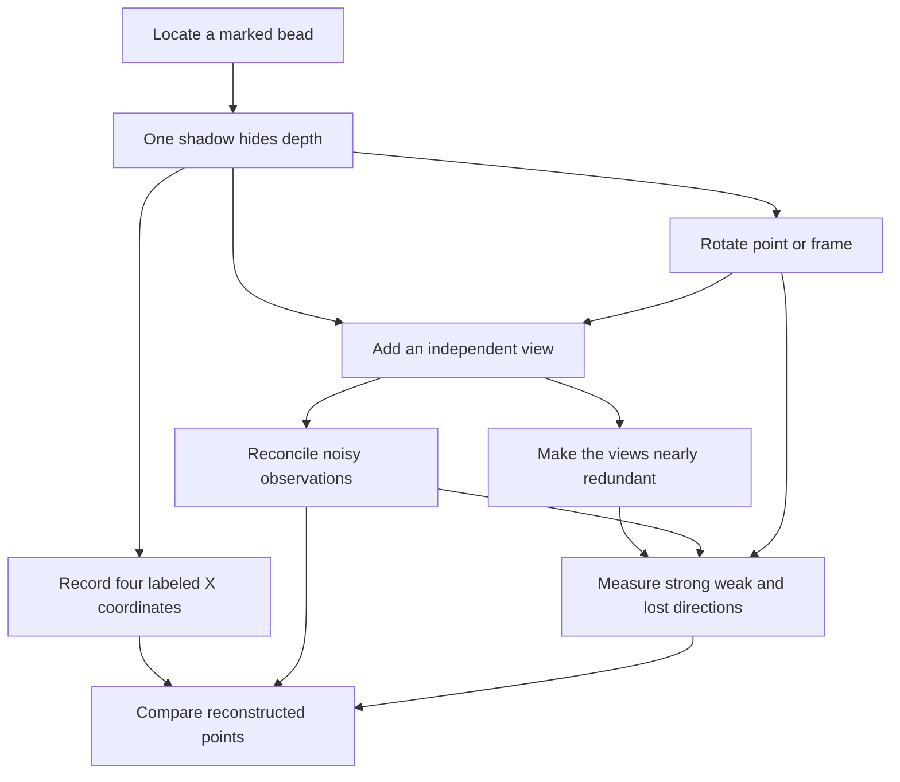

# The Object Behind the Shadows

[Build method](../../build-method.md) · [Preserved earlier systems](../../old/README.md)

Connected analogy canon · 2026-10-26
[Rubric](rubric.md) · [Head-to-head comparison](../../comparisons/light-vs-shadows.md)
[Exact lecture/topic map](../../course-map.md) · [Main bible](../../../SHOW_BIBLE.md)

Source pages and topic definitions are maintained only in the
[course map](../../course-map.md). This reference owns its mechanisms, examples,
and limits; its topic table is a navigation index, not a duplicate page register.

## 1. The strongest case for this lens

A bead moves closer to a screen, but its shadow stays still. One observation
cannot tell that it moved. Add a second screen at a different angle: the hidden
motion becomes visible. Add another screen in the original direction: there are
more readings, but no new independent spatial information.

This is the course made visible. A vector is the bead's position. A matrix is a
view. Null space is an invisible direction. Rank is the number of independent
spatial distinctions retained. A system combines views. Least squares reconciles
views that disagree. SVD tells which directions are seen strongly or weakly. PCA
finds the dominant directions in a collection of measured points.

**Thesis:** A measurement can be incomplete without being incorrect; recovering
the object depends on independent information, not simply the number of screens.
Unlike an invisible algebraic assumption, missing depth can be demonstrated by a
single physical movement. This lens is especially strong for independent exam reasoning.

Orthographic views retain selected coordinates without perspective division;
[Scratchapixel's orthographic derivation](https://www.scratchapixel.com/lessons/3d-basic-rendering/perspective-and-orthographic-projection-matrix/orthographic-projection-matrix.html)
provides the geometric foundation. Our teaching scene and exact coordinates are
original constructions, not a copied illustration or a measured camera calibration.

## 2. Permanent scene and boundaries

Use a small open frame holding distinguishable marked beads, with known
correspondence between each bead and its screen marks. Ideal parallel rays give
orthographic views. Screens have fixed calibrated axes; coordinates are measured
relative to a chosen reference so the maps below are linear.

| Object | Meaning | What it is not |
| --- | --- | --- |
| `x=(X,Y,Z)^T` | One marked point in object/world coordinates | A silhouette image or an entire solid object |
| `O` | One view's coordinate map | A square same-space projection matrix |
| `H` | Stacked coordinate maps from several views | Automatically independent observations |
| `b` | Corresponding screen coordinates | Unknown-correspondence pixels |
| `P` | Projection back into the original three-dimensional coordinate space | A universal formula for perspective rendering |
| `D` | Rows are declared point observations or aligned specimens | Unlabeled point sets with solved correspondence |

Real finite-distance light gives perspective; silhouettes involve occlusion and
can fail to reveal concavity. Do not promise reconstruction of arbitrary objects
from silhouettes. This canon follows matched points, not general shadow images.
Moving the origin introduces affine translations; state reference subtraction or
use homogeneous coordinates instead of silently calling translation linear.
Geometric reconstruction is not a proof of a particular physical material or shape
between observed beads.

## 3. Numerical anchors that carry the scene through the course

### ONE — A shadow hides a direction

Screen 1 records X and Y:

```text
O=[[1,0,0],[0,1,0]]
x=(2,3,4)^T      O x=(2,3)^T
```

Moving the bead to `(2,3,9)` leaves the same screen mark. `N(O)=span((0,0,1))`;
`rank(O)=2`, row space is the XY plane, column space is all `R^2`, and left null
space is zero. All solutions for mark `(2,3)` are `(2,3,t)`.
There is no depth recovery from this view without an additional assumption.

The embedded orthogonal projection is instead `P=O^T O=diag(1,1,0)`. Here
`P=P^T=P^2`; `O` is 2-by-3, while P is 3-by-3. The null direction, visible plane,
and eigenvalues of P can be drawn on the same picture. A shadow record and an
embedded projection are related but not the same matrix.

### TWO — A second independent view restores depth

Screen 2 records Y and Z. Stack the observations:

```text
H=[[1,0,0],
   [0,1,0],
   [0,1,0],
   [0,0,1]]

H(2,3,4)^T=(2,3,3,4)^T
```

The two Y readings must agree. H has rank 3, null space zero, row space `R^3`,
column space `{b:b2=b3}`, and left-null direction `(0,1,-1,0)`.
The missing input freedom is gone, but an output consistency condition remains.
Together ONE and TWO illustrate all four spaces without pretending all must be nonzero.

Choose rows X,Y,Z once each to obtain an invertible 3-by-3 observation map.
H itself is rectangular and has no determinant or two-sided inverse. A left
inverse can reconstruct a consistent record; it does not make every four-vector
an achievable record. More copies of screen 1 would keep the rank at 2.

### FIT — The two screens disagree slightly

Suppose the report is `b=(2,2,4,4)`: the Y readings are 2 and 4. Equal-weight least
squares gives

```text
x_hat=(2,3,4)^T       p=H x_hat=(2,3,3,4)^T
e=b-p=(0,-1,1,0)^T   H^T e=0
H^T H=diag(1,2,1)
```

The projector in four-dimensional **measurement space** is

```text
Q=H(H^T H)^(-1)H^T
 = [[1,0,0,0],
    [0,1/2,1/2,0],
    [0,1/2,1/2,0],
    [0,0,0,1]].
```

It satisfies `Q=Q^T=Q^2`, and is different from the object-space P in ONE.
Equal Y averaging assumes the declared equal squared-error weights. If measurement
uncertainties differ, state a weighted model; projection geometry changes accordingly.
The fitted point is an estimate, not proof that the physical bead was exactly there.

### ANGLE — A second view can be new but nearly redundant

Let screen 1 record X,Y; a second view records
`X cos θ+Z sin θ, Y`, using unit orthogonal axes. The stacked map has rows
`(1,0,0),(0,1,0),(cos θ,0,sin θ),(0,1,0)`.

At θ=0 both views are the same and depth is invisible. For `0<θ≤90°`, rank is 3.
Its singular values are `sqrt(2)`, `sqrt(1+cos θ)`, `sqrt(1−cos θ)`.
As θ approaches zero, the last tends to zero: algebraic uniqueness can coexist
with poor stability. At 90° the view reads Z,Y, a row-reordered version of TWO.

This is a direct reason independent measurements matter. Gram–Schmidt on the
viewing row directions `(1,0,0)` and `(cos θ,0,sin θ)` gives eX and eZ for positive
θ, but normalization of a tiny residual warns about sensitivity. No additional
linear-algebra course is assumed: demonstrate the geometry before discussing conditioning.

### TURN — Rotate axes and distinguish deformation from observation

Use `R90=[[0,-1,0],[1,0,0],[0,0,1]]`. It is orthogonal, determinant 1, inverse
transpose; active rotation of points differs from passive rotation of axes.
The Z axis is a +1 eigen-direction, while the XY rotation has no real eigenvectors.
The embedded projection P has eigenvalues 1,1,0 and is real symmetric.
Thus rotation, projection, and a generic matrix need not share eigenstructure.

For ideal coordinate deformation `D=diag(2,1,1/2)`, determinant is 1: oriented volume
is preserved while individual lengths change. D and R90 do not commute.
A two-dimensional picture of an observation does not make the underlying 3-by-3
transformation a two-dimensional matrix; state the restricted plane when using one.

### MODES — Ask how strongly the views see each direction

For H in TWO, one full SVD has strengths `sqrt(2),1,1`.
Right directions can be `v1=eY`, `v2=eX`, `v3=eZ`.
Output directions are `u1=(0,1,1,0)/sqrt(2)`, `u2=(1,0,0,0)`, `u3=(0,0,0,1)`;
`u4=(0,1,-1,0)/sqrt(2)` completes the left-null direction.
Verify `Hv1=sqrt(2)u1`, `Hv2=u2`, `Hv3=u3`.

Full shapes: U 4-by-4, Σ 4-by-3, V 3-by-3; compact rank-3 form uses only three U
columns. Rank-1 approximation retains the twice-observed Y direction and loses X,Z,
with squared Frobenius error 2. This ranking depends on measurement scaling and
repetition; it does not make Y intrinsically more important in the object.
Repeated singular values allow different orthonormal choices in their tied subspace.
Use symmetric Gram matrices for the spectral theorem, and give a separate formal
defective example rather than pretending every transformation diagonalizes.

### CLOUD — Compare a collection of reconstructed marked points

Use four invented planar point records `(3,2),(2,3),(1,0),(0,1)` as rows.
Mean `(1.5,1.5)`; sample covariance `[[5/3,1],[1,5/3]]`; standard deviations
`sqrt(5/3)`. Principal directions `(1,1)/sqrt(2)` and `(1,-1)/sqrt(2)` have
covariance eigenvalues `8/3,2/3`, centered singular values `sqrt(8),sqrt(2)`.
The first direction captures 80% of sample variance. Project onto it, reconstruct,
and restore the mean. PCA summarizes measured points; it cannot recover unseen
depth from ONE or prove an unmeasured surface between markers.

For the recommendation section, explicitly introduce viewer-by-sculpture ratings.
Those ratings are not XYZ coordinates. A withheld coordinate table is a different
matrix-completion exercise; neither makes missing entries equal to zero or lets
ordinary SVD alone claim validated missing-data predictions.

## 4. Concrete action cards and complete lecture route

| Card | Actual action/observation | Mathematical job and continuity |
| --- | --- | --- |
| MARK | Put a named bead in a fixed reference frame | Vectors, entries, distances, signed displacement; leads to ONE. |
| ONE | Move it along the first view's rays without changing its mark | Lost depth, null space, embedded versus recorded projection. |
| TWO | Add a differently oriented calibrated screen | Stack systems, independent information, rank, output consistency. |
| FIT | Reconcile two noisy marks of the same coordinate | Projection, full-rank normal equations, residual, measurement metric. |
| ANGLE | Bring the view directions nearly together | Redundancy, independence, Gram–Schmidt, weak singular mode. |
| TURN | Rotate object or frame and compare with a deformation | Basis change, orthogonal map, determinant, eigen-direction limits. |
| MODES | Measure which directions survive strongly or weakly | Spectral theorem for Gram matrices, full/compact/truncated SVD. |
| CLOUD | Compare many reconstructed point records | Statistics, centered covariance/PCA, reconstruction, rating-table boundary. |

[Shared course map](../../course-map.md) gives each topic's exact PDF pages.

| Lecture route | Topic IDs | Required treatment |
| --- | --- | --- |
| Week 1: locate and observe the bead | W1.01–W1.08 | Coordinate vectors/representations; displacements and combinations; dot product against unit screen axes; norms/angles; map entries/shapes/sums; diagonal/identity/symmetric/orthogonal examples and trace; transpose versus inverse; multiplication/composition and order. |
| Week 2: reconstruct position from views | W2.01–W2.04 | ONE's family and TWO's stacked equations; augmented systems, elimination, pivots/echelon/back substitution; determinant/cofactor properties on square chosen maps; inverse/Gauss–Jordan only when information and dimensions allow. |
| Week 3: locate missing and redundant information | W3.01–W3.09 | Real coordinate spaces and subspaces; both four-space ledgers; full solutions, rank/nullity, independent versus repeated views; span, basis, dimension; invertible frame change versus noninvertible observation. |
| Week 4: reconcile imperfect observations | W4.01–W4.06 | Both complement pairs; line/subspace projections; P versus Q; proof of invertible H transpose H; FIT's least squares and a line-trend example for tracked records; normalized axes, orthonormal projection, ANGLE's Gram–Schmidt. |
| Week 5: describe the observation system | W5.01–W5.07 | TURN's transformations/eigen-directions, characteristic equation/eigenspaces; diagonalization requirements and failures; symmetric spectral theorem; H/ANGLE full/compact/truncated SVD, approximation; a separately declared viewer-rating extension. |
| Exam-topic bridge | B.01–B.02 | CLOUD's mean, sample/population variance, standard deviation, covariance, centered SVD/PCA, mean restoration, scaling/sign/tie caveats. Treat as topic-list supplement until lecture source support is established. |

Exact supporting problem references and full manuscript development remain pending.

## 5. Opening passage and checked transfer questions

“Slide the bead straight toward the screen. Its shadow does not move. The bead
changed, but this view cannot tell you how. Now look from the side. The motion
appears. Your first view was not wrong: it was missing a direction. In matrix
language that direction lies in its null space. A second view is useful when it
sees something the first one cannot.”

- **W3 transfer:** Given O, characterize all solutions to `Ox=(2,3)`. Answer
  `(2,3,t)`; identify all four spaces. Do not report a unique Z coordinate.
- **W4 transfer:** Given H and `b=(2,2,4,4)`, compute xhat, p, e and prove `H^T e=0`.
  Answer `(2,3,4)`, `(2,3,3,4)`, `(0,-1,1,0)`. Explain which space contains e.
- **W5 transfer:** Find H's singular values, one left-null unit vector, and the
  full versus compact shapes. Use MODES; explain why repeated Y readings improve
  a strength in this scaling without increasing rank beyond 3.

These are checked anchors, not a complete fresh question bank or observed learning evidence.

## 6. Connected graph and cross-lens contract



Accessible route: location becomes observations; lost depth motivates independent
views; inconsistent observations motivate fitting; view geometry motivates singular
modes; collections motivate statistics. Link the light lens's invisible spectral
difference to ONE's invisible depth through `Av=0`; neither representation preserves
all the original distinctions. Use topic IDs to connect yarn, biology, and wheel
records while keeping physical objects and spaces distinct. Every passage needs
its source, action, mathematical landing, boundary, callback, and formal transfer question.

## 7. Status

Domain premise sourced; original coordinate, fitting, angle, eigen/SVD, and statistics
anchors calculation-checked. Not arbitrary silhouette reconstruction, a calibrated
camera experiment, a rendered interactive figure, completed later-week chapters, or learner
validation. Lecture 1 integration is documented below. Full formal countercases, exact supporting problem references, figures,
independent review, and observed transfer remain open.

## 8. Current primary-lens implementation and Week 1 profile records

The owner selected this system as the textbook backbone. [Vectors and geometry](../../../book/lecture1/index.md),
[matrices and products](../../../book/lecture1/matrix-guide.md),
[exercises](../../../book/lecture1/practice.md), and
[solutions](../../../book/lecture1/solutions.md) implement the first lecture.
There are four website pages, 12 numbered sections, 12 worked examples, and
12 checkpoints. Later-week routes above remain plans.

ONE and TWO use the same O and H as the chapter. The matrices have not been
replaced by the former shaping ledger. In particular H maps R3 into R4 and
repeats Y; a four-entry output is not a four-dimensional physical point.

### PROFILE — Four labeled beads on one front screen

For additional vector/data examples, fix bead labels A–D and their vertical
coordinates Y=1,2,3,4. Let r list their horizontal readings, all in the same units:

```text
r=(3,1,3,1), s=(1,3,1,3)
e=(1,1,1,1), a=(1,-1,1,-1)
r=2e+a, s=2e-a
W=[r; s; r; s]  # configurations by labeled beads
```

These are **four measurements across points**, distinct from ONE's one-point
world vector in R3 and front mark in R2. Signed and fractional coordinates are
valid. Adding r and s can describe successive horizontal displacements from a
zero-X reference; it does not add shadow images. Adding a fixed displacement is
not silently claimed to be a linear map of absolute positions under origin changes.

The profile geometry has e·a=0, both norms 2, r·s=12, both profile squared norms 20,
distance 4, and cosine 3/5. In orthonormal record coordinates e/2,a/2, r=(4,2) and
s=(4,-2). These describe **measurement-record angles**, not a physical rotation of
the frame or complete 3D distances containing unobserved Z.

W is numerically symmetric, with trace 12 and whole-table sum 32. Its index roles
are still configurations versus beads. Grouping bead columns loses individual X
distinctions; summing a profile using J=[1,1,1,1] hides s-r=(-2,2,-2,2). This is a
different loss from O's hidden Z direction. State the map before interpreting loss.
PROFILE links MARK to CLOUD: the same declared table can later support data-space
geometry without pretending PCA recovers unmeasured depth.

| Topic ID | Implemented mechanism and section |
| --- | --- |
| W1.01 | MARK/PROFILE: distinguish a point, a screen mark, and a multi-point profile (§1.1). |
| W1.02 | PROFILE: displacement arithmetic and uniform/alternating directions (§1.2–1.3). |
| W1.03 | ONE/PROFILE: screen-axis dot products, cosine formula and proof (§1.4, §1.6). |
| W1.04 | MARK/PROFILE: norms, unit directions, and record geometry (§1.5). |
| W1.05 | PROFILE: configuration/bead indexing and entrywise arithmetic (§1.7, §1.9). |
| W1.06 | PROFILE/TURN: special arrays and trace, with numerical versus physical symmetry separated (§1.8, §1.10). |
| W1.07 | PROFILE: transpose swaps configuration/bead index roles (§1.10). |
| W1.08 | ONE/TWO: O and H; formal source examples, products/composition/properties (§1.11–1.12). |

The four active diagrams are `shadow-views.svg`, `shadow-profiles.svg`,
`shadow-geometry.svg`, and `shadow-map.svg`, generated by
[the figure builder](../../../tools/build_lecture1_figures.py).
The [chapter review](../../../authoring/lecture1-review.md) records checks. No
physical demonstration, outside review, or student effectiveness result is claimed.

## Week 2 systems integration · 2026-10-27

The [systems page](../../../book/lecture2/index.md) and
[elimination page](../../../book/lecture2/elimination.md) now implement the exact
reconstruction route. Front (2,3) with side (3,4) yields (2,3,4). The repeated
Y row reduces to zero while every coordinate still has a pivot: unique does not
require every row to be independent. Front alone leaves (2,3,t). Conflicting
front (2,2) and side (4,4) produce 0=2, not an implicit average. General front
(a,b), side (c,d) is consistent exactly when b=c, giving unique (a,b,d).

Operations transform equations and their right sides, never the underlying point.
The chapter includes source-only systems as well as the shared scene; no silhouette
reconstruction or perspective claim is introduced. Determinants/inverses are not
yet implemented. See the [source audit](../../../authoring/lecture2-coverage.md).
